# Báo cáo tổng Submission 3 Smart E Mobility Hub

Nhóm BEE BRAVE  |  CO3001  |  HK261  |  Tổng hợp ngày 06/11/2026

# Mục 1: Giới thiệu và phạm vi báo cáo

Báo cáo trình bày thiết kế tổng thể của Smart E-Mobility Hub cho mạng lưới trạm phương tiện điện trong Khu đô thị ĐHQG-HCM. Nhóm BEE BRAVE tổ chức hệ thống thành bảy phân hệ dùng chung mô hình tài nguyên, hợp đồng tài chính và cơ chế mô phỏng. Tài liệu hợp nhất thiết kế kiến trúc, lớp và phương thức, đồng thời truy vết tới 17 use case đã xác lập ở Submission 2.

Kiến trúc triển khai hiện tại là một ứng dụng Python/Streamlit dạng module với dữ liệu seed và trạng thái trong bộ nhớ theo session. Các service OOP được thiết kế để làm rõ ranh giới trách nhiệm và điều kiện nhất quán; báo cáo ghi riêng mức ánh xạ tới prototype, phần đã hiện thực và phần còn là đề xuất. Sự phân biệt này được giữ xuyên suốt các chương.

## 1.1 Căn cứ và nội dung cần trình bày

Theo mục Submission 3 detail trong đề giảng viên (trang 5), báo cáo cần có Deployment view, Development/Implementation view, class diagram và mô tả tất cả phương thức trên class diagram; test case là nội dung bonus. Mô tả tổng quát ở trang 4 còn nêu class descriptions. Báo cáo này bổ sung truy vết và hợp đồng liên phân hệ để các quyết định thiết kế có thể được kiểm tra cùng SRS và mã nguồn.

**Bảng 1.1: Đối chiếu nội dung báo cáo với yêu cầu Submission 3**

| Nội dung | Vị trí trong báo cáo |
| --- | --- |
| Triển khai và cấu trúc module | Chương 3 |
| Mô hình dùng chung và giao tiếp | Chương 4 |
| Class diagram và mô tả lớp phương thức SS1 đến SS7 | Chương 5 đến 11 |
| Truy vết 17 use case | Chương 12 |
| Test case và bằng chứng hiện có | Chương 13 |
| Giới hạn và đóng góp của nhóm | Chương 14 và 15 |

## 1.2 Quy ước đọc bản thiết kế

Nhãn đã triển khai chỉ áp dụng cho lớp, hàm hoặc module thực sự có trong src/. Nhãn đề xuất áp dụng cho service, DTO và bảo đảm giao dịch chưa có code tương ứng. Ký hiệu shared là tham chiếu tới chủ sở hữu chuẩn, không tạo một bản định nghĩa khác. Kiểu datetime trong thiết kế theo đồng hồ mô phỏng quy ước UTC+7; prototype hiện lưu chuỗi naive, chưa tự mang thông tin múi giờ.

# Mục 2: Phạm vi hệ thống và phân công

Sinh viên sử dụng xe chung hoặc gửi xe cá nhân; nhân viên vận hành giám sát, điều phối và quản lý sạc; kỹ thuật viên xử lý sự cố; nhà phân tích đánh giá kịch bản nhu cầu và hạ tầng. Dữ liệu IoT, thanh toán, QR/barie và danh tính được mô phỏng trong phạm vi prototype. Đề bài cho phép hard-code dữ liệu và không bắt buộc database cho giai đoạn này (trang 4).

**Bảng 2.1: Phạm vi phân hệ và số use case phụ trách**

| SS | Thành viên | MSSV | UC | Phạm vi |
| --- | --- | --- | --- | --- |
| SS1 | Nguyễn Thành Đạt | 2410709 | 3 | Đặt và quản lý xe dùng chung |
| SS2 | Nguyễn Anh Tài | 2413035 | 4 | Xe cá nhân và quản lý chỗ đỗ |
| SS3 | Phạm Tiến Đạt | 2410724 | 2 | Giám sát mạng lưới Hub |
| SS4 | Đặng Hoàng Quý Nhân | 2412401 | 2 | Điều chuyển và sự cố phương tiện |
| SS5 | Dương Đăng Khoa | 2411589 | 2 | Lập lịch và quản lý phiên sạc |
| SS6 | Hoàng Văn Tấn | 2213074 | 2 | Mô phỏng nhu cầu và dự báo 24 giờ |
| SS7 | Nguyễn Trung Nguyên | 2011710 | 2 | Sự cố hạ tầng và gợi ý Hub thay thế |

## 2.1 Nguyên tắc phân chia trách nhiệm

SS1 sở hữu User, Vehicle và tài chính; SS3 sở hữu Hub; SS5 sở hữu yêu cầu, phiên và dịch vụ sạc; SS6 sở hữu ForecastResult, SimulationPreview và SimulationCoordinator. Các phân hệ còn lại giữ tham chiếu tới những mô hình này. Một khoản tiền chỉ được ghi qua hợp đồng tài chính thiết kế, còn quyền thay đổi xe, giữ chỗ và phiên sạc thuộc service phụ trách nghiệp vụ tương ứng.

# Mục 3: Thiết kế kiến trúc hệ thống

## 3.1 Deployment view

Trình duyệt giao tiếp với tiến trình Python/Streamlit trên máy chạy ứng dụng. app.py điều hướng tới các component; core thực hiện các phép xử lý. state.py đọc src/data/mock_hubs.json khi khởi tạo hoặc reset. st.session_state giữ Hub, ví, booking, queue/scheduler, preview và version ở phía server theo từng phiên.

Rerun chạy lại script theo tương tác và làm mới giao diện; không phải một worker IoT hoặc background polling. Reset tạo lại trạng thái từ seed; dữ liệu session không là lưu trữ bền. Các phiên trình duyệt khác nhau không mặc nhiên cùng đọc một cơ sở dữ liệu mạng lưới. Host/cổng tùy cấu hình; chạy từ repository bằng lệnh dưới đây.

```text
streamlit run src/app.py
```


## 3.2 Development và Implementation view

Mã nguồn chia thành entry point, components giao diện và core. booking/personal_ev/billing/scheduler/simulator/routing/state/policies là các module hiện có. SS3, SS4 và các thao tác Apply SS6/SS7 còn chứa xử lý nghiệp vụ trong render(). Các service trong class diagram là bước tổ chức thiết kế mục tiêu, không phải các package core.services/core.domain đang chạy.


**Bảng 3.1: Các thành phần kiến trúc và ánh xạ mã nguồn**

| Thành phần | Trách nhiệm | Ánh xạ |
| --- | --- | --- |
| Trình bày | Nhận thao tác và hiển thị kết quả | src/app.py và src/components |
| Nghiệp vụ và chính sách | Vòng đời tài nguyên và tính phí | src/core |
| Dữ liệu phiên | Seed reset và trạng thái tạm thời | state.py và st.session_state |
| Thiết kế mục tiêu | Service DTO và adapter dùng chung | Class diagram và hợp đồng trong báo cáo |

## 3.3 Class diagram cấp hệ thống

Sơ đồ tổng quan thể hiện ranh giới sở hữu và liên kết giữa các phân hệ. Thuộc tính và phương thức được trình bày ở các sơ đồ chi tiết và catalog trong mục 5 đến 11. Các nhãn trên sơ đồ không hàm ý toàn bộ lớp đã được hiện thực; prototype vẫn có các hàm và dictionary đóng vai trò adapter.

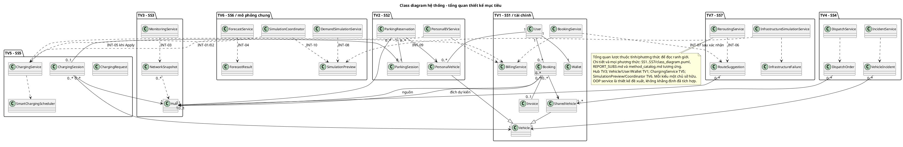

## 3.4 Ràng buộc chất lượng

Thiết kế đặt kiểm tra quyền, trạng thái và version ở ranh giới service, không chỉ ở UI. Thay đổi Hub, booking, wallet và charging phải được kiểm tra trước rồi commit đồng bộ; lỗi không được để lại phần dữ liệu đã cập nhật. Với nhiều người dùng cần storage/version/transaction chia sẻ và xác thực thật. Unit test của prototype per-session chưa chứng minh các NFR về tải, độ trễ, availability hay bảo mật production.

**Bảng 3.2: Đối chiếu yêu cầu phi chức năng**

| Mã SRS và chỉ tiêu | Đáp ứng thiết kế và cách xác minh |
| --- | --- |
| NFR-01 UI ≤ 2 giây; NFR-02 ít nhất 500 yêu cầu đồng thời | Đo thời gian end-to-end và kiểm thử tải trên hạ tầng xác định. Metro Surge mô phỏng nhu cầu không thay thế phép đo 500 request thực. Chưa có benchmark. |
| NFR-03 cập nhật ≤ 5 giây; NFR-04 uptime ≥ 99,5% trong 06:00-22:00; NFR-05 điều hướng ≤ 30 giây | Snapshot SS3 và INT-05/06 xác định trách nhiệm. Cần đo refresh, availability và thời gian phát hiện/gợi ý; Streamlit rerun hiện tại chưa chứng minh polling nền hoặc các chỉ tiêu này. |
| NFR-06 nhất quán dữ liệu | Version, operation_key, charge_id và commit nguyên tử bảo vệ invariant. Cần kiểm thử đồng thời trên storage chia sẻ; session riêng không là state lock toàn hệ thống. |
| NFR-07 desktop ≥ 1024px, mobile ≥ 375px; NFR-08 đặt xe ≤ 3 bước; NFR-09 tiếng Việt | Giữ luồng chọn Hub, chọn xe, xác nhận. Cần kiểm tra giao diện ở hai kích thước và thử với người dùng; unit test không thay kiểm thử khả dụng. |
| NFR-10 VNU-SSO; NFR-11 ví và audit; NFR-12 Student/Operator/Admin | Auth mock chỉ phục vụ demo. Thiết kế cần kiểm tra quyền tại service và ledger có truy vết. Vai trò kỹ thuật viên/nhà phân tích cần ánh xạ quyền rõ khi mở rộng RBAC. |
| NFR-13 module hóa; NFR-14 docstring mục đích, tham số, kết quả | components tách theo SS, core tái sử dụng; service mục tiêu giảm nghiệp vụ trong render. Rà docstring và dependency khi bàn giao; việc có module không bảo đảm mọi thay đổi đều độc lập. |

# Mục 4: Mô hình dùng chung và hợp đồng liên phân hệ

## 4.1 Chính sách và đơn vị

**Bảng 4.1: Chính sách nghiệp vụ và đơn vị**

| Quy tắc | Giá trị và điều kiện |
| --- | --- |
| Giữ xe chung | 30 phút từ lúc tạo booking; now bằng expires_at là hết hạn khi chưa nhận |
| Giữ chỗ xe cá nhân | 30 phút từ booking_start_time đã chọn |
| Cọc và no show | 50.000 VNĐ; phạt 10.000 và hoàn 40.000 VNĐ một lần |
| Thuê xe chung | Miễn 30 phút đầu; sau đó 1.000 VNĐ/phút; voucher hợp lệ giảm 5.000 |
| Điều hướng | Thêm 15 phút miễn phí tối đa một lần; không đổi TTL giữ xe |
| Ân hạn và overstay | Ân hạn 15 phút; 10.000 VNĐ cho mỗi khối 15 phút bắt đầu sau ân hạn |
| Công suất mặc định | 150 kW/Hub và 11 kW/cổng; từng cấu hình/test có thể dùng giá trị khác |
| Phí và tariff | Prototype đỗ 5.000 VNĐ/lượt; điện cao điểm 7.000 và thấp điểm 3.000 VNĐ/kWh |
| Ngưỡng occupancy | NORMAL dưới 70; WARNING từ 70 đến dưới 85; CRITICAL từ 85 đến dưới 100; FULL từ 100 phần trăm |

Tiền lưu số nguyên VNĐ; công suất kW khác năng lượng kWh; SoC dùng phần trăm, khoảng cách km. Capacity được bảo toàn theo available_slots + present_vehicles + destination_holds + background_occupied = total_slots. Present không tính xe IN_USE đã rời Hub. Giữ chỗ đến và xe hiện diện không được cộng hai lần cho cùng một chỗ.

## 4.2 Kiểu trao đổi và xử lý lặp

OperationResult trả ok, data hoặc error_code, message và state_version. ChargeLine có charge_id, source_id, kind, amount_vnd ổn định; SettlementResult tách paid, refunded và debt. Lặp operation_key với cùng payload trả kết quả cũ; khác payload trả CONFLICTING_OPERATION. Cùng charge_id nhưng khác tiền trả CONFLICTING_CHARGE, không ghi đè lịch sử.

SimulationPreview thống nhất cho DEMAND và PORT_FAILURE gồm preview_id, scenario_type, baseline_version, modified_hubs, charging_effects, summary và is_applied; target_hub_id/event_log hỗ trợ adapter UI. metrics của prototype được ánh xạ sang summary. Preview chứa candidate cách ly, không dùng snapshot ví/booking cũ để chép đè trạng thái hiện tại.

**Bảng 4.2: Danh mục hợp đồng liên phân hệ**

| ID | Chủ sở hữu và bên gọi | Giao tiếp và trách nhiệm |
| --- | --- | --- |
| INT-01 | SS5 ChargingService; gọi từ SS2 | request_charging - Tạo yêu cầu sau check-in hợp lệ; request đang chờ chưa có cổng |
| INT-02 | SS5 ChargingService; gọi từ SS2 SS3 | get_bill - Đọc hóa đơn sạc và khoản đã thu; không trừ ví |
| INT-03 | SS3 MonitoringService; gọi từ Dashboard | get_network_snapshot - Đọc cùng timestamp/version; tách cọc và nợ |
| INT-04 | SS6 ForecastService; gọi từ SS6 SS3 SS4 | forecast - Yêu cầu 24 giờ tường minh; seed tái lập |
| INT-05 | SS5 ChargingService; gọi từ Coordinator | handle_port_failure - Stage tác động cổng/phiên trong Apply; không đổi slot đỗ |
| INT-06 | SS7 ReroutingService; gọi từ SS1 SS7 | suggest_hubs - Lọc tài nguyên/tình trạng và xếp Haversine; không đổi booking |
| INT-07 | SS1 BookingService; gọi từ UI sau xác nhận | accept_rerouting - Kiểm tra lại quyền/version/capacity; chuyển hold và ưu đãi một lần |
| INT-08 | SS6 DemandSimulationService; gọi từ SS6 | preview_demand - Tạo preview DEMAND cách ly |
| INT-09 | SS7 InfrastructureSimulationService; gọi từ SS7 | preview_port_failure - Tạo preview PORT_FAILURE theo cùng schema |
| INT-10 | SS6 SimulationCoordinator; gọi từ SS6 SS7 | apply_preview - Commit đồng bộ sau validation; chống stale và Apply lặp |

## 4.3 Luồng tài chính và sạc

SS2 xác nhận check-in rồi gửi nhu cầu sạc qua INT-01. SS5 quản lý queue và cấp cổng theo công suất. Khi check-out, SS2 lấy ChargingBill qua INT-02, cộng dòng phí đỗ và gửi BillingService.settle_invoice. Chỉ các charge_id chưa thu được xử lý; phần thiếu được ghi nợ minh bạch. SS2 không tính lại phí SS5 bằng một công thức khác khi giao tiếp mục tiêu đã được dùng.

## 4.4 Luồng preview và Apply

SS6 hoặc SS7 lấy snapshot/version, tạo candidate bằng deepcopy và lưu preview. Khi Apply, coordinator kiểm tra baseline_version, expected_version và version hiện tại cùng invariant. Nếu là PORT_FAILURE, tác động SS5 qua INT-05 được stage cùng thay đổi Hub. Chỉ commit khi mọi kiểm tra thành công, tăng version một lần và ghi is_applied; lỗi giữ nguyên state. Gọi lại preview đã áp dụng trả already_applied trước khi kiểm tra stale, không gây tác động lần hai.

## 4.5 Luồng điều hướng

SS7 trả RouteSuggestion theo nhu cầu slot/cổng và khoảng cách. UI trình đề xuất cho người dùng; chỉ sau xác nhận mới gọi INT-07. BookingService kiểm tra lại version, quyền, trạng thái và capacity của Hub mới, chuyển giữ chỗ cũ/mới trong cùng thao tác và áp dụng ưu đãi tối đa một lần. Gợi ý cũ không là bảo đảm tài nguyên còn trống.

# Mục 5: Thiết kế SS1 đặt và quản lý xe dùng chung

SS1 quản lý hành trình của xe dùng chung từ tra cứu, đặt giữ chỗ và nhận xe đến trả xe, hủy hoặc hết hạn. BookingService điều phối thay đổi xe và chỗ đỗ; BillingService tiếp nhận các khoản cọc và phí. Thiết kế tách quyền định danh, trạng thái phương tiện và biến động ví để các phân hệ khác có thể dùng cùng một hợp đồng tài chính.

**Bảng 5.1: Danh mục use case của SS1**

| Use case | Phạm vi |
| --- | --- |
| UC_SS1_01 | Tra cứu, Đặt xe & Nhận xe qua QR/PIN |
| UC_SS1_02 | Trả xe, Cập nhật vị trí & Quyết toán ví điện tử |
| UC_SS1_03 | Hủy đặt chỗ & Hoàn cọc / Phạt quá giờ |

Phần trình bày hiện tại nằm ở src/components/student_booking.py; ánh xạ nghiệp vụ tại src/core/booking.py và billing.py. Chủ sở hữu theo phân công là Nguyễn Thành Đạt, MSSV 2410709.

## 5.1 Class diagram và quan hệ

User có nhiều Booking; mỗi Booking tham chiếu một SharedVehicle và Hub nguồn. Hub đích dự kiến có bội số 0..1; khi trả phải xác định Hub trả thực tế. SharedVehicle kế thừa Vehicle với ownership SHARED. User sở hữu Wallet, Wallet có lịch sử Transaction, Invoice chứa các ChargeLine. Các quan hệ lịch sử không cho phép hai lượt đang hoạt động cùng giữ một xe.

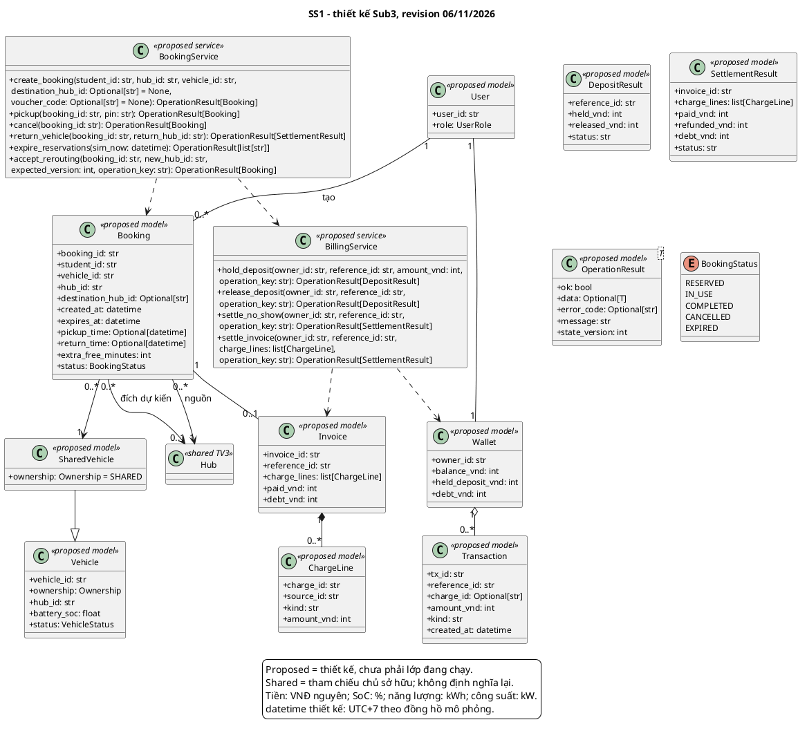

## 5.2 Mô tả lớp và thuộc tính

### User

Lưu định danh và vai trò; danh tính hiện được chọn trong mô phỏng. Thiết kế ràng buộc mỗi thao tác tới người dùng có quyền.

Mức triển khai: Thiết kế đề xuất.

Thuộc tính: `user_id: str`; `role: UserRole`.

### Vehicle

Mô hình chung cho định danh, ownership, Hub, SoC và trạng thái; SoC tính theo phần trăm từ 0 đến 100.

Mức triển khai: Thiết kế đề xuất.

Thuộc tính: `vehicle_id: str`; `ownership: Ownership`; `hub_id: str`; `battery_soc: float`; `status: VehicleStatus`.

### SharedVehicle

Chuyên biệt của Vehicle cho xe dùng chung. Ownership luôn SHARED; xe đang bị giữ, đang dùng hoặc sự cố không được cấp lại.

Mức triển khai: Thiết kế đề xuất.

Thuộc tính: `ownership: Ownership = SHARED`.

### Booking

Lưu vòng đời giữ và sử dụng xe, các mốc thời gian và Hub liên quan. EXPIRED chỉ áp dụng khi chưa nhận xe.

Mức triển khai: Thiết kế đề xuất.

Thuộc tính: `booking_id: str`; `student_id: str`; `vehicle_id: str`; `hub_id: str`; `destination_hub_id: Optional[str]`; `created_at: datetime`; `expires_at: datetime`; `pickup_time: Optional[datetime]`; `return_time: Optional[datetime]`; `extra_free_minutes: int`; `status: BookingStatus`.

### Wallet

Phân biệt số dư khả dụng, cọc đang giữ và nợ; các đại lượng không âm, tiền lưu VNĐ nguyên.

Mức triển khai: Thiết kế đề xuất.

Thuộc tính: `owner_id: str`; `balance_vnd: int`; `held_deposit_vnd: int`; `debt_vnd: int`.

### Transaction

Bản ghi dòng tiền có định danh và tham chiếu nghiệp vụ. Thiết kế xem lịch sử đã ghi là bất biến.

Mức triển khai: Thiết kế đề xuất.

Thuộc tính: `tx_id: str`; `reference_id: str`; `charge_id: Optional[str]`; `amount_vnd: int`; `kind: str`; `created_at: datetime`.

### Invoice

Tập hợp dòng phí, khoản đã thu và phần nợ theo reference; không bổ sung số đo quãng đường khi chưa có dữ liệu.

Mức triển khai: Thiết kế đề xuất.

Thuộc tính: `invoice_id: str`; `reference_id: str`; `charge_lines: list[ChargeLine]`; `paid_vnd: int`; `debt_vnd: int`.

### ChargeLine

Khoản phí có charge_id ổn định. Cùng khoản đã thu không được đổi ID để thu lại hoặc thay số tiền của lịch sử.

Mức triển khai: Thiết kế đề xuất.

Thuộc tính: `charge_id: str`; `source_id: str`; `kind: str`; `amount_vnd: int`.

### DepositResult

Kết quả xử lý cọc theo đúng reference, ghi phần đang giữ, phần đã hoàn và trạng thái.

Mức triển khai: Thiết kế đề xuất.

Thuộc tính: `reference_id: str`; `held_vnd: int`; `released_vnd: int`; `status: str`.

### SettlementResult

Kết quả quyết toán với paid, refunded, debt và danh sách phí; khoản nợ được thể hiện rõ thay vì bỏ phần thiếu.

Mức triển khai: Thiết kế đề xuất.

Thuộc tính: `invoice_id: str`; `charge_lines: list[ChargeLine]`; `paid_vnd: int`; `refunded_vnd: int`; `debt_vnd: int`; `status: str`.

### OperationResult tổng quát

Kiểu kết quả dùng chung: thành công/dữ liệu hoặc mã lỗi/thông điệp, kèm state_version. Lỗi không cho phép commit một phần.

Mức triển khai: Thiết kế đề xuất.

Thuộc tính: `ok: bool`; `data: Optional[T]`; `error_code: Optional[str]`; `message: str`; `state_version: int`.

### BookingService

Điều phối vòng đời booking xe chung, quyền sử dụng xe, giữ chỗ đích và xác nhận điều hướng; gọi BillingService khi có biến động tiền.

Mức triển khai: Thiết kế đề xuất.

### BillingService

Đầu mối tài chính dùng chung: giữ và hoàn cọc theo reference, phạt no show, quyết toán dòng phí và ghi phần nợ. Thiết kế bảo vệ lịch sử bằng operation_key và charge_id.

Mức triển khai: Thiết kế đề xuất.

## 5.3 Mô tả phương thức

**BookingService.create_booking**

```text
create_booking(student_id: str, hub_id: str, vehicle_id: str, destination_hub_id: Optional[str] = None, voucher_code: Optional[str] = None) -> OperationResult[Booking]
```

Sinh viên chưa có lượt RESERVED/IN_USE; xe SHARED, AVAILABLE và SoC >=20%; Hub đích nếu chọn phải còn chỗ. Quét hết hạn trước, giữ cọc 50.000 VNĐ qua BillingService, giữ xe và chỗ đích, tạo expires_at=created_at+30 phút. Không đổi trạng thái khi kiểm tra thất bại; NOT_FOUND/INVALID_STATE/NO_CAPACITY/INSUFFICIENT_FUNDS/DEBT_BLOCKED. Prototype chưa kiểm tra ownership tại core; UI có lọc. Thiết kế bắt buộc kiểm tra ở service.

Ánh xạ hiện tại: `src/core/booking.py:create_shared_booking`. Chữ ký prototype có thể khác service; service OOP vẫn thuộc thiết kế mục tiêu.

**BookingService.pickup**

```text
pickup(booking_id: str, pin: str) -> OperationResult[Booking]
```

Yêu cầu đúng chủ booking (thiết kế), PIN và trạng thái RESERVED. Khi now >= expires_at phải xử lý no-show trước khi xét nhận xe. Nhận trong hạn chuyển IN_USE, ghi pickup_time, giải phóng chỗ nguồn; giữ chỗ đích còn hiệu lực. PIN sai trả FORBIDDEN, hết hạn EXPIRED, gọi lại INVALID_STATE; không trừ thêm cọc. Prototype dùng PIN 4 chữ số, QR/khóa vật lý là mô phỏng.

Ánh xạ hiện tại: `src/core/booking.py:pickup_shared_vehicle`. Chữ ký prototype có thể khác service; service OOP vẫn thuộc thiết kế mục tiêu.

**BookingService.cancel**

```text
cancel(booking_id: str) -> OperationResult[Booking]
```

Chỉ chủ booking RESERVED trong hạn được hủy. Hoàn đúng cọc reference 50.000 VNĐ một lần, giải phóng xe/giữ chỗ đích, chuyển CANCELLED. Nếu tới hạn, xử lý EXPIRED và no-show thay vì hoàn toàn phần cọc. Gọi lại không hoàn thêm. NOT_FOUND/INVALID_STATE/EXPIRED.

Ánh xạ hiện tại: `src/core/booking.py:cancel_shared_booking`. Chữ ký prototype có thể khác service; service OOP vẫn thuộc thiết kế mục tiêu.

**BookingService.return_vehicle**

```text
return_vehicle(booking_id: str, return_hub_id: str) -> OperationResult[SettlementResult]
```

Booking IN_USE, xe có trong active trip, Hub trả tồn tại và có chỗ hoặc giữ chỗ của lượt đó. Chốt thời lượng từ pickup_time, miễn phí 30 phút + ưu đãi reroute nếu có; 1.000 VNĐ/phút sau miễn phí, voucher hợp lệ giảm 5.000 VNĐ và tổng không âm. Chuyển giữ chỗ cũ sang hiện diện Hub trả, COMPLETED, quyết toán/ghi nợ nếu thiếu. Gọi lại không thu thêm; NOT_FOUND/INVALID_STATE/NO_CAPACITY. Chưa có dữ liệu đo quãng đường trong prototype.

Ánh xạ hiện tại: `src/core/booking.py:return_shared_vehicle`. Chữ ký prototype có thể khác service; service OOP vẫn thuộc thiết kế mục tiêu.

**BookingService.expire_reservations**

```text
expire_reservations(sim_now: datetime) -> OperationResult[list[str]]
```

Duyệt booking RESERVED và sim_now >= expires_at. Chuyển EXPIRED, trả xe AVAILABLE và giải phóng hold đích, settle_no_show phạt 10.000 và hoàn 40.000 VNĐ. Trả danh sách booking vừa hết hạn; sweep lặp trả danh sách rỗng, không tác động IN_USE. Đồng hồ service phải là đồng hồ mô phỏng.

Ánh xạ hiện tại: `src/core/booking.py:process_expired_bookings`. Chữ ký prototype có thể khác service; service OOP vẫn thuộc thiết kế mục tiêu.

**BookingService.accept_rerouting**

```text
accept_rerouting(booking_id: str, new_hub_id: str, expected_version: int, operation_key: str) -> OperationResult[Booking]
```

INT-07, chỉ sau xác nhận của người dùng. Kiểm tra chủ booking, RESERVED/IN_USE, version và capacity Hub mới. Chuyển hold cũ/mới trong một commit, ưu đãi thêm 15 phút miễn phí tối đa một lần; không kéo TTL giữ xe. Cùng key/cùng dữ liệu trả kết quả cũ, key khác dữ liệu CONFLICTING_OPERATION; STALE_STATE/NO_CAPACITY không commit. Prototype chưa có expected_version/operation_key và vẫn có thể cộng ưu đãi khi đổi sang Hub khác nhiều lần; đây là hợp đồng đề xuất.

Ánh xạ hiện tại: `src/core/booking.py:apply_rerouting_to_booking`. Chữ ký prototype có thể khác service; service OOP vẫn thuộc thiết kế mục tiêu.

**BillingService.hold_deposit**

```text
hold_deposit(owner_id: str, reference_id: str, amount_vnd: int, operation_key: str) -> OperationResult[DepositResult]
```

Đúng owner/reference, amount_vnd >=0, ví không nợ và đủ số dư. Chuyển từ khả dụng sang held theo reference; ghi ledger với cùng operation_key. Lặp cùng nội dung không khóa thêm; CONFLICTING_OPERATION nếu key khác payload, INSUFFICIENT_FUNDS/DEBT_BLOCKED nếu không đủ điều kiện. Prototype giữ tổng cọc, chưa có sổ cọc theo reference.

Ánh xạ hiện tại: `src/core/billing.py:hold_deposit`. Chữ ký prototype có thể khác service; service OOP vẫn thuộc thiết kế mục tiêu.

**BillingService.release_deposit**

```text
release_deposit(owner_id: str, reference_id: str, operation_key: str) -> OperationResult[DepositResult]
```

Chỉ hoàn phần cọc chưa quyết toán của đúng reference, không lấy cọc booking khác. Tăng khả dụng, giảm held, ghi ledger; lặp trả kết quả cũ. NOT_FOUND/FORBIDDEN/CONFLICTING_OPERATION giữ nguyên dữ liệu. Prototype hàm thấp cấp chỉ bảo vệ tổng held, caller chịu kiểm tra vòng đời.

Ánh xạ hiện tại: `src/core/billing.py:release_held_deposit_full`. Chữ ký prototype có thể khác service; service OOP vẫn thuộc thiết kế mục tiêu.

**BillingService.settle_no_show**

```text
settle_no_show(owner_id: str, reference_id: str, operation_key: str) -> OperationResult[SettlementResult]
```

Caller đã xác nhận EXPIRED. Với cọc 50.000 VNĐ, phạt 10.000 và hoàn 40.000; đóng cọc reference, ghi dòng tiền đúng một lần. Key/payload mâu thuẫn trả CONFLICTING_OPERATION; không áp dụng cho lượt IN_USE hoặc cọc đã quyết toán.

Ánh xạ hiện tại: `src/core/billing.py:settle_noshow_penalty`, `src/core/billing.py:settle_pev_noshow_penalty`. Chữ ký prototype có thể khác service; service OOP vẫn thuộc thiết kế mục tiêu.

**BillingService.settle_invoice**

```text
settle_invoice(owner_id: str, reference_id: str, charge_lines: list[ChargeLine], operation_key: str) -> OperationResult[SettlementResult]
```

Chỉ thu charge_id chưa thu, cùng ID khác tiền trả CONFLICTING_CHARGE. Đối trừ/hoàn cọc đúng reference rồi trừ số dư tối đa phần có thể thu và ghi nợ phần thiếu; paid/refunded/debt lấy từ ledger. Gọi lặp cùng key trả kết quả cũ, không thu lại phí SS5 ở SS2. Prototype có nhiều hàm thu trực tiếp, chưa có BillingService hay dedup charge_id. Thiết kế phải stage tất cả thay đổi trước commit.

Ánh xạ hiện tại: `src/core/billing.py:settle_shared_rental`, `src/core/personal_ev.py:check_out_personal_ev`, `src/core/billing.py:settle_overstay_charging`. Chữ ký prototype có thể khác service; service OOP vẫn thuộc thiết kế mục tiêu.

## 5.4 Ánh xạ và giới hạn triển khai

Core đã có các hàm đặt, nhận, trả, hủy và xử lý hết hạn; dữ liệu booking/ví chủ yếu là dictionary. Service OOP, sổ cọc theo reference và dedup charge_id dùng chung chưa được hiện thực. Core đặt xe còn cần kiểm tra ownership bên cạnh bộ lọc UI; ưu đãi điều hướng cần marker một lần; nguồn số đo quãng đường cho US-06 chưa có.

# Mục 6: Thiết kế SS2 xe cá nhân và quản lý chỗ đỗ

SS2 quản lý hồ sơ xe cá nhân, đặt trước chỗ đỗ, check-in và check-out. PersonalVehicle kế thừa Vehicle và liên kết chủ xe qua owner_id. ParkingReservation thể hiện quyền giữ một chỗ đến hạn; ParkingSession ghi nhận sự hiện diện thực tế và tham chiếu yêu cầu hoặc phiên sạc do SS5 quản lý.

**Bảng 6.1: Danh mục use case của SS2**

| Use case | Phạm vi |
| --- | --- |
| UC_SS2_01 | Đăng ký xe EV cá nhân lên hệ thống |
| UC_SS2_02 | Đặt trước chỗ đỗ và nhu cầu sạc xe EV cá nhân |
| UC_SS2_03 | Check-in xe EV cá nhân tại cổng Hub (QR/Biển số) |
| UC_SS2_04 | Check-out và thanh toán tổng hợp dịch vụ xe EV cá nhân |

Phần trình bày hiện tại nằm ở src/components/personal_ev.py; ánh xạ nghiệp vụ tại src/core/personal_ev.py và billing.py. Chủ sở hữu theo phân công là Nguyễn Anh Tài, MSSV 2413035.

## 6.1 Class diagram và quan hệ

Một User có nhiều PersonalVehicle; mỗi ParkingReservation gắn một xe, một chủ xe và một Hub. Một reservation kích hoạt tối đa một ParkingSession. Khi check-in, chỗ giữ trước chuyển thành hiện diện vật lý mà không giảm available_slots lần hai. Request sạc đang chờ có thể chưa có session_id hoặc cổng thực sự.

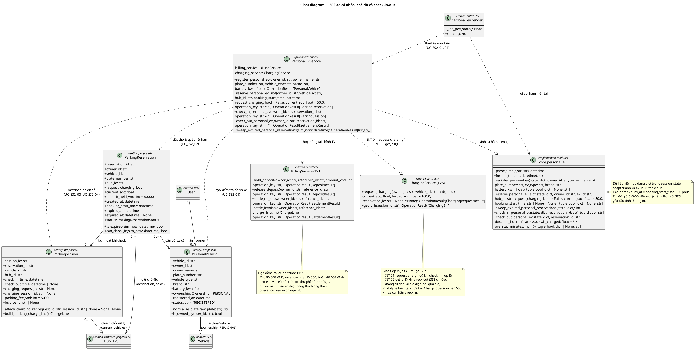

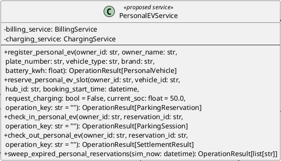

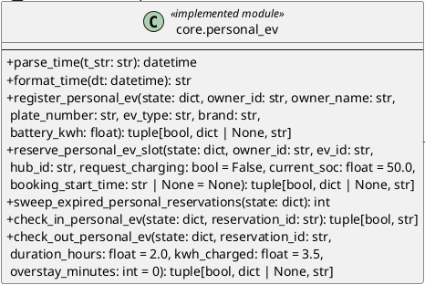

## 6.2 Mô tả lớp và thuộc tính

### PersonalVehicle

Hồ sơ xe cá nhân với ownership PERSONAL, định danh chủ xe, biển số chuẩn hóa và dung lượng pin kWh.

Mức triển khai: Thiết kế đề xuất.

Thuộc tính: `vehicle_id: str`; `owner_id: str`; `owner_name: str`; `plate_number: str`; `vehicle_type: str`; `brand: str`; `battery_kwh: float`; `ownership: Ownership = PERSONAL`; `registered_at: datetime`; `status: str = "REGISTERED"`.

### ParkingReservation

Quyền giữ chỗ từ giờ đến đã chọn tới hạn check-in. Deadline bằng booking_start_time cộng 30 phút.

Mức triển khai: Thiết kế đề xuất.

Thuộc tính: `reservation_id: str`; `owner_id: str`; `vehicle_id: str`; `plate_number: str`; `hub_id: str`; `request_charging: bool`; `current_soc: float`; `deposit_held_vnd: int = 50000`; `created_at: datetime`; `booking_start_time: datetime`; `expires_at: datetime`; `expired_at: datetime | None`; `status: ParkingReservationStatus`.

### ParkingSession

Lượt đỗ thực tế, ghi check-in/out và tham chiếu sạc. Request đang chờ không được đồng nhất với phiên/cổng đã cấp.

Mức triển khai: Thiết kế đề xuất.

Thuộc tính: `session_id: str`; `reservation_id: str`; `vehicle_id: str`; `hub_id: str`; `check_in_time: datetime`; `check_out_time: datetime | None`; `charging_request_id: str | None`; `charging_session_id: str | None`; `parking_fee_vnd: int = 5000`; `invoice_id: str | None`.

### PersonalEVService

Điều phối hồ sơ xe cá nhân và vòng đời đặt chỗ, check-in/out; phối hợp ChargingService và BillingService để giữ một nguồn phí và tài nguyên thống nhất.

Mức triển khai: Thiết kế đề xuất.

Thuộc tính: `billing_service: BillingService`; `charging_service: ChargingService`.

### SS2UI

Ký hiệu module UI personal_ev với khởi tạo trạng thái và render; không thay thế lớp miền hoặc authorization thật.

Mức triển khai: Đã có trong prototype.

### PersonalEVModule

Ký hiệu module core.personal_ev đã có; adapter trả tuple/dictionary, khác API OOP mục tiêu.

Mức triển khai: Đã có trong prototype.

## 6.3 Mô tả phương thức

**PersonalVehicle.normalize_plate**

```text
normalize_plate(raw_plate: str) -> str
```

Thuần đọc: nhận raw_plate không rỗng, bỏ dấu cách/dấu gạch ngang và viết hoa để kiểm tra trùng. Trả chuỗi chuẩn hóa; không đăng ký thêm xe hoặc đổi số chỗ. Lớp đề xuất ánh xạ đoạn chuẩn hóa trong register_personal_ev, không có method class thực tế.

**PersonalVehicle.is_owned_by**

```text
is_owned_by(user_id: str) -> bool
```

So sánh user_id với owner_id của xe; trả bool, không đổi dữ liệu. Caller phải kiểm tra quyền trước đặt chỗ/check-in/out, không coi bool này là xác thực tài khoản thật.

**ParkingReservation.is_expired**

```text
is_expired(sim_now: datetime) -> bool
```

Trả status=RESERVED và sim_now>=expires_at; chỉ đọc và không tự phạt. Hạn là booking_start_time+30 phút, tại đúng hạn là hết hạn.

**ParkingReservation.can_check_in**

```text
can_check_in(sim_now: datetime) -> bool
```

Trả True khi RESERVED và booking_start_time<=sim_now<expires_at. Đến sớm/trạng thái khác/đúng hạn đều False; không tự thay đổi ví/chỗ đỗ.

**ParkingSession.attach_charging_ref**

```text
attach_charging_ref(request_id: str, session_id: str | None = None) -> None
```

Chỉ sau check-in hợp lệ. Ghi request_id, session_id tùy chọn; không gán request đang chờ thành đang sạc. Cùng tham chiếu lặp không tạo request khác; tham chiếu xung đột phải INVALID_STATE/CONFLICTING_OPERATION.

**ParkingSession.build_parking_charge_line**

```text
build_parking_charge_line() -> ChargeLine
```

Trả ChargeLine có charge_id ổn định theo parking session, kind PARKING và amount_vnd=5.000 VNĐ/lượt của prototype; không trừ ví. SRS theo giờ là chênh lệch chưa giải quyết, không suy ra đã có hourly policy.

**PersonalEVService.register_personal_ev**

```text
register_personal_ev(owner_id: str, owner_name: str, plate_number: str, vehicle_type: str, brand: str, battery_kwh: float) -> OperationResult[PersonalVehicle]
```

Kiểm tra owner/biển số/loại xe/dung lượng pin hợp lệ; chuẩn hóa biển số, từ chối trùng, thêm hồ sơ ownership PERSONAL, tăng version. Không đổi Hub/slot. Service thiết kế trả OperationResult, core trả tuple(ok,record,msg), ev_id ánh xạ vehicle_id. Giới hạn tích hợp UI/prototype được trình bày tại mục 6.4.

**PersonalEVService.reserve_personal_ev_slot**

```text
reserve_personal_ev_slot(owner_id: str, vehicle_id: str, hub_id: str, booking_start_time: datetime, request_charging: bool = False, current_soc: float = 50.0, operation_key: str = "") -> OperationResult[ParkingReservation]
```

Xác nhận xe thuộc owner và chưa có lượt hoạt động, Hub còn chỗ, booking_start_time không trước sim_now, SoC hợp lệ. Khóa cọc 50.000, giảm available_slots và tăng destination_holds đúng một lần; deadline=start+30 phút. Thiếu tiền/nợ/Hub đầy/đầu vào sai giữ nguyên. Service thiết kế thêm operation_key để chống lặp; core chưa có key. Trả reservation trong OperationResult hoặc tuple prototype.

**PersonalEVService.check_in_personal_ev**

```text
check_in_personal_ev(owner_id: str, reservation_id: str, operation_key: str = "") -> OperationResult[ParkingSession]
```

Quét hết hạn, yêu cầu RESERVED và start<=now<deadline. Chuyển destination_holds sang hiện diện PERSONAL mà không giảm available lần hai, ghi CHECKED_IN/check_in_time. Service gọi INT-01 nếu request_charging, không tự cấp trùng. Core hiện giảm số cổng nếu có và có thể gán xe CHARGING khi chưa được cấp; đây là giới hạn hiện tại của prototype. Không thực sự mở barie/scan QR vật lý. Lặp từ chối INVALID_STATE, quá hạn EXPIRED.

**PersonalEVService.check_out_personal_ev**

```text
check_out_personal_ev(owner_id: str, reservation_id: str, operation_key: str = "") -> OperationResult[SettlementResult]
```

Chỉ CHECKED_IN. Theo thiết kế lấy phí sạc INT-02 + phí đỗ, quyết toán BillingService bằng charge_id, trả slot/cổng thực sự đã cấp, COMPLETED và invoice. Thiếu số dư ghi nợ, không mất phần thiếu; gọi lại không thu thêm do vòng đời. Core nhận duration_hours/kwh/overstay từ mô phỏng và tự tính phí tại giờ checkout; chưa đo telemetry/thời gian biểu giá tích phân. Owner/key trong service chưa có ở core.

**PersonalEVService.sweep_expired_personal_reservations**

```text
sweep_expired_personal_reservations(sim_now: datetime) -> OperationResult[list[str]]
```

Duyệt RESERVED khi sim_now>=arrival_deadline, chuyển EXPIRED, giảm hold/tăng available, phạt 10.000 hoàn 40.000 một lần. Không chạm CHECKED_IN; lặp không phạt lại. Service trả danh sách ID trong OperationResult, hàm core nhận state và trả số lượng int.

**SS2UI._init_pev_state**

```text
_init_pev_state() -> None
```

Hàm UI hiện có; tạo các danh sách xe/đơn cá nhân chưa có trong session bằng mặc định. Không ghi đè danh sách đã tồn tại hoặc reset ví. Không tham số/trả None; gọi lặp chỉ khởi tạo thiếu.

**SS2UI.render**

```text
render() -> None
```

Hàm UI hiện có: hiển thị form đăng ký/đặt/check-in/out, gọi core theo thao tác Streamlit và rerun. Đọc/ghi session qua core, hiển thị tuple lỗi; không thay thế kiểm tra quyền phía service hoặc QR/barie thật. Không có giá trị trả về, render lặp không tự thu tiền nếu không có thao tác.

**PersonalEVModule.parse_time**

```text
parse_time(t_str: str) -> datetime
```

Adapter thuần đọc: nhận chuỗi thời gian YYYY-MM-DD HH:MM:SS; parse thành datetime naive. Theo quy ước tài liệu UTC+7 của đồng hồ mô phỏng, không tự chuyển timezone. Chuỗi lỗi: code fallback datetime.now, là giới hạn cần validation tại service trước khi tính hạn/phí.

**PersonalEVModule.format_time**

```text
format_time(dt: datetime) -> str
```

Adapter thuần đọc: datetime vào -> chuỗi YYYY-MM-DD HH:MM:SS, không ghi session. Đầu vào datetime hợp lệ; không kèm timezone offset trong chuỗi hiện tại.

**PersonalEVModule.register_personal_ev**

```text
register_personal_ev(state: dict, owner_id: str, owner_name: str, plate_number: str, ev_type: str, brand: str, battery_kwh: float) -> tuple[bool, dict | None, str]
```

Kiểm tra owner/biển số/loại xe/dung lượng pin hợp lệ; chuẩn hóa biển số, từ chối trùng, thêm hồ sơ ownership PERSONAL, tăng version. Không đổi Hub/slot. Service thiết kế trả OperationResult, core trả tuple(ok,record,msg), ev_id ánh xạ vehicle_id. Giới hạn tích hợp UI/prototype được trình bày tại mục 6.4.

**PersonalEVModule.reserve_personal_ev_slot**

```text
reserve_personal_ev_slot(state: dict, owner_id: str, ev_id: str, hub_id: str, request_charging: bool = False, current_soc: float = 50.0, booking_start_time: str | None = None) -> tuple[bool, dict | None, str]
```

Xác nhận xe thuộc owner và chưa có lượt hoạt động, Hub còn chỗ, booking_start_time không trước sim_now, SoC hợp lệ. Khóa cọc 50.000, giảm available_slots và tăng destination_holds đúng một lần; deadline=start+30 phút. Thiếu tiền/nợ/Hub đầy/đầu vào sai giữ nguyên. Service thiết kế thêm operation_key để chống lặp; core chưa có key. Trả reservation trong OperationResult hoặc tuple prototype.

**PersonalEVModule.sweep_expired_personal_reservations**

```text
sweep_expired_personal_reservations(state: dict) -> int
```

Duyệt RESERVED khi sim_now>=arrival_deadline, chuyển EXPIRED, giảm hold/tăng available, phạt 10.000 hoàn 40.000 một lần. Không chạm CHECKED_IN; lặp không phạt lại. Service trả danh sách ID trong OperationResult, hàm core nhận state và trả số lượng int.

**PersonalEVModule.check_in_personal_ev**

```text
check_in_personal_ev(state: dict, reservation_id: str) -> tuple[bool, str]
```

Quét hết hạn, yêu cầu RESERVED và start<=now<deadline. Chuyển destination_holds sang hiện diện PERSONAL mà không giảm available lần hai, ghi CHECKED_IN/check_in_time. Service gọi INT-01 nếu request_charging, không tự cấp trùng. Core hiện giảm số cổng nếu có và có thể gán xe CHARGING khi chưa được cấp; đây là giới hạn hiện tại của prototype. Không thực sự mở barie/scan QR vật lý. Lặp từ chối INVALID_STATE, quá hạn EXPIRED.

**PersonalEVModule.check_out_personal_ev**

```text
check_out_personal_ev(state: dict, reservation_id: str, duration_hours: float = 2.0, kwh_charged: float = 3.5, overstay_minutes: int = 0) -> tuple[bool, dict | None, str]
```

Chỉ CHECKED_IN. Theo thiết kế lấy phí sạc INT-02 + phí đỗ, quyết toán BillingService bằng charge_id, trả slot/cổng thực sự đã cấp, COMPLETED và invoice. Thiếu số dư ghi nợ, không mất phần thiếu; gọi lại không thu thêm do vòng đời. Core nhận duration_hours/kwh/overstay từ mô phỏng và tự tính phí tại giờ checkout; chưa đo telemetry/thời gian biểu giá tích phân. Owner/key trong service chưa có ở core.

Các phương thức shared được tham chiếu trên sơ đồ nhưng chỉ đặc tả một lần trong báo cáo tổng: `BillingService.hold_deposit` tại mục 5; `BillingService.release_deposit` tại mục 5; `BillingService.settle_no_show` tại mục 5; `BillingService.settle_invoice` tại mục 5; `ChargingService.request_charging` tại mục 9; `ChargingService.get_bill` tại mục 9. Việc tham chiếu không tạo service hoặc chữ ký mới.

## 6.4 Ánh xạ và giới hạn triển khai

Core đã có đăng ký, reserve, check-in/out và sweep. Adapter đổi ev_id thành vehicle_id trong thiết kế. Hợp đồng ChargingService và BillingService chưa được tích hợp đầy đủ; check-in có thể gán CHARGING trước khi được cấp cổng. Phí đỗ hiện là 5.000 VNĐ/lượt, khác yêu cầu theo giờ; điện năng và quá giờ là đầu vào mô phỏng, tariff chọn tại checkout. Barie và QR là tương tác mô phỏng.

# Mục 7: Thiết kế SS3 giám sát mạng lưới hub

SS3 cung cấp một bản đọc trạng thái mạng lưới tại cùng thời điểm và phiên bản. Hub là mô hình dùng chung; OccupancySnapshot mô tả một trạm, NetworkSnapshot tổng hợp KPI toàn mạng và Alert thể hiện cảnh báo theo ngưỡng hoặc cổng offline mô phỏng. MonitoringService chỉ đọc, không sở hữu thay đổi booking hoặc ví.

**Bảng 7.1: Danh mục use case của SS3**

| Use case | Phạm vi |
| --- | --- |
| UC_SS3_01 | Giám sát mạng lưới Hub, KPI & Doanh thu thời gian thực |
| UC_SS3_02 | Cảnh báo phân cấp chiếm dụng Hub & Sự cố IoT |

Phần trình bày hiện tại nằm ở src/components/hub_monitor.py; ánh xạ nghiệp vụ tại src/core/state.py và policies.py. Chủ sở hữu theo phân công là Phạm Tiến Đạt, MSSV 2410724.

## 7.1 Class diagram và quan hệ

Một NetworkSnapshot chứa nhiều OccupancySnapshot; mỗi snapshot và Alert tham chiếu một Hub. Chỗ đỗ, chỗ giữ trước và hiện diện vật lý được đếm riêng. Công suất sạc phải lấy từ các phiên đang CHARGING; cổng offline không được coi là đang tiêu thụ điện. Held deposit và debt được tách khỏi doanh thu đã thu.

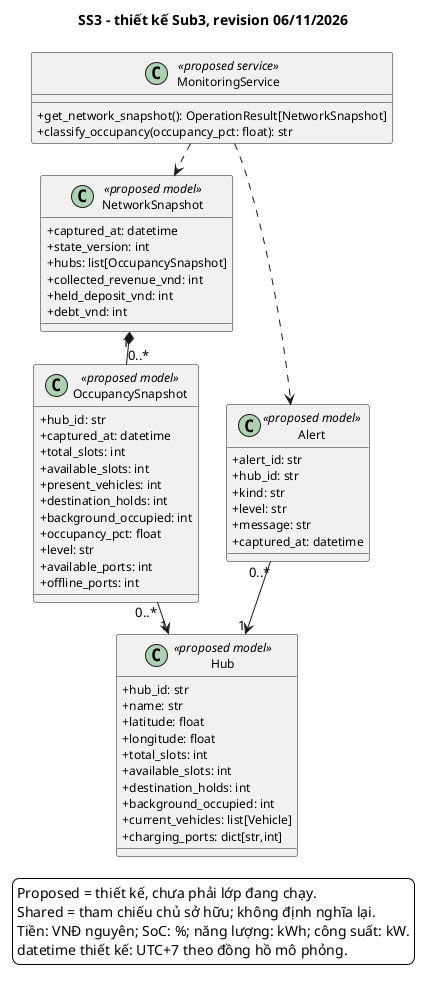

## 7.2 Mô tả lớp và thuộc tính

### Hub

Định nghĩa chuẩn do SS3 sở hữu cho chỗ đỗ, xe, giữ chỗ, tải nền và số đếm cổng. Không tạo bảy mô hình Hub khác nhau.

Mức triển khai: Thiết kế đề xuất.

Thuộc tính: `hub_id: str`; `name: str`; `latitude: float`; `longitude: float`; `total_slots: int`; `available_slots: int`; `destination_holds: int`; `background_occupied: int`; `current_vehicles: list[Vehicle]`; `charging_ports: dict[str,int]`.

### OccupancySnapshot

Bản đọc một Hub tại captured_at; lượng hiện diện, giữ chỗ và background được tách để kiểm tra bảo toàn sức chứa.

Mức triển khai: Thiết kế đề xuất.

Thuộc tính: `hub_id: str`; `captured_at: datetime`; `total_slots: int`; `available_slots: int`; `present_vehicles: int`; `destination_holds: int`; `background_occupied: int`; `occupancy_pct: float`; `level: str`; `available_ports: int`; `offline_ports: int`.

### NetworkSnapshot

Bản đọc toàn mạng theo version, kèm doanh thu đã thu, cọc và nợ; không sửa các bản ghi nghiệp vụ.

Mức triển khai: Thiết kế đề xuất.

Thuộc tính: `captured_at: datetime`; `state_version: int`; `hubs: list[OccupancySnapshot]`; `collected_revenue_vnd: int`; `held_deposit_vnd: int`; `debt_vnd: int`.

### Alert

Cảnh báo occupancy hoặc offline mô phỏng với thời điểm và Hub; không khẳng định đã có cảm biến/push nền thật.

Mức triển khai: Thiết kế đề xuất.

Thuộc tính: `alert_id: str`; `hub_id: str`; `kind: str`; `level: str`; `message: str`; `captured_at: datetime`.

### MonitoringService

Tạo snapshot và phân loại occupancy từ dữ liệu cùng phiên bản; chỉ đọc, không tự sửa tài nguyên hoặc ghi doanh thu.

Mức triển khai: Thiết kế đề xuất.

## 7.3 Mô tả phương thức

**MonitoringService.get_network_snapshot**

```text
get_network_snapshot() -> OperationResult[NetworkSnapshot]
```

INT-03. Đọc một phiên bản session, timestamp theo đồng hồ mô phỏng; tính occupancy=(total_slots-available_slots)/total_slots*100 nếu total>0. Kiểm tra available+present+holds+background=total. Tổng doanh thu thiết kế là tổng khoản thu thực có đối soát, tách tiền cọc, hoàn và nợ. Đếm cổng offline riêng, không suy ra công suất từ total-available. Trả INVALID_INPUT nếu capacity <=0 hoặc dữ liệu bất nhất, không chia 0 và không sửa booking/ví. Rerun lấy snapshot mới, không có polling IoT nền. Prototype dashboard mới cộng một số loại giao dịch SS1, chưa phải doanh thu toàn hệ thống.

Ánh xạ hiện tại: `src/components/hub_monitor.py:render`. Chữ ký prototype có thể khác service; service OOP vẫn thuộc thiết kế mục tiêu.

**MonitoringService.classify_occupancy**

```text
classify_occupancy(occupancy_pct: float) -> str
```

Đầu vào phần trăm hữu hạn >=0. NORMAL khi <70; WARNING khi 70<=x<85; CRITICAL khi 85<=x<100; FULL khi >=100. Thuần đọc, cùng đầu vào cùng kết quả; adapter phải từ chối NaN/âm thay vì mặc định NORMAL. Không đồng nhất mức occupancy với tỷ lệ cổng hay kW. Khóa đặt chỗ thuộc service đặt chỗ, không thuộc phương thức phân loại.

Ánh xạ hiện tại: `src/core/policies.py:get_occupancy_level`. Chữ ký prototype có thể khác service; service OOP vẫn thuộc thiết kế mục tiêu.

## 7.4 Ánh xạ và giới hạn triển khai

Dashboard hiện xử lý trong render() khi Streamlit rerun; chưa có lớp MonitoringService hay push IoT nền. Tổng thu hiện chỉ cộng một số giao dịch SS1; chưa đại diện đầy đủ cho SS2/SS5. Ước tính power theo total-minus-available nhân 7,4 kW có thể đếm offline và khác scheduler mặc định 11 kW/cổng.

# Mục 8: Thiết kế SS4 điều chuyển và sự cố phương tiện

SS4 tách điều chuyển phương tiện và xử lý sự cố thành DispatchService và IncidentService. DispatchOrder theo dõi tập xe đi từ Hub nguồn đến Hub đích; VehicleIncident lưu người báo, người tiếp nhận, mức độ và thời điểm xử lý. Hai nghiệp vụ cùng bảo vệ vòng đời tài nguyên nhưng có bản ghi và trạng thái riêng.

**Bảng 8.1: Danh mục use case của SS4**

| Use case | Phạm vi |
| --- | --- |
| UC_SS4_01 | Lập lệnh điều chuyển phương tiện cân bằng phụ tải |
| UC_SS4_02 | Báo cáo, tiếp nhận xử lý và khắc phục sự cố phương tiện |

Phần trình bày hiện tại nằm ở src/components/dispatch_incident.py; ánh xạ nghiệp vụ tại src/core/state.py. Chủ sở hữu theo phân công là Đặng Hoàng Quý Nhân, MSSV 2412401.

## 8.1 Class diagram và quan hệ

Mỗi lệnh điều chuyển gắn một Hub nguồn, một Hub đích và ít nhất một SharedVehicle. Chỉ xe SHARED đủ điều kiện được điều chuyển. VehicleIncident tham chiếu đúng một Vehicle và không thay thế InfrastructureFailure của SS7. Khi phục hồi, trạng thái xe phải xét các binding booking/charging còn hiệu lực.

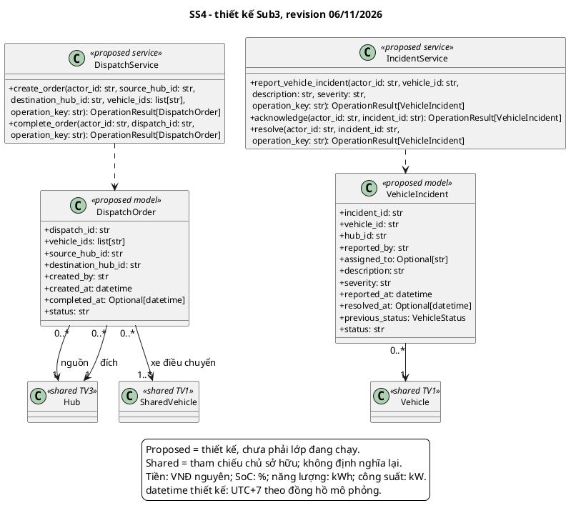

## 8.2 Mô tả lớp và thuộc tính

### DispatchOrder

Lệnh chuyển tập xe giữa hai Hub khác nhau. Thiết kế CREATED/IN_TRANSIT/COMPLETED; prototype tạo thẳng IN_TRANSIT.

Mức triển khai: Thiết kế đề xuất.

Thuộc tính: `dispatch_id: str`; `vehicle_ids: list[str]`; `source_hub_id: str`; `destination_hub_id: str`; `created_by: str`; `created_at: datetime`; `completed_at: Optional[datetime]`; `status: str`.

### VehicleIncident

Sự cố xe REPORTED/ACKNOWLEDGED/RESOLVED, có previous_status để hỗ trợ phục hồi hợp lệ.

Mức triển khai: Thiết kế đề xuất.

Thuộc tính: `incident_id: str`; `vehicle_id: str`; `hub_id: str`; `reported_by: str`; `assigned_to: Optional[str]`; `description: str`; `severity: str`; `reported_at: datetime`; `resolved_at: Optional[datetime]`; `previous_status: VehicleStatus`; `status: str`.

### DispatchService

Kiểm tra điều kiện xe và capacity, giữ chỗ đích rồi hoàn tất điều chuyển trong ranh giới cập nhật nhất quán.

Mức triển khai: Thiết kế đề xuất.

### IncidentService

Quản lý report, acknowledge và resolve sự cố xe; phối hợp các chủ sở hữu booking/charging trước khi cách ly hoặc phục hồi phương tiện.

Mức triển khai: Thiết kế đề xuất.

## 8.3 Mô tả phương thức

**DispatchService.create_order**

```text
create_order(actor_id: str, source_hub_id: str, destination_hub_id: str, vehicle_ids: list[str], operation_key: str) -> OperationResult[DispatchOrder]
```

Operator có quyền, Hub nguồn khác đích, danh sách xe duy nhất không rỗng; mọi xe SHARED/AVAILABLE và không bị booking/charging giữ. Kiểm tra đủ chỗ đích, tạo hold đích, đưa xe DISPATCHED ra khỏi nguồn và tăng chỗ nguồn trong một commit. Ghi người tạo/thời gian/ID lệnh. Key lặp cùng nội dung trả lệnh cũ; FORBIDDEN/INVALID_STATE/NO_CAPACITY/CONFLICTING_OPERATION không commit. Prototype logic nằm trong UI, chưa có service/key.

Ánh xạ hiện tại: `src/components/dispatch_incident.py:render`. Chữ ký prototype có thể khác service; service OOP vẫn thuộc thiết kế mục tiêu.

**DispatchService.complete_order**

```text
complete_order(actor_id: str, dispatch_id: str, operation_key: str) -> OperationResult[DispatchOrder]
```

Chỉ hoàn tất lệnh IN_TRANSIT, kiểm tra Hub đích và phần giữ chỗ của lệnh còn hợp lệ tại thời điểm nhận. Chuyển hold thành hiện diện xe, trạng thái xe AVAILABLE, lệnh COMPLETED, ghi completed_at và tăng version. Không giảm available_slots lần hai khi chuyển hold. Hoàn tất lặp trả kết quả đã ghi; không nhân đôi xe; NO_CAPACITY/INVALID_STATE không cập nhật một phần.

Ánh xạ hiện tại: `src/components/dispatch_incident.py:render`. Chữ ký prototype có thể khác service; service OOP vẫn thuộc thiết kế mục tiêu.

**IncidentService.report_vehicle_incident**

```text
report_vehicle_incident(actor_id: str, vehicle_id: str, description: str, severity: str, operation_key: str) -> OperationResult[VehicleIncident]
```

Người báo có quyền; xe tồn tại, mô tả không rỗng và chưa có incident mở cho cùng sự kiện. Lưu previous_status, REPORTED và sim timestamp; cách ly xe INCIDENT. Nếu xe đang gắn booking/charging thì phải điều phối chủ service trước khi đổi trạng thái, không tự xóa ràng buộc. Lặp key không tạo sự cố trùng. Sự cố cổng/điện là SS7/SS5, không dùng VehicleIncident thay thế.

Ánh xạ hiện tại: `src/components/dispatch_incident.py:render`. Chữ ký prototype có thể khác service; service OOP vẫn thuộc thiết kế mục tiêu.

**IncidentService.acknowledge**

```text
acknowledge(actor_id: str, incident_id: str) -> OperationResult[VehicleIncident]
```

Technician tiếp nhận incident REPORTED, ghi assigned_to và chuyển ACKNOWLEDGED. Không thay ví/chỗ đỗ/cổng. Đã ACKNOWLEDGED trả dữ liệu cũ; đã RESOLVED trả INVALID_STATE, không mở lại. NOT_FOUND/FORBIDDEN không cập nhật.

Ánh xạ hiện tại: `src/components/dispatch_incident.py:render`. Chữ ký prototype có thể khác service; service OOP vẫn thuộc thiết kế mục tiêu.

**IncidentService.resolve**

```text
resolve(actor_id: str, incident_id: str, operation_key: str) -> OperationResult[VehicleIncident]
```

Technician chỉ resolve incident ACKNOWLEDGED sau sửa chữa; kiểm tra binding booking/charging trước phục hồi. Ghi resolved_at theo mô phỏng, RESOLVED và trả xe về trạng thái hợp lệ; chỉ AVAILABLE nếu không còn binding. Không tăng chỗ/cổng vì sửa xe. Lặp key không phục hồi hai lần. Prototype hiện phục hồi xe về AVAILABLE trực tiếp, chưa bảo vệ đầy đủ previous_status/binding.

Ánh xạ hiện tại: `src/components/dispatch_incident.py:render`. Chữ ký prototype có thể khác service; service OOP vẫn thuộc thiết kế mục tiêu.

## 8.4 Ánh xạ và giới hạn triển khai

Các thao tác hiện nằm trong UI render(), chưa có hai service độc lập hoặc operation_key. Prototype có giữ chỗ đích cho lệnh; bước nhận còn cần kiểm tra lại hold/capacity. Resolve hiện đưa xe AVAILABLE trực tiếp, chưa bảo vệ đầy đủ previous_status và các binding. Nhật ký nằm trong session, chưa là log lưu bền.

# Mục 9: Thiết kế SS5 lập lịch và quản lý phiên sạc

SS5 tiếp nhận nhu cầu sạc, xếp queue, cấp tài nguyên theo mức ưu tiên và giới hạn công suất, mô phỏng tiến trình sạc, tính phí điện và phí chiếm dụng cổng. ChargingRequest, ChargingSession và SmartChargingScheduler đã có trong core; ChargingService chuẩn hóa giao tiếp với SS2, SS3 và SS7 trong thiết kế mục tiêu.

**Bảng 9.1: Danh mục use case của SS5**

| Use case | Phạm vi |
| --- | --- |
| UC_SS5_01 | Lập lịch sạc tự động theo điểm ưu tiên & Giới hạn công suất lưới |
| UC_SS5_02 | Giám sát hàng chờ sạc, hoàn thành, ân hạn & Tính phí quá giờ |

Phần trình bày hiện tại nằm ở src/components/smart_charging.py; ánh xạ nghiệp vụ tại src/core/scheduler.py và billing.py. Chủ sở hữu theo phân công là Dương Đăng Khoa, MSSV 2411589.

## 9.1 Class diagram và quan hệ

Scheduler quản lý nhiều yêu cầu và phiên. Một phiên đang hoạt động liên kết một xe, một Hub và một cổng; lịch sử có thể có nhiều phiên nhưng không cấp trùng tài nguyên đang dùng. ChargingBill chứa các ChargeLine và số đã thu; BillingService thuộc SS1 chịu trách nhiệm ghi nhận tiền, SS5 không tự tạo một sổ ví khác.

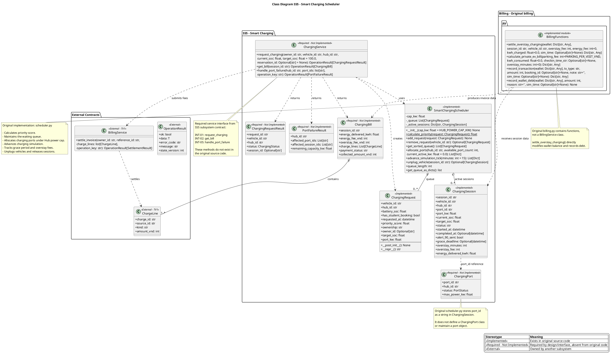

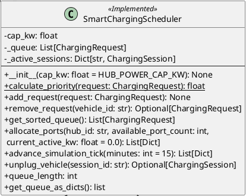

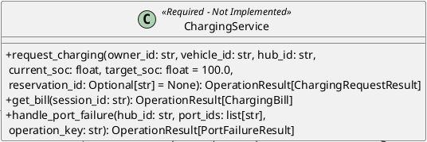

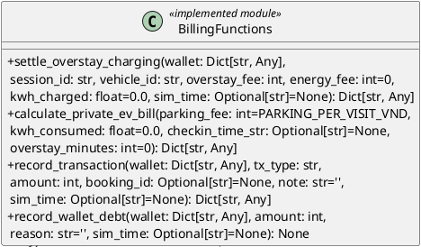

## 9.2 Mô tả lớp và thuộc tính

### ChargingRequest

Yêu cầu đang chờ, có SoC, thời điểm, booking và công suất. Lớp dataclass đã có trong scheduler.py.

Mức triển khai: Đã có trong prototype.

Thuộc tính: `vehicle_id: str`; `hub_id: str`; `battery_soc: float`; `has_student_booking: bool`; `requested_at: datetime`; `priority_score: float`; `ownership: str`; `owner_id: Optional[str]`; `target_soc: float`; `port_kw: float`.

### ChargingSession

Phiên sạc hiện có: định danh xe/cổng, SoC, kW, kWh, thời điểm, thông báo và dữ liệu grace/overstay.

Mức triển khai: Đã có trong prototype.

Thuộc tính: `session_id: str`; `vehicle_id: str`; `hub_id: str`; `port_id: str`; `port_kw: float`; `current_soc: float`; `target_soc: float`; `status: str`; `started_at: datetime`; `completed_at: Optional[datetime]`; `alert_90_sent: bool`; `grace_deadline: Optional[datetime]`; `overstay_minutes: int`; `overstay_fee: int`; `energy_delivered_kwh: float`.

### SmartChargingScheduler

Quản lý queue và các phiên sạc đang hoạt động; tính ưu tiên, cấp công suất/cổng, tick trạng thái và giải phóng phiên khi rút xe.

Mức triển khai: Đã có trong prototype.

Thuộc tính: `cap_kw: float`; `_queue: List[ChargingRequest]`; `_active_sessions: Dict[str, ChargingSession]`; `queue_length: int`.

queue_length là property đọc số phần tử queue, không làm thay đổi scheduler. Đọc property không tạo request, phiên hoặc khoản thu.

### ChargingService

Hợp đồng chuẩn hóa yêu cầu sạc, hóa đơn chỉ đọc và xử lý cổng lỗi; kết nối SS2/SS3/SS7 với scheduler mà không tạo sổ ví riêng.

Mức triển khai: Thiết kế đề xuất.

### ChargingRequestResult

DTO trả về yêu cầu mới; session_id có thể rỗng khi vẫn chờ. Đây là thiết kế đề xuất.

Mức triển khai: Thiết kế đề xuất.

Thuộc tính: `request_id: str`; `vehicle_id: str`; `hub_id: str`; `status: ChargingStatus`; `session_id: Optional[str]`.

### ChargingPort

Cổng có định danh, Hub, trạng thái và công suất tối đa; là lớp đề xuất, khác số đếm cổng trong seed.

Mức triển khai: Thiết kế đề xuất.

Thuộc tính: `port_id: str`; `hub_id: str`; `status: PortStatus`; `max_power_kw: float`.

### ChargingBill

Bản đọc lượng điện, phí điện/quá giờ, dòng phí và khoản đã thu; bản thân DTO không trừ tiền ví.

Mức triển khai: Thiết kế đề xuất.

Thuộc tính: `session_id: str`; `energy_delivered_kwh: float`; `energy_fee_vnd: int`; `overstay_fee_vnd: int`; `charge_lines: List[ChargeLine]`; `payment_status: str`; `collected_amount_vnd: int`.

### PortFailureResult

Kết quả xử lý cổng lỗi, liệt kê cổng/phiên bị ảnh hưởng và công suất sau xử lý; không làm đổi số chỗ đỗ.

Mức triển khai: Thiết kế đề xuất.

Thuộc tính: `hub_id: str`; `affected_port_ids: List[str]`; `affected_session_ids: List[str]`; `remaining_capacity_kw: float`.

### BillingFunctions

Ký hiệu nhóm hàm trong core/billing.py, không phải một class instance được triển khai. Caller quản lý vòng đời và thời điểm ghi tiền.

Mức triển khai: Đã có trong prototype.

## 9.3 Mô tả phương thức

**ChargingRequest.__post_init__**

```text
__post_init__() -> None
```

ChargingRequest đã có. Sau khởi tạo dataclass, nếu priority_score==0 thì tính từ calculate_priority; score khác 0 được giữ. Cần battery_soc hữu hạn 0-100 từ caller; core chưa validation đầy đủ. Không thêm queue hoặc thu phí.

**ChargingRequest.__repr__**

```text
__repr__() -> str
```

ChargingRequest đã có. Tạo chuỗi vehicle/SoC/priority để debug, không cập nhật request/queue. Gọi lặp cho cùng dữ liệu trả cùng chuỗi.

**SmartChargingScheduler.__init__**

```text
__init__(cap_kw: float = HUB_POWER_CAP_KW) -> None
```

Scheduler đã có. Nhận cap_kw mặc định 150 kW, tạo queue và active_sessions rỗng. Thiết kế ràng buộc cap_kw>0/hữu hạn; khởi tạo không đặt cổng/thu phí.

**SmartChargingScheduler.calculate_priority**

```text
calculate_priority(request: ChargingRequest) -> float
```

Static đã có. Score=0.5*(100-SoC)+100*I(SoC<20)+60*I(has_booking)+30*I(SoC<50). Trả float; ví dụ SoC 5 không booking 177.5, SoC 30 không booking 65, có booking 125. Thuần đọc; chưa có thành phần giá điện hoặc thời gian chờ tăng điểm theo SRS, requested_at chỉ dùng phá hòa.

**SmartChargingScheduler.add_request**

```text
add_request(request: ChargingRequest) -> None
```

Đã có: bỏ request cũ cùng vehicle_id khỏi queue, tính lại score rồi append request mới. Không tự allocate hoặc kiểm tra trùng xe trong active_sessions; yêu cầu active-dedup do service thiết kế kiểm tra. Không đổi wallet/cổng.

**SmartChargingScheduler.remove_request**

```text
remove_request(vehicle_id: str) -> Optional[ChargingRequest]
```

Đã có: tìm vehicle_id trong queue, xóa và trả ChargingRequest hoặc None nếu không có. Gọi lặp trả None và không tác động session đang sạc.

**SmartChargingScheduler.get_sorted_queue**

```text
get_sorted_queue() -> List[ChargingRequest]
```

Đã có: trả bản sắp xếp theo (-priority_score,requested_at,vehicle_id), không sửa thứ tự lưu của queue hay allocate. Bảo đảm tie deterministic khi requested_at/ID đã cố định.

**SmartChargingScheduler.allocate_ports**

```text
allocate_ports(hub_id: str, available_port_count: int, current_active_kw: float = 0.0) -> List[Dict]
```

Đã có: theo Hub và số cổng available, ưu tiên queue, kiểm tra active power đang có và current_active_kw trước thêm port_kw; trả danh sách allocation, xóa request được nhận và tạo session CHARGING. Không vượt cap khi gọi liên tiếp; không tự giảm charging_ports của Hub ngoài scheduler, UI/service chịu đồng bộ. Caller loại cổng offline. Không đảm bảo port ID vật lý hoặc giao dịch SS2/SS7.

**SmartChargingScheduler.advance_simulation_tick**

```text
advance_simulation_tick(minutes: int = 15) -> List[Dict]
```

Đã có: tăng mức pin/energy theo minutes, phát ngưỡng 90%, đạt target ghi completed và GRACE_PERIOD. Sau 15 phút grace, mỗi khối 15 phút bắt đầu tính 10.000 VNĐ; cập nhật session, trả sự kiện. Mỗi lời gọi là một bước thời gian mới, không idempotent; retry phải do service/key kiểm soát. Không tự thu ví; core dùng giờ session thực khi tạo, cần adapter đồng hồ mô phỏng.

**SmartChargingScheduler.unplug_vehicle**

```text
unplug_vehicle(session_id: str) -> Optional[ChargingSession]
```

Đã có: pop session_id khỏi active_sessions, trả ChargingSession hoặc None. Lặp không tháo phiên hai lần. UI/service trả port/count và chuyển trạng thái xe, đối soát phí; hàm scheduler không tự thay Hub/wallet.

**SmartChargingScheduler.get_queue_as_dicts**

```text
get_queue_as_dicts() -> list
```

Đã có: trả danh sách dictionary biểu diễn queue cho UI, không tạo request hay quyết toán. Không coi returned list là dữ liệu giao dịch có khóa hoặc snapshot toàn hệ thống.

**ChargingService.request_charging**

```text
request_charging(owner_id: str, vehicle_id: str, hub_id: str, current_soc: float, target_soc: float = 100.0, reservation_id: Optional[str] = None) -> OperationResult[ChargingRequestResult]
```

INT-01 (thiết kế SS5). Xe/owner/Hub hợp lệ, check-in đã thành công, SoC 0-100 và target>=current. Tạo request có ID ổn định, chưa có session/cổng khi còn chờ; thêm queue, cấp theo power/cổng thực khi có khả năng. Không cấp trùng cùng lượt/xe; NOT_FOUND/FORBIDDEN/INVALID_STATE/INVALID_INPUT không commit. Prototype SS2 giảm cổng tổng hợp trực tiếp, chưa gọi service này.

**ChargingService.get_bill**

```text
get_bill(session_id: str) -> OperationResult[ChargingBill]
```

INT-02 (thiết kế SS5). Tìm session_id và đối soát energy_delivered_kwh, giá/phí, charge_id và khoản đã thu từ ledger. Trả ChargingBill chỉ đọc; gọi lặp không trừ ví hoặc tăng phí giả. Phiên không có trả NOT_FOUND. SS2 lấy dòng phí còn phải thu, không tính lại giá điện/quá giờ độc lập.

**ChargingService.handle_port_failure**

```text
handle_port_failure(hub_id: str, port_ids: list[str], operation_key: str) -> OperationResult[PortFailureResult]
```

INT-05 (thiết kế SS5), chỉ trong coordinator Apply SS7. Kiểm tra Hub, port_ids duy nhất thuộc Hub và operation_key; ngắt các phiên liên quan, đưa về chờ hợp lệ, cập nhật port offline và công suất, trả PortFailureResult. Không thay capacity đỗ. Stage cùng preview, lỗi rollback toàn bộ. Lặp key/cùng nội dung không ngắt lần hai; CONFLICTING_OPERATION/NOT_FOUND/INVALID_STATE. Prototype chưa có adapter này và cổng chỉ là số đếm ở simulator.

**BillingFunctions.settle_overstay_charging**

```text
settle_overstay_charging(wallet: Dict[str, Any], session_id: str, vehicle_id: str, overstay_fee: int, energy_fee: int=0, kwh_charged: float=0.0, sim_time: Optional[str]=None) -> Dict[str, Any]
```

Hàm module billing hiện có. Nhận phí overstay/energy đã tính và session_id/vehicle_id; thu tối đa số dư, ghi nợ còn thiếu, append invoice/ledger. Không tự tái tính tariff. Không có operation_key/charge_id dedup toàn cục; caller chỉ gọi một lần theo vòng đời unplug. Phí tiền VNĐ nguyên không âm là điều kiện caller phải bảo vệ.

**BillingFunctions.calculate_private_ev_bill**

```text
calculate_private_ev_bill(parking_fee: int=PARKING_PER_VISIT_VND, kwh_consumed: float=0.0, checkin_time_str: Optional[str]=None, overstay_minutes: int=0) -> Dict[str, Any]
```

Hàm module billing hiện có, thuần tính toán phí đỗ/kWh theo khung giờ và phí overstay. Trả dictionary phân rã phí, không đổi ví/Hub. parking_fee mặc định 5.000 VNĐ/lượt, tariff 7.000 cao điểm/3.000 thấp điểm; không mô hình hourly parking hay tích phân biểu giá theo từng tick.

**BillingFunctions.record_transaction**

```text
record_transaction(wallet: Dict[str, Any], tx_type: str, amount: int, booking_id: Optional[str]=None, note: str='', sim_time: Optional[str]=None) -> Dict[str, Any]
```

Hàm module billing hiện có: append ledger entry mới với tx_id, time/type/amount và balance_after/held_after/debt_after, booking_id/note. Caller đã thực hiện thay đổi số dư; hàm không tự giữ/hoàn/thu và không kiểm tra dedup. Gọi hai lần tạo hai entry; đây không là một API idempotent.

**BillingFunctions.record_wallet_debt**

```text
record_wallet_debt(wallet: Dict[str, Any], amount: int, reason: str='', sim_time: Optional[str]=None) -> None
```

Hàm module billing hiện có: cộng khoản thiếu vào debt và ghi ledger theo reason/sim_time; amount<=0 không phát sinh nợ. Gọi lại cùng amount vẫn có thể cộng thêm; caller kiểm soát vòng đời. Không coi ghi nợ là doanh thu thực thu.

Các phương thức shared được tham chiếu trên sơ đồ nhưng chỉ đặc tả một lần trong báo cáo tổng: `BillingService.settle_invoice` tại mục 5. Việc tham chiếu không tạo service hoặc chữ ký mới.

## 9.4 Ánh xạ và giới hạn triển khai

Thuật toán core dùng SoC và booking để tính điểm; requested_at dùng phá hòa, chưa phải trọng số chờ tăng dần. Giá điện chưa là trọng số score. ChargingService, ChargingPort vật lý và adapter lỗi cổng chưa có; các hàm billing hiện vẫn có thể sửa ví trực tiếp. Luồng nhân viên xác nhận thanh toán US-12 cần hoàn thiện trước demo/final.

Điểm ưu tiên hiện tại: score = 0,5 × (100 - SoC) + 100 khi SoC < 20 + 60 khi có booking + 30 khi SoC < 50. Queue sắp theo (-score, requested_at, vehicle_id). Cấp cổng kiểm tra tổng công suất của các phiên CHARGING đang có và phần cấp mới. Tick cập nhật SoC/energy và phát sự kiện; unplug giải phóng phiên, còn UI/service chịu đồng bộ số cổng và khoản thu.

# Mục 10: Thiết kế SS6 mô phỏng nhu cầu và dự báo 24 giờ

SS6 tạo kịch bản nhu cầu cách ly và chuỗi dự báo 24 giờ. DemandSimulationService và ForecastService bọc HubEventSimulator; SimulationCoordinator là đầu mối Apply chung cho SS6/SS7 trong thiết kế. Dự báo ghi giả định và seed để có thể tái lập; preview lưu baseline_version để phát hiện dữ liệu đã đổi.

**Bảng 10.1: Danh mục use case của SS6**

| Use case | Phạm vi |
| --- | --- |
| UC_SS6_01 | Mô phỏng tăng đột biến nhu cầu khách Metro (What-if Metro Surge) |
| UC_SS6_02 | Dự báo phụ tải nhu cầu và phân tích hàng đợi 24h |

Phần trình bày hiện tại nằm ở src/components/sim_demand.py; ánh xạ nghiệp vụ tại src/core/simulator.py và state.py. Chủ sở hữu theo phân công là Hoàng Văn Tấn, MSSV 2213074.

## 10.1 Class diagram và quan hệ

ForecastResult chứa đúng 24 ForecastPoint theo thiết kế Sub 3. SimulationPreview là bản sao candidate cùng charging_effects, summary và trạng thái Apply; không chứa một bản ví/booking để chép đè. Coordinator quản lý preview, gọi SS5 khi có lỗi cổng và chỉ commit khi toàn bộ điều kiện đều hợp lệ.

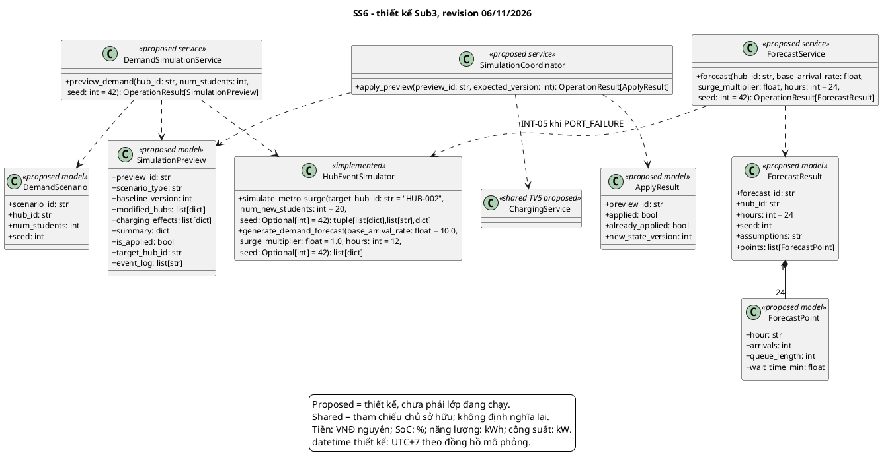

## 10.2 Mô tả lớp và thuộc tính

### DemandScenario

Dữ liệu đầu vào kịch bản nhu cầu không âm và seed; không tự cập nhật mạng lưới.

Mức triển khai: Thiết kế đề xuất.

Thuộc tính: `scenario_id: str`; `hub_id: str`; `num_students: int`; `seed: int`.

### ForecastPoint

Một mốc giờ với arrivals, queue theo người và wait_time_min theo phút; đây là ước lượng mô hình.

Mức triển khai: Thiết kế đề xuất.

Thuộc tính: `hour: str`; `arrivals: int`; `queue_length: int`; `wait_time_min: float`.

### ForecastResult

Kết quả đủ 24 điểm, có giả định và seed. Service rate 8 xe/giờ là giả định, không phải số đo mọi Hub.

Mức triển khai: Thiết kế đề xuất.

Thuộc tính: `forecast_id: str`; `hub_id: str`; `hours: int = 24`; `seed: int`; `assumptions: str`; `points: list[ForecastPoint]`.

### SimulationPreview

DTO chuẩn dùng chung cho DEMAND/PORT_FAILURE, chứa candidate cách ly và tác động dự kiến; metrics prototype được adapter ánh xạ vào summary.

Mức triển khai: Thiết kế đề xuất.

Thuộc tính: `preview_id: str`; `scenario_type: str`; `baseline_version: int`; `modified_hubs: list[dict]`; `charging_effects: list[dict]`; `summary: dict`; `is_applied: bool`; `target_hub_id: str`; `event_log: list[str]`.

### ApplyResult

Phân biệt lần Apply thành công với lần gọi lại đã áp dụng; new_state_version chỉ tăng khi commit mới.

Mức triển khai: Thiết kế đề xuất.

Thuộc tính: `preview_id: str`; `applied: bool`; `already_applied: bool`; `new_state_version: int`.

### DemandSimulationService

Kiểm tra đầu vào Metro Surge, gọi engine trên candidate cách ly và đóng gói SimulationPreview để người dùng xem trước khi Apply.

Mức triển khai: Thiết kế đề xuất.

### ForecastService

Chuẩn hóa đầu vào dự báo và tạo ForecastResult đủ 24 điểm với seed, giả định và các đơn vị rõ ràng.

Mức triển khai: Thiết kế đề xuất.

### SimulationCoordinator

Đầu mối Apply chung cho SS6/SS7: phát hiện stale, stage tác động liên phân hệ, commit toàn bộ và ngăn áp dụng cùng preview lần hai.

Mức triển khai: Thiết kế đề xuất.

### HubEventSimulator

Động cơ core đã có. _original giữ dữ liệu đầu vào, các phép mô phỏng deepcopy trước khi thay đổi; constructor không tự tạo trạng thái vận hành mới.

Mức triển khai: Đã có trong prototype.

## 10.3 Mô tả phương thức

**DemandSimulationService.preview_demand**

```text
preview_demand(hub_id: str, num_students: int, seed: int = 42) -> OperationResult[SimulationPreview]
```

INT-08, service đề xuất. Hub tồn tại, num_students nguyên >=0. Deepcopy snapshot và lưu baseline_version; gọi engine, đóng gói scenario_type=DEMAND, summary=metrics, charging_effects dự kiến và is_applied=False. Không sửa hubs thật/ví/booking. admitted=min(demand,available_slots), unserved=demand-admitted. Invalid/NOT_FOUND không lưu preview hợp lệ; timestamp log thực không là tiêu chí tái lập.

Ánh xạ hiện tại: `src/core/simulator.py:HubEventSimulator.simulate_metro_surge`. Chữ ký prototype có thể khác service; service OOP vẫn thuộc thiết kế mục tiêu.

**ForecastService.forecast**

```text
forecast(hub_id: str, base_arrival_rate: float, surge_multiplier: float, hours: int = 24, seed: int = 42) -> OperationResult[ForecastResult]
```

INT-04, service đề xuất. Xác nhận Hub tồn tại, rate/multiplier hữu hạn >=0 và hours=24 cho báo cáo Sub 3. Gọi engine với hours tường minh, trả 24 mốc 06:00 đến 05:00, arrivals/queue theo người và wait_time_min theo phút. service_rate=8 xe/giờ là giả định mô hình, không phải số đo từng Hub. Cùng input/seed cùng dữ liệu; không sửa state. INVALID_INPUT/NOT_FOUND nếu không hợp lệ. Prototype UI vẫn mặc định 12, có thể chọn 24.

Ánh xạ hiện tại: `src/core/simulator.py:HubEventSimulator.generate_demand_forecast`. Chữ ký prototype có thể khác service; service OOP vẫn thuộc thiết kế mục tiêu.

**SimulationCoordinator.apply_preview**

```text
apply_preview(preview_id: str, expected_version: int) -> OperationResult[ApplyResult]
```

INT-10, coordinator dùng chung đề xuất. Tìm preview, kiểm tra baseline_version=expected_version=current version và invariant capacity/tài chính/công suất. Nếu đã apply cùng preview trả already_applied=True trước kiểm tra stale, không tác động lại. Stage candidate và tác động SS5 (INT-05) nếu PORT_FAILURE; chỉ commit toàn bộ khi hợp lệ, tăng version một lần và ghi applied. Không chép ví/booking từ snapshot. NOT_FOUND/STALE_STATE/INVALID_STATE giữ nguyên state. Prototype chỉ có Apply riêng ở UI và version check, chưa có class/coordinator, kiểm tra toàn bộ invariant hoặc giao dịch SS5.

Ánh xạ hiện tại: `src/components/sim_demand.py:render`, `src/components/sim_infrastructure.py:render`. Chữ ký prototype có thể khác service; service OOP vẫn thuộc thiết kế mục tiêu.

**HubEventSimulator.simulate_metro_surge**

```text
simulate_metro_surge(target_hub_id: str = "HUB-002", num_new_students: int = 20, seed: Optional[int] = 42) -> tuple[list[dict],list[str],dict]
```

Đã có trong core. Sao chép _original, tìm Hub, tiếp nhận tối đa số chỗ trống, thêm xe mô phỏng, giảm slots và cấp số cổng tổng hợp cho xe pin thấp; trả hubs/log/metrics. Không sửa nguồn. Hub không tồn tại trả metrics rỗng kèm log. Core chưa validation đầy đủ số âm/kiểu; adapter đề xuất phải chặn. Log timestamp dùng đồng hồ thật; loại log khi so tính tái lập.

Ánh xạ hiện tại: `src/core/simulator.py:HubEventSimulator.simulate_metro_surge`. Chữ ký prototype có thể khác service; service OOP vẫn thuộc thiết kế mục tiêu.

**HubEventSimulator.generate_demand_forecast**

```text
generate_demand_forecast(base_arrival_rate: float = 10.0, surge_multiplier: float = 1.0, hours: int = 12, seed: Optional[int] = 42) -> list[dict]
```

Đã có, static, mặc định thực tế 12 giờ. Cao điểm 7/8/17/18 factor 2.5; 9/16/19 factor 1.5; còn lại 1.0, Gaussian sigma 1.5, arrivals=max(0,int(rate*factor*mult+noise)). queue=max(0,queue+arrivals-8), wait=round(queue/8*60,1). Trả list hour/arrivals/queue_length/wait_time_min, không sửa state. Để đáp ứng Sub 3 gọi hours=24; không mô tả giá trị mặc định là 24 và không coi wait estimate là đo chờ thực.

Ánh xạ hiện tại: `src/core/simulator.py:HubEventSimulator.generate_demand_forecast`. Chữ ký prototype có thể khác service; service OOP vẫn thuộc thiết kế mục tiêu.

## 10.4 Ánh xạ và giới hạn triển khai

HubEventSimulator đã triển khai, service/coordinator/DTO OOP vẫn là đề xuất. UI và core mặc định 12 giờ nhưng cho phép chọn 24 tường minh. Apply hiện nằm riêng trong hai UI và có version check; chưa là transaction chung với SS5. US-21 chưa có mô hình biến động doanh thu. Log dùng đồng hồ thực cần loại khỏi tiêu chí so sánh kết quả nghiệp vụ.

Dự báo dùng service_rate = 8 xe/giờ, hệ số cao điểm 2,5 tại 7/8/17/18 giờ và 1,5 tại 9/16/19 giờ. Nhiễu Gaussian có độ lệch chuẩn 1,5; arrivals được chặn không âm. Queue cuối giờ bằng max(0, queue trước + arrivals - 8), thời gian chờ ước lượng bằng queue/8 nhân 60 phút. Đây là mô hình giả định, chưa là dữ liệu dự báo doanh thu hoặc số đo chờ thực tế.

# Mục 11: Thiết kế SS7 sự cố hạ tầng và gợi ý hub thay thế

SS7 mô phỏng lỗi cổng hoặc mức mất điện của Hub, đánh giá ảnh hưởng và gợi ý điểm đến thay thế. InfrastructureSimulationService tạo preview PORT_FAILURE theo DTO chung; ReroutingService chỉ trả danh sách đề xuất. Thay đổi booking thuộc BookingService và chỉ diễn ra sau xác nhận của người dùng.

**Bảng 11.1: Danh mục use case của SS7**

| Use case | Phạm vi |
| --- | --- |
| UC_SS7_01 | Mô phỏng sự cố hạ tầng & Mất điện trạm sạc |
| UC_SS7_02 | Đề xuất gợi ý điều hướng tự động sang Hub lân cận & Cảnh báo |

Phần trình bày hiện tại nằm ở src/components/sim_infrastructure.py; ánh xạ nghiệp vụ tại src/core/simulator.py và routing.py. Chủ sở hữu theo phân công là Nguyễn Trung Nguyên, MSSV 2011710.

## 11.1 Class diagram và quan hệ

InfrastructureFailure ghi bối cảnh sự cố, không tạo một cơ chế Apply mới. RouteSuggestion tham chiếu Hub cùng khoảng cách km và số chỗ/cổng tại thời điểm đề xuất. Danh sách rỗng là kết quả hợp lệ. Gợi ý không giữ tài nguyên; chỗ/cổng và phiên bản phải được kiểm tra lại khi người dùng chấp nhận.

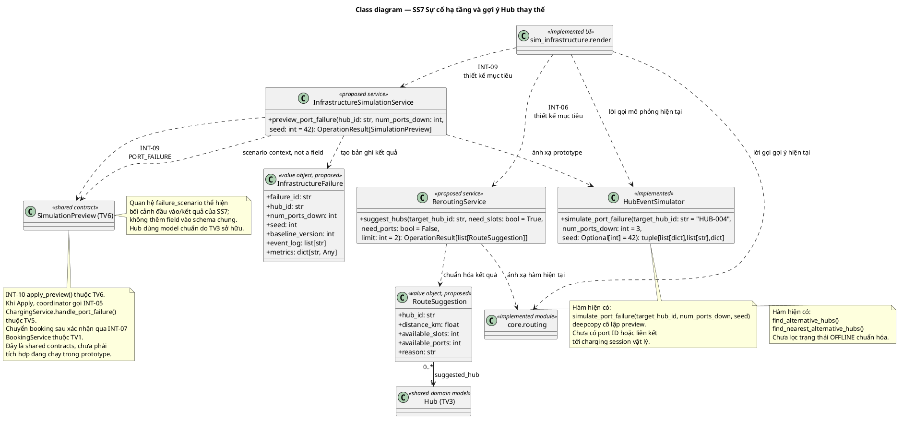

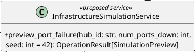

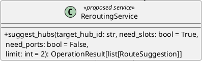

## 11.2 Mô tả lớp và thuộc tính

### InfrastructureFailure

Kịch bản/kết quả sự cố hạ tầng theo Hub; không được dùng thay VehicleIncident của SS4.

Mức triển khai: Thiết kế đề xuất.

Thuộc tính: `failure_id: str`; `hub_id: str`; `num_ports_down: int`; `seed: int`; `baseline_version: int`; `event_log: list[str]`; `metrics: dict[str, Any]`.

### InfrastructureSimulationService

Tạo preview PORT_FAILURE và mô tả ảnh hưởng hạ tầng; giao quyền commit cho SimulationCoordinator thay vì tự đổi Hub đang vận hành.

Mức triển khai: Thiết kế đề xuất.

### ReroutingService

Lọc và xếp hạng Hub thay thế theo tài nguyên, trạng thái và khoảng cách; trả gợi ý để người dùng xác nhận, không tự đổi booking.

Mức triển khai: Thiết kế đề xuất.

### RouteSuggestion

Thông tin gợi ý tại một thời điểm, gồm khoảng cách km và tài nguyên; không bảo đảm tài nguyên vẫn còn khi xác nhận.

Mức triển khai: Thiết kế đề xuất.

Thuộc tính: `hub_id: str`; `distance_km: float`; `available_slots: int`; `available_ports: int`; `reason: str`.

HubEventSimulator là động cơ dùng chung đã mô tả ở mục 10; SS7 sử dụng thêm simulate_port_failure được đặc tả tại mục phương thức của mục này.

### RoutingModule

Ký hiệu module core.routing với các hàm tìm Hub thay thế hiện có; đây là module hàm, không phải service OOP đã hiện thực.

Mức triển khai: Đã có trong prototype.

Lớp được tham chiếu ở mức trách nhiệm; các trường dữ liệu chi tiết theo mô hình chuẩn của chủ sở hữu.

### SS7UI

Ký hiệu module giao diện sim_infrastructure.render hiện có; nhận tham số mô phỏng, hiển thị preview/gợi ý và xử lý thao tác Apply trong prototype.

Mức triển khai: Đã có trong prototype.

Lớp được tham chiếu ở mức trách nhiệm; các trường dữ liệu chi tiết theo mô hình chuẩn của chủ sở hữu.

## 11.3 Mô tả phương thức

**InfrastructureSimulationService.preview_port_failure**

```text
preview_port_failure(hub_id: str, num_ports_down: int, seed: int = 42) -> OperationResult[SimulationPreview]
```

INT-09 đề xuất. Hub tồn tại, số cổng nguyên không âm và không vượt tập cổng hoạt động hợp lệ; snapshot baseline_version, gọi engine/adapter rồi đóng gói PORT_FAILURE với charging_effects/summary/is_applied. Không commit Hub/phiên/booking trước Apply. Invalid/NOT_FOUND không tạo preview hợp lệ; dùng DTO/INT-10 của SS6, không tạo coordinator thứ hai.

**ReroutingService.suggest_hubs**

```text
suggest_hubs(target_hub_id: str, need_slots: bool = True, need_ports: bool = False, limit: int = 2) -> OperationResult[list[RouteSuggestion]]
```

INT-06 đề xuất. Hub gốc tồn tại, limit>0; lọc nhu cầu chỗ/cổng và operational status, loại Hub gốc, xếp khoảng cách Haversine km rồi ID để phá hòa. Trả list RouteSuggestion (rỗng là hợp lệ), không đổi booking/cọc. Prototype mapping find_alternative_hubs/find_nearest_alternative_hubs chưa lọc OFFLINE chuẩn. Khi nhận gợi ý phải kiểm tra lại capacity/version ở INT-07 sau xác nhận.

**HubEventSimulator.simulate_port_failure**

```text
simulate_port_failure(target_hub_id: str = "HUB-004", num_ports_down: int = 3, seed: Optional[int] = 42) -> tuple[list[dict],list[str],dict]
```

Engine hiện có: deepcopy _original, xác định Hub, phân chia busy/free bị ảnh hưởng bằng số đếm, chuyển xe CHARGING ảnh hưởng sang WAITING, cập nhật available/offline và trả hubs/log/metrics. Không đổi slot đỗ hoặc dữ liệu nguồn. Hub không tồn tại trả metrics rỗng; core chưa chặn đầy đủ số âm/lỗi lặp/offline đã có, không có port-ID/session adapter.

## 11.4 Ánh xạ và giới hạn triển khai

Simulator hiện dùng số đếm cổng và deepcopy; chưa có port ID/session adapter hoặc IoT thật. Routing chưa có bộ lọc OFFLINE chuẩn. Lỗi cổng không được làm thay đổi capacity đỗ. INT-05 xử lý phiên sạc và INT-10 Apply là hợp đồng mục tiêu; không suy ra đã có cơ chế phục hồi điện thực tế.

# Mục 12: Truy vết yêu cầu và thiết kế

Chuỗi truy vết được giữ từ SRS tới use case, scenario và sequence/activity của Submission 2, sau đó tới lớp/phương thức Sub 3 và test. Mã UC, người phụ trách và đường dẫn sơ đồ kế thừa manifest chuẩn. Các alias hàm cũ trong Sub 2 không được dùng để khẳng định một method OOP hiện đã có code.

## 12.1 Truy vết SS1

**UC_SS1_01 Tra cứu, Đặt xe & Nhận xe qua QR/PIN**

Yêu cầu: US-01, US-02, US-03, US-03b, US-04, FR-01, FR-01b, FR-01c.

Thiết kế phụ trách: `BookingService.create_booking`, `BookingService.pickup`.

Đầu vào Sub 2: UC_SS1_01_NguyenThanhDat_sequence.puml và UC_SS1_01_NguyenThanhDat_activity.puml. Scenario: UC_SS1_NguyenThanhDat.md.

Bằng chứng test prototype: `tests/test_core_state_and_billing.py::test_booking_pickup_return_capacity_conservation`; `tests/test_submission_2_acceptance.py::test_student_ui_filters_available_vehicles_and_books_voucher`.

**UC_SS1_02 Trả xe, Cập nhật vị trí & Quyết toán ví điện tử**

Yêu cầu: US-05b, US-06, FR-01c, FR-15b.

Thiết kế phụ trách: `BookingService.return_vehicle`, `BillingService.settle_invoice`.

Đầu vào Sub 2: UC_SS1_02_NguyenThanhDat_sequence.puml và UC_SS1_02_NguyenThanhDat_activity.puml. Scenario: UC_SS1_NguyenThanhDat.md.

Bằng chứng test prototype: `tests/test_core_state_and_billing.py::test_booking_pickup_return_capacity_conservation`; `tests/test_core_state_and_billing.py::test_no_silent_debt_loss`; `tests/test_submission_2_readiness_fixes.py::test_r08_alternate_hub_return_releases_destination_hold`.

**UC_SS1_03 Hủy đặt chỗ & Hoàn cọc / Phạt quá giờ**

Yêu cầu: US-05, FR-02.

Thiết kế phụ trách: `BookingService.cancel`, `BookingService.expire_reservations`, `BillingService.release_deposit`, `BillingService.settle_no_show`.

Đầu vào Sub 2: UC_SS1_03_NguyenThanhDat_sequence.puml và UC_SS1_03_NguyenThanhDat_activity.puml. Scenario: UC_SS1_NguyenThanhDat.md.

Bằng chứng test prototype: `tests/test_core_state_and_billing.py::test_noshow_expiry_and_penalty`; `tests/test_core_state_and_billing.py::test_early_cancellation_full_refund`; `tests/test_reservation_30_minutes.py::test_reservation_30_minute_boundary_and_single_settlement`.

## 12.2 Truy vết SS2

**UC_SS2_01 Đăng ký xe EV cá nhân lên hệ thống**

Yêu cầu: US-08, FR-03.

Thiết kế phụ trách: `PersonalEVService.register_personal_ev`, `PersonalVehicle.normalize_plate`.

Đầu vào Sub 2: UC_SS2_01_NguyenAnhTai_sequence.puml và UC_SS2_01_NguyenAnhTai_activity.puml. Scenario: UC_SS2_NguyenAnhTai.md.

Bằng chứng test prototype: `tests/test_personal_ev.py::test_register_personal_ev_success_and_duplicate`.

**UC_SS2_02 Đặt trước chỗ đỗ và nhu cầu sạc xe EV cá nhân**

Yêu cầu: US-09, US-10, FR-04, FR-05b.

Thiết kế phụ trách: `PersonalEVService.reserve_personal_ev_slot`, `PersonalEVService.sweep_expired_personal_reservations`.

Đầu vào Sub 2: UC_SS2_02_NguyenAnhTai_sequence.puml và UC_SS2_02_NguyenAnhTai_activity.puml. Scenario: UC_SS2_NguyenAnhTai.md.

Bằng chứng test prototype: `tests/test_personal_ev.py::test_reserve_and_checkin_checkout_lifecycle`; `tests/test_submission_2_acceptance.py::test_personal_future_arrival_and_exact_expiry`; `tests/test_submission_2_acceptance.py::test_personal_invalid_reservation_has_no_financial_or_capacity_effect`.

**UC_SS2_03 Check-in xe EV cá nhân tại cổng Hub (QR/Biển số)**

Yêu cầu: US-11b, US-10, FR-03b, FR-04.

Thiết kế phụ trách: `PersonalEVService.check_in_personal_ev`, `ParkingSession.attach_charging_ref`.

Đầu vào Sub 2: UC_SS2_03_NguyenAnhTai_sequence.puml và UC_SS2_03_NguyenAnhTai_activity.puml. Scenario: UC_SS2_NguyenAnhTai.md.

Bằng chứng test prototype: `tests/test_personal_ev.py::test_reserve_and_checkin_checkout_lifecycle`; `tests/test_reservation_30_minutes.py::test_reservation_30_minute_boundary_and_single_settlement`.

**UC_SS2_04 Check-out và thanh toán tổng hợp dịch vụ xe EV cá nhân**

Yêu cầu: US-09, US-10, US-11, US-11b, FR-03b, FR-05b, FR-15b.

Thiết kế phụ trách: `PersonalEVService.check_out_personal_ev`, `BillingService.settle_invoice`.

Đầu vào Sub 2: UC_SS2_04_NguyenAnhTai_sequence.puml và UC_SS2_04_NguyenAnhTai_activity.puml. Scenario: UC_SS2_NguyenAnhTai.md.

Bằng chứng test prototype: `tests/test_personal_ev.py::test_reserve_and_checkin_checkout_lifecycle`; `tests/test_submission_2_acceptance.py::test_personal_charging_is_billed_once_on_consolidated_checkout`.

## 12.3 Truy vết SS3

**UC_SS3_01 Giám sát mạng lưới Hub, KPI & Doanh thu thời gian thực**

Yêu cầu: US-07, US-13, FR-05, FR-15b.

Thiết kế phụ trách: `MonitoringService.get_network_snapshot`.

Đầu vào Sub 2: UC_SS3_01_PhamTienDat_sequence.puml và UC_SS3_01_PhamTienDat_activity.puml. Scenario: UC_SS3_PhamTienDat.md.

Bằng chứng test prototype: `tests/test_submission_2_acceptance.py::test_dashboard_shows_actual_booking_ledger_and_revenue`.

**UC_SS3_02 Cảnh báo phân cấp chiếm dụng Hub & Sự cố IoT**

Yêu cầu: US-13b, US-14, FR-05c, FR-06.

Thiết kế phụ trách: `MonitoringService.get_network_snapshot`, `MonitoringService.classify_occupancy`.

Đầu vào Sub 2: UC_SS3_02_PhamTienDat_sequence.puml và UC_SS3_02_PhamTienDat_activity.puml. Scenario: UC_SS3_PhamTienDat.md.

Bằng chứng test prototype: `tests/test_core_state_and_billing.py::test_occupancy_threshold_levels`.

## 12.4 Truy vết SS4

**UC_SS4_01 Lập lệnh điều chuyển phương tiện cân bằng phụ tải**

Yêu cầu: US-15, FR-07.

Thiết kế phụ trách: `DispatchService.create_order`, `DispatchService.complete_order`.

Đầu vào Sub 2: UC_SS4_01_sequence.puml và UC_SS4_01_activity.puml. Scenario: UC_SS4_DangHoangQuyNhan.md.

Bằng chứng test prototype: `tests/test_submission_2_acceptance.py::test_dispatch_ui_moves_vehicle_and_conserves_capacity`.

**UC_SS4_02 Báo cáo, tiếp nhận xử lý và khắc phục sự cố phương tiện**

Yêu cầu: US-16, US-17, FR-08.

Thiết kế phụ trách: `IncidentService.report_vehicle_incident`, `IncidentService.acknowledge`, `IncidentService.resolve`.

Đầu vào Sub 2: UC_SS4_02_sequence.puml và UC_SS4_02_activity.puml. Scenario: UC_SS4_DangHoangQuyNhan.md.

Bằng chứng test prototype: `tests/test_submission_2_acceptance.py::test_incident_ui_report_acknowledge_resolve_and_history`.

## 12.5 Truy vết SS5

**UC_SS5_01 Lập lịch sạc tự động theo điểm ưu tiên & Giới hạn công suất lưới**

Yêu cầu: US-10, US-12, US-18, US-20, FR-04, FR-09, FR-11.

Thiết kế phụ trách: `SmartChargingScheduler.calculate_priority`, `SmartChargingScheduler.allocate_ports`, `ChargingService.request_charging`.

Đầu vào Sub 2: UC_SS5_01_DuongDangKhoa_sequence.puml và UC_SS5_01_DuongDangKhoa_activity.puml. Scenario: UC_SS5_DuongDangKhoa.md.

Bằng chứng test prototype: `tests/test_scheduler_and_charging.py::test_priority_scores_matching_plan_specification`; `tests/test_scheduler_and_charging.py::test_deterministic_tie_breaking`; `tests/test_scheduler_and_charging.py::test_allocation_and_power_cap`; `tests/test_submission_2_readiness_fixes.py::test_r09_repeated_charging_allocation_obeys_power_cap`.

**UC_SS5_02 Giám sát hàng chờ sạc, hoàn thành, ân hạn & Tính phí quá giờ**

Yêu cầu: US-12, US-19, US-19b, FR-05b, FR-10, FR-10b, FR-15b.

Thiết kế phụ trách: `SmartChargingScheduler.advance_simulation_tick`, `SmartChargingScheduler.unplug_vehicle`, `ChargingService.get_bill`.

Đầu vào Sub 2: UC_SS5_02_DuongDangKhoa_sequence.puml và UC_SS5_02_DuongDangKhoa_activity.puml. Scenario: UC_SS5_DuongDangKhoa.md.

Bằng chứng test prototype: `tests/test_scheduler_and_charging.py::test_simulation_tick_and_overstay`; `tests/test_submission_2_acceptance.py::test_charging_completion_notification_survives_rerun_and_receipt_is_recorded`; `tests/test_submission_2_readiness_fixes.py::test_r11_overstay_charging_settlement_and_debt`.

## 12.6 Truy vết SS6

**UC_SS6_01 Mô phỏng tăng đột biến nhu cầu khách Metro (What-if Metro Surge)**

Yêu cầu: US-21, FR-12.

Thiết kế phụ trách: `DemandSimulationService.preview_demand`, `SimulationCoordinator.apply_preview`, `HubEventSimulator.simulate_metro_surge`.

Đầu vào Sub 2: UC_SS6_01_HoangVanTan_sequence.puml và UC_SS6_01_HoangVanTan_activity.puml. Scenario: UC_SS6_HoangVanTan.md.

Bằng chứng test prototype: `tests/test_simulations.py::test_metro_surge_deepcopy_isolation_and_unserved_students`.

**UC_SS6_02 Dự báo phụ tải nhu cầu và phân tích hàng đợi 24h**

Yêu cầu: US-22, FR-13.

Thiết kế phụ trách: `ForecastService.forecast`, `HubEventSimulator.generate_demand_forecast`.

Đầu vào Sub 2: UC_SS6_02_HoangVanTan_sequence.puml và UC_SS6_02_HoangVanTan_activity.puml. Scenario: UC_SS6_HoangVanTan.md.

Bằng chứng test prototype: `tests/test_submission_2_acceptance.py::test_forecast_24h_queue_wait_and_reproducibility`.

## 12.7 Truy vết SS7

**UC_SS7_01 Mô phỏng sự cố hạ tầng & Mất điện trạm sạc**

Yêu cầu: US-23, US-24, FR-14, FR-15.

Thiết kế phụ trách: `InfrastructureSimulationService.preview_port_failure`, `HubEventSimulator.simulate_port_failure`, `SimulationCoordinator.apply_preview`.

Đầu vào Sub 2: UC_SS7_01_NguyenTrungNguyen_sequence.puml và UC_SS7_01_NguyenTrungNguyen_activity.puml. Scenario: UC_SS7_NguyenTrungNguyen.md.

Bằng chứng test prototype: `tests/test_simulations.py::test_port_failure_distinguishes_free_vs_busy_ports`; `tests/test_submission_2_acceptance.py::test_infrastructure_preview_isolated_apply_and_stale_rejected`.

**UC_SS7_02 Đề xuất gợi ý điều hướng tự động sang Hub lân cận & Cảnh báo**

Yêu cầu: US-24, US-24b, FR-15, FR-15c.

Thiết kế phụ trách: `ReroutingService.suggest_hubs`, `BookingService.accept_rerouting`.

Đầu vào Sub 2: UC_SS7_02_NguyenTrungNguyen_sequence.puml và UC_SS7_02_NguyenTrungNguyen_activity.puml. Scenario: UC_SS7_NguyenTrungNguyen.md.

Bằng chứng test prototype: `tests/test_submission_2_acceptance.py::test_rerouting_selects_two_hubs_and_transfers_hold_once`; `tests/test_core_state_and_billing.py::test_haversine_distance_accuracy`.

# Mục 13: Test case và bằng chứng kiểm tra

Log review ngày 06/11/2026 ghi nhận 49 trường hợp pytest đạt trên bộ core/UI prototype. Đây là kết quả của lần chạy được lưu tại docs/audit/submission_3/review_20261106/pytest-baseline.txt, không phải tuyên bố đã chạy lại trong lần soạn báo cáo này. Test của hàm core/UI không chứng minh service OOP đề xuất đã được triển khai.

```text
PYTHONPATH=src python -m pytest -q
```

**TC-T01 SS1 giữ xe và hết hạn**

Đầu vào và thao tác: Tạo booking lúc 08:00; nhận ở 08:29:59 và ở lượt độc lập 08:30:00.

Kết quả mong đợi: Trước hạn nhận được; đúng hạn EXPIRED, phạt 10.000/hoàn 40.000; sweep lặp không quyết toán lần hai.

Phạm vi bằng chứng: có kiểm thử prototype trong tests/test_reservation_30_minutes.py. Trạng thái đạt trong baseline 49; chi tiết các assert vẫn là giới hạn của bằng chứng.

**TC-T02 SS1 trả xe và giữ chỗ**

Đầu vào và thao tác: Giữ HubB rồi trả tại HubC; lặp thao tác trả.

Kết quả mong đợi: HoldB được trả, xe hiện diệnC, số chỗ bảo toàn; không thu hai lần.

Phạm vi bằng chứng: có kiểm thử prototype trong tests/test_submission_2_readiness_fixes.py. Trạng thái đạt trong baseline 49; chi tiết các assert vẫn là giới hạn của bằng chứng.

**TC-T03 SS2 đăng ký và lượt đỗ**

Đầu vào và thao tác: Đăng ký biển số với cách viết khác; reserve check-in/out.

Kết quả mong đợi: Từ chối biển số trùng; chuyển hold thành hiện diện không trừ slot hai lần.

Phạm vi bằng chứng: có kiểm thử prototype trong tests/test_personal_ev.py. Trạng thái đạt trong baseline 49; chi tiết các assert vẫn là giới hạn của bằng chứng.

**TC-T04 SS2 giờ đến tương lai**

Đầu vào và thao tác: Đặt giờ 09:00; thử trước 09:00 và đúng 09:30.

Kết quả mong đợi: Trước giờ từ chối; đúng deadline xử lý hết hạn và quyết toán một lần.

Phạm vi bằng chứng: có kiểm thử prototype trong tests/test_submission_2_acceptance.py. Trạng thái đạt trong baseline 49; chi tiết các assert vẫn là giới hạn của bằng chứng.

**TC-T05 SS3 occupancy**

Đầu vào và thao tác: Đầu vào dưới 70,70,85 và 100 phần trăm.

Kết quả mong đợi: NORMAL WARNING CRITICAL FULL đúng biên.

Phạm vi bằng chứng: có kiểm thử prototype trong tests/test_core_state_and_billing.py. Trạng thái đạt trong baseline 49; chi tiết các assert vẫn là giới hạn của bằng chứng.

**TC-T06 SS3 doanh thu prototype**

Đầu vào và thao tác: Tạo booking/giao dịch trong session rồi mở dashboard.

Kết quả mong đợi: UI hiển thị ledger và khoản thu được assert; không chứng minh mọi loại thu SS2/SS5.

Phạm vi bằng chứng: có kiểm thử prototype trong tests/test_submission_2_acceptance.py. Trạng thái đạt trong baseline 49; chi tiết các assert vẫn là giới hạn của bằng chứng.

**TC-T07 SS4 điều chuyển**

Đầu vào và thao tác: Chọn xe SHARED AVAILABLE, nguồn khác đích; tạo và nhận.

Kết quả mong đợi: Xe di chuyển đúng vòng đời và capacity/hold bảo toàn.

Phạm vi bằng chứng: có kiểm thử prototype trong tests/test_submission_2_acceptance.py. Trạng thái đạt trong baseline 49; chi tiết các assert vẫn là giới hạn của bằng chứng.

**TC-T08 SS4 sự cố xe**

Đầu vào và thao tác: Report rồi acknowledge và resolve trong UI.

Kết quả mong đợi: Ghi lịch sử và trạng thái theo workflow được assert.

Phạm vi bằng chứng: có kiểm thử prototype trong tests/test_submission_2_acceptance.py. Trạng thái đạt trong baseline 49; chi tiết các assert vẫn là giới hạn của bằng chứng.

**TC-T09 SS5 ưu tiên và power**

Đầu vào và thao tác: Ba request 7,4kW, cap 20kW; allocate lặp.

Kết quả mong đợi: Chỉ hai phiên 14,8kW; lần gọi sau không vượt cap.

Phạm vi bằng chứng: có kiểm thử prototype trong tests/test_scheduler_and_charging.py và test_submission_2_readiness_fixes.py. Trạng thái đạt trong baseline 49; chi tiết các assert vẫn là giới hạn của bằng chứng.

**TC-T10 SS5 grace và overstay**

Đầu vào và thao tác: Phiên 98 phần trăm; tick 15 phút,15 phút rồi 5 phút.

Kết quả mong đợi: Vào grace khi đầy; đúng 15 phút vẫn grace; sau đó overstay 10.000.

Phạm vi bằng chứng: có kiểm thử prototype trong tests/test_scheduler_and_charging.py. Trạng thái đạt trong baseline 49; chi tiết các assert vẫn là giới hạn của bằng chứng.

**TC-T11 SS6 forecast**

Đầu vào và thao tác: rate 15 multiplier 1,5 hours 24 seed 42; chạy hai lần.

Kết quả mong đợi: Đúng 24 mốc 06:00 đến 05:00, queue/wait không âm, kết quả tái lập.

Phạm vi bằng chứng: có kiểm thử prototype trong tests/test_submission_2_acceptance.py. Trạng thái đạt trong baseline 49; chi tiết các assert vẫn là giới hạn của bằng chứng.

**TC-T12 SS6 Metro Surge**

Đầu vào và thao tác: Nhu cầu 50 tại Hub ít chỗ; so trước/sau.

Kết quả mong đợi: Nguồn không đổi; admitted theo chỗ trống và unserved phần thiếu.

Phạm vi bằng chứng: có kiểm thử prototype trong tests/test_simulations.py. Trạng thái đạt trong baseline 49; chi tiết các assert vẫn là giới hạn của bằng chứng.

**TC-T13 SS7 lỗi cổng và stale**

Đầu vào và thao tác: Tạo preview lỗi cổng; đổi version trước Apply.

Kết quả mong đợi: Preview cách ly; stale không ghi đè Hub hiện tại.

Phạm vi bằng chứng: có kiểm thử prototype trong tests/test_simulations.py và test_submission_2_acceptance.py. Trạng thái đạt trong baseline 49; chi tiết các assert vẫn là giới hạn của bằng chứng.

**TC-T14 SS7 điều hướng**

Đầu vào và thao tác: Tìm hai Hub phù hợp; chấp nhận gợi ý trong phạm vi test.

Kết quả mong đợi: Xếp khoảng cách và chuyển hold/ưu đãi theo các assert hiện có.

Phạm vi bằng chứng: có kiểm thử prototype trong tests/test_submission_2_acceptance.py. Trạng thái đạt trong baseline 49; chi tiết các assert vẫn là giới hạn của bằng chứng.

## 13.1 Ca kiểm thử hợp đồng mới thiết kế

**Bảng 13.1: Các ca kiểm thử hợp đồng được thiết kế**

| Ca | Điều kiện và kết quả mong đợi | Trạng thái |
| --- | --- | --- |
| Tài chính lặp | Cùng charge_id/key không thu lần hai; đổi tiền cùng ID phải CONFLICTING_CHARGE | DESIGNED |
| Apply nguyên tử | INT-05 lỗi thì rollback Hub/cổng/phiên, không tăng version | DESIGNED |
| Reroute nhiều lần | Đổi qua nhiều Hub vẫn chỉ thêm15 phút một lần | DESIGNED |
| Phục hồi binding | Xe còn booking/charging không trở lại AVAILABLE trái điều kiện | DESIGNED |
| Doanh thu toàn mạng | Cộng thực thu SS1/SS2/SS5, loại cọc/hoàn và tách debt | DESIGNED |

# Mục 14: Giới hạn và hướng hoàn thiện

Bản thiết kế đưa ra các trách nhiệm và giao tiếp cần có để bảo toàn tài nguyên khi nhiều luồng tương tác. Prototype hiện vẫn còn khoảng cách giữa service mục tiêu và hàm/UI thực thi. Nhóm ghi các khoảng cách này để tránh coi sơ đồ hoặc mô tả như bằng chứng tích hợp đã chạy.

**Bảng 14.1: Giới hạn hiện tại và hướng hoàn thiện**

| Hạng mục | Giới hạn hiện tại | Hướng hoàn thiện |
| --- | --- | --- |
| Tài chính và SS2 SS5 | Chưa ledger cọc theo reference và dedup chung | Hiện thực BillingService và test không thu trùng |
| Charging và hạ tầng | Cổng số đếm, thiếu adapter phiên/cổng | ChargingService và INT-05 cùng coordinator |
| Mô phỏng | Hai UI Apply riêng; forecast mặc định12 | Coordinator chung, validation DTO và24 giờ tường minh |
| Dashboard | Revenue giới hạnSS1 và powerước tính | Đọc ledger đối soát toàn mạng và active sessions |
| Quyền và incident | Mock auth; core/binding còn thiếu kiểm tra | Authorization tại service và khôi phục trạng thái hợp lệ |
| Yêu cầu mở rộng | Hourly parking, quãng đường và doanh thu dự báo chưa đầy đủ | Chốt chính sách và nguồn dữ liệu, thực thi theo phạm vi final |
| NFR đa người dùng | Session tách biệt, chưa benchmark production | Storage/transaction chia sẻ và đo tải/độ trễ |

## 14.1 Kế hoạch hoàn thiện và điều kiện bàn giao

Kế hoạch sắp theo phụ thuộc công việc, không tự đặt hạn thay thông báo giảng viên. Phân công dưới đây là đề xuất phối hợp theo chủ sở hữu phân hệ, cần được nhóm xác nhận khi chốt bản nộp.

**Bảng 14.2: Kế hoạch hoàn thiện và điều kiện bàn giao**

| Bước và phụ trách | Kết quả cần chốt |
| --- | --- |
| 1. Trưởng nhóm và cả bảy thành viên | Đọc đối chiếu SRS/Sub2/Sub3; xác nhận lớp, chữ ký, quy tắc dùng chung và phần đóng góp/AI cá nhân. Giữ nguyên ID yêu cầu; ghi rõ mọi mục chưa triển khai. |
| 2. SS1/SS2/SS5 và SS6/SS7 | Ưu tiên ledger không thu trùng, ChargingService, DTO preview và Apply nguyên tử theo thứ tự phụ thuộc. Mỗi tích hợp có ca lỗi, gọi lặp và invariant; cập nhật tài liệu nếu chữ ký đổi. |
| 3. SS3/SS4 cùng chủ sở hữu liên quan | Đối soát doanh thu/công suất từ nguồn chuẩn, kiểm tra ownership/binding và bộ lọc Hub offline. Chạy lại bộ core/UI cùng kiểm thử hợp đồng vừa bổ sung; lưu log và revision. |
| 4. Trưởng nhóm và chủ báo cáo cá nhân | Kiểm đủ 17 UC, 70 lượt phương thức và dẫn chiếu shared, hình đọc được, mục lục đúng, Word/PDF đồng bộ. Đóng gói báo cáo tổng và tài liệu cá nhân theo yêu cầu LMS; kiểm tra tệp tải lên và lưu biên nhận khi nộp. |

Tài liệu tổng phục vụ việc đọc thiết kế toàn hệ thống; cách nộp và hạn cuối tuân theo thông báo LMS/giảng viên. Bản tổng không tự tạo xác nhận cá nhân hoặc biên nhận nộp bài. Trước khi sử dụng để nộp, nhóm cần xác nhận nội dung và khai báo đóng góp theo bản cuối.

# Mục 15: Đóng góp của nhóm

## 15.1 Phạm vi đóng góp

Phạm vi phụ trách của bảy thành viên được giữ ở mục 2. Báo cáo tổng kế thừa nguồn thiết kế đã tích hợp, hợp đồng dùng chung và truy vết của nhóm; việc tổng hợp không thay đổi quyền sở hữu nội dung cá nhân. Bản báo cáo này không suy ra các thành viên đã đọc, tự kiểm tra hoặc xác nhận những chỉnh sửa được thực hiện trong phiên hỗ trợ.
