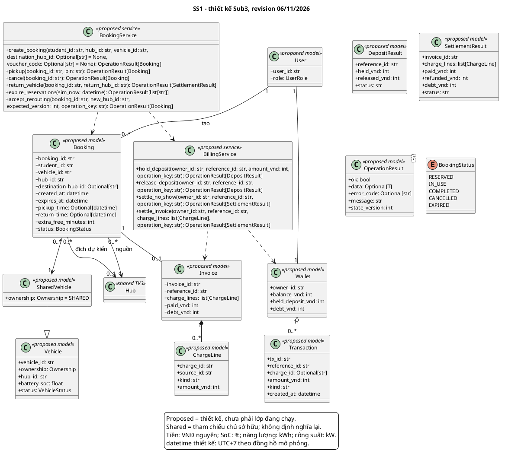

# Submission 3 - Nguyễn Thành Đạt - SS1

**MSSV:** 2410709. **Revision:** 06/11/2026. **Trạng thái:** bản tích hợp kỹ thuật, cần chủ sở hữu đọc và xác nhận trước nộp.

Nội dung được bổ sung/chỉnh trong đợt tổng hợp theo yêu cầu trưởng nhóm, có AI hỗ trợ; không ghi nhận thay tác giả rằng họ đã tự làm hoặc tự xác nhận. Nguồn bàn giao cũ giữ trong lịch sử Git.

## 1. Phạm vi

- `UC_SS1_01`: Tra cứu, Đặt xe & Nhận xe qua QR/PIN.
- `UC_SS1_02`: Trả xe, Cập nhật vị trí & Quyết toán ví điện tử.
- `UC_SS1_03`: Hủy đặt chỗ & Hoàn cọc / Phạt quá giờ.

## Kiến trúc chung và trạng thái phiên bản tích hợp

Revision 06/11/2026. Một ứng dụng Python/Streamlit: trình duyệt -> app.py -> components/core -> dữ liệu seed và session ở tiến trình server. Không có database bắt buộc, SSO/IoT/payment thật hay các microservice đang vận hành. Session thuộc từng kết nối Streamlit; reset nạp lại seed; rerun làm mới giao diện, không tạo telemetry nền. Chạy từ repository: `streamlit run src/app.py`; host/cổng phụ thuộc cấu hình, không cố định trong dự án.

Sơ đồ hệ thống lược thuộc tính/phương thức nằm trong phụ lục chung. Tất cả mô tả chi tiết phải được đọc cùng [danh mục phương thức](method_catalog.md), [truy vết](traceability.md), [test cases](test_cases.md) và [khai báo AI](ai_usage.md); PDF build sẽ nhúng toàn bộ các phụ lục này. Không đánh đồng kiểm tra kỹ thuật với chữ ký xác nhận của tác giả hoặc biên nhận LMS.

## 2. Class diagram SS1

Mô hình OOP là thiết kế đề xuất, trừ HubEventSimulator thực sự tồn tại ở SS6. Service trong sơ đồ là giao tiếp nội bộ, không phải server độc lập.

## 3. Mô tả lớp, thuộc tính và ràng buộc

### `User`

Định danh và vai trò thiết kế; prototype chọn người dùng mô phỏng, chưa xác thực SSO thật.

Thuộc tính và kiểu: `user_id: str`, `role: UserRole`.

### `Vehicle`

Định danh, ownership, Hub, SoC 0–100 và trạng thái dùng chung. Không cho xe PERSONAL được thuê/điều chuyển như SHARED.

Thuộc tính và kiểu: `vehicle_id: str`, `ownership: Ownership`, `hub_id: str`, `battery_soc: float`, `status: VehicleStatus`.

### `SharedVehicle`

Chuyên biệt Vehicle với ownership SHARED; xe RESERVED/IN_USE/INCIDENT không được tái phân bổ trái vòng đời.

Thuộc tính và kiểu: `ownership: Ownership = SHARED`.

### `Booking`

Vòng đời RESERVED/IN_USE/COMPLETED/CANCELLED/EXPIRED; nguồn bắt buộc, đích dự kiến 0..1, khi trả ghi Hub thực tế. Hết hạn chỉ áp dụng khi chưa nhận.

Thuộc tính và kiểu: `booking_id: str`, `student_id: str`, `vehicle_id: str`, `hub_id: str`, `destination_hub_id: Optional[str]`, `created_at: datetime`, `expires_at: datetime`, `pickup_time: Optional[datetime]`, `return_time: Optional[datetime]`, `extra_free_minutes: int`, `status: BookingStatus`.

### `Wallet`

Số dư khả dụng, held và nợ không âm, VNĐ nguyên. Held không là doanh thu. Thiết kế sở hữu bởi User, prototype hiện một ví trong session.

Thuộc tính và kiểu: `owner_id: str`, `balance_vnd: int`, `held_deposit_vnd: int`, `debt_vnd: int`.

### `Transaction`

Bản ghi bất biến về thao tác tài chính, ID ổn định; chống thu lại bằng reference/charge/key ở thiết kế.

Thuộc tính và kiểu: `tx_id: str`, `reference_id: str`, `charge_id: Optional[str]`, `amount_vnd: int`, `kind: str`, `created_at: datetime`.

### `Invoice`

Hóa đơn gắn reference, dòng phí không âm, tách số đã thu và nợ; không tự có số km khi chưa có nguồn đo.

Thuộc tính và kiểu: `invoice_id: str`, `reference_id: str`, `charge_lines: list[ChargeLine]`, `paid_vnd: int`, `debt_vnd: int`.

### `ChargeLine`

Giá trị khoản phí; cùng charge_id cùng nghĩa và số tiền. Không tạo ID mới để thu lại cùng khoản.

Thuộc tính và kiểu: `charge_id: str`, `source_id: str`, `kind: str`, `amount_vnd: int`.

### `DepositResult`

Kết quả giữ/hoàn cọc theo reference, trạng thái xử lý idempotent.

Thuộc tính và kiểu: `reference_id: str`, `held_vnd: int`, `released_vnd: int`, `status: str`.

### `SettlementResult`

Kết quả quyết toán từ ledger, bao gồm paid/refunded/debt và dòng phí; khoản nợ là kết quả nghiệp vụ có kiểm soát.

Thuộc tính và kiểu: `invoice_id: str`, `charge_lines: list[ChargeLine]`, `paid_vnd: int`, `refunded_vnd: int`, `debt_vnd: int`, `status: str`.

### `OperationResult<T>`

Kiểu kết quả chung do TV1 sở hữu; ok/data/error_code/message/state_version, lỗi không để commit dở dang.

Thuộc tính và kiểu: `ok: bool`, `data: Optional[T]`, `error_code: Optional[str]`, `message: str`, `state_version: int`.

### `BookingService`

Service thiết kế đề xuất; các method bên dưới nêu rõ ánh xạ đến hàm/UI đang có. Lớp sở hữu vòng đời nghiệp vụ, gọi các hợp đồng dùng chung theo quyền sở hữu.

### `BillingService`

Service thiết kế đề xuất; các method bên dưới nêu rõ ánh xạ đến hàm/UI đang có. Lớp sở hữu vòng đời nghiệp vụ, gọi các hợp đồng dùng chung theo quyền sở hữu.

## 4. Mô tả mọi phương thức

Xem [method_catalog.md](method_catalog.md), được nhúng đầy đủ trong PDF. Danh mục có chữ ký, đầu vào/đầu ra, điều kiện, tác động, lỗi và quy tắc gọi lặp cho từng phương thức được vẽ.

## 5. Ánh xạ và giới hạn

Các hàm hiện tại nằm trong core.booking/core.billing, model chủ yếu là dictionary; chưa có sổ cọc theo reference/operation_key hoặc dedup charge_id dùng chung. UI lọc ownership nhưng core.create_shared_booking chưa chặn PERSONAL. PIN trong core là 4 chữ số, chưa mở khóa IoT. US-06 thiếu nguồn quãng đường; trả xe thiếu tiền ghi nợ. INT-07 là mục tiêu kiểm tra version và ưu đãi một lần, không nhận là đã hoàn tất.

## 6. Chính sách và ranh giới thiết kế

Giữ xe SS1 30 phút từ tạo; hạn SS2 30 phút từ giờ đến. Cọc 50.000, no-show phạt10.000/hoàn40.000 VNĐ. Reroute thêm15 phút miễn phí tối đa một lần, không đổi TTL. Sạc grace15 phút, phí10.000/khối15 phút bắt đầu sau grace; công suất mặc định150 kW/Hub và11 kW/cổng, cấu hình từng test có thể khác. Phí đỗ prototype5.000 VNĐ/lượt khác SRS tính theo giờ, phải ghi chênh lệch. Ownership PERSONAL/SHARED và binding nguồn lực không được trộn.

NFR về bảo mật, dữ liệu bền, phân quyền đồng thời và hiệu năng là mục tiêu thiết kế. Prototype per-session không chứng minh tính nhất quán toàn mạng giữa nhiều phiên; thiết kế tương lai cần shared storage/transaction/version và authorization thật. Đề không bắt buộc thêm database cho Sub3.

## 7. Truy vết, test, đóng góp và AI

Các phụ lục traceability.md, test_cases.md, self_check.md và ai_usage.md được nhúng khi build PDF. Các test trên core/UI prototype không chứng minh service OOP đề xuất đã triển khai. Không tự xác nhận PASS cho test chưa có nguồn và log tái chạy.
