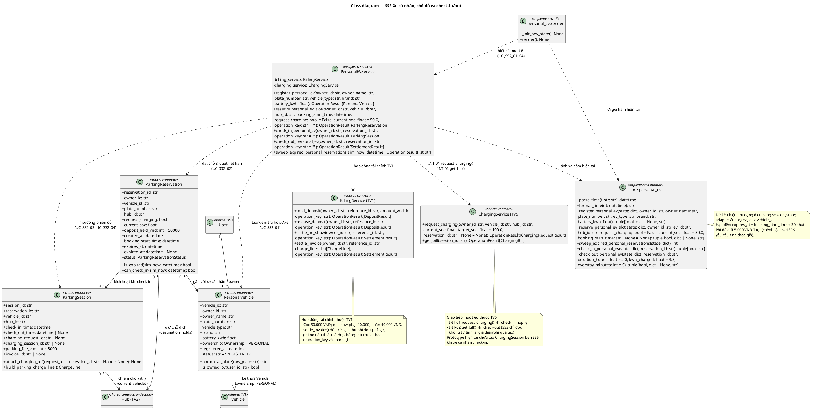

# BÁO CÁO THIẾT KẾ CHI TIẾT — SUBMISSION 3 (PHÂN HỆ SS2)

> **Revision tích hợp06/11/2026:** có chỉnh sửa với Codex hỗ trợ; chủ sở hữu cần xác nhận bản mới. Truy vết/test/catalog revision này được dùng khi khác nhận định của bản bàn giao trước.

**Dự án:** Smart E-Mobility Hub — BEE BRAVE (Nhóm 7)  
**Môn học:** Công nghệ Phần mềm CO3001 — HK261  
**Họ và tên:** Nguyễn Anh Tài  
**MSSV:** 2413035  
**Vai trò & Phân hệ phụ trách:** Thành viên 2 (TV2) — Phân hệ SS2: Quản lý Xe điện Cá nhân, Đặt chỗ & Check-in/Check-out  
**Phiên bản:** 1.1 - tích hợp06/11/2026<br>
**Ngày bản bàn giao:** 31/10/2026 (UTC+7)<br>

[Hướng dẫn và phân công](<../../../../GUIDANCE_FOR_SUB_3.md>) · [Quyết định dùng chung](<../shared/shared_contracts.md>)

---

## 1. Phạm vi và đóng góp

### 1.1. Các Use Case kế thừa và phạm vi phân hệ SS2

Phân hệ **SS2 (Personal EV & Parking Subsystem)** quản lý trọn vẹn vòng đời dịch vụ dành cho sinh viên sở hữu phương tiện điện cá nhân (`Ownership = PERSONAL`) tại các trạm thông minh ĐHQG-HCM, bao gồm **4 Use Case hiện hành**:

1. **`UC_SS2_01` — Đăng ký xe EV cá nhân lên hệ thống (`UC_Dang_Ki_EV`):** Sinh viên đăng ký hồ sơ phương tiện cá nhân (biển số, loại xe, hãng xe, dung lượng pin `kWh`), chuẩn hóa biển số để chống đăng ký trùng trên toàn hệ thống và cấp mã định danh `PEV-XXXXXX`.
2. **`UC_SS2_02` — Đặt trước chỗ đỗ và nhu cầu sạc xe EV cá nhân (`UC_Dat_Cho_Va_Sac`):** Sinh viên chọn xe cá nhân đã đăng ký, chọn Hub đích, giờ dự kiến đến trạm (`booking_start_time`), tùy chọn đăng ký nhu cầu sạc và mức pin ước tính (`current_soc`), tạm khóa cọc giữ chỗ `50.000 VNĐ` qua hợp đồng tài chính và giữ trước 1 chỗ đỗ (`destination_holds += 1`, `available_slots -= 1`) với hạn check-in `expires_at = booking_start_time + 30 phút`.
3. **`UC_SS2_03` — Check-in xe EV cá nhân tại cổng Hub (`UC_Check_In`):** Quét hết hạn các lượt đặt chỗ quá hạn trước khi xử lý; kiểm tra điều kiện check-in hợp lệ trong khung giờ `[booking_start_time, expires_at)`, chuyển chỗ giữ trước thành hiện diện vật lý tại Hub (`destination_holds -= 1`, giữ nguyên `available_slots` để không trừ hai lần), kích hoạt phiên đỗ `ParkingSession` và gửi yêu cầu sạc sang phân hệ SS5 (`INT-01`) nếu đơn có đăng ký sạc.
4. **`UC_SS2_04` — Check-out và thanh toán tổng hợp dịch vụ xe EV cá nhân (`UC_Check_Out_Thanh_Toan`):** Giải phóng vị trí đỗ vật lý tại Hub (`available_slots += 1`), đọc hóa đơn điện năng và phí chiếm dụng quá giờ từ phân hệ SS5 (`INT-02`), ghép với dòng phí đỗ xe cá nhân (`5.000 VNĐ/lượt` theo prototype hiện hành) và gọi hợp đồng quyết toán `BillingService.settle_invoice()` để đối trừ cọc `50.000 VNĐ`, khấu trừ ví hoặc ghi nhận nợ minh bạch.

### 1.2. Đóng góp thực tế của cá nhân và phần dùng chung

| Hạng mục | Chủ sở hữu / Người thực hiện | Phạm vi đóng góp của TV2 (Nguyễn Anh Tài — 2413035) |
| :--- | :--- | :--- |
| **Thiết kế chi tiết Phân hệ SS2** | **TV2 — Nguyễn Anh Tài** | Chủ trì thiết kế sơ đồ lớp SS2 ([class_diagram.puml](<../../../diagrams/submission_3/SS2/class_diagram.puml>), [class_diagram.svg](<../../../diagrams/submission_3/SS2/class_diagram.svg>), [class_diagram.png](<../../../diagrams/submission_3/SS2/class_diagram.png>)), đặc tả các lớp `PersonalVehicle`, `ParkingReservation`, `ParkingSession`, `PersonalEVService` và enum `ParkingReservationStatus`. |
| **Ánh xạ mã nguồn & Chính sách SS2** | **TV2 — Nguyễn Anh Tài** | Đối chiếu 5 hàm nghiệp vụ trong `src/core/personal_ev.py` và giao diện `src/components/personal_ev.py`; đặc tả quy tắc `expires_at = booking_start_time + 30 phút`, bảo toàn sức chứa Hub khi giữ chỗ/check-in/check-out và công khai chênh lệch phí đỗ `5.000 VNĐ/lượt` so với SRS. |
| **Áp dụng hợp đồng liên phân hệ** | **TV1** (`BillingService`), **TV3** (`Hub`), **TV5** (`ChargingService`) — **TV2 áp dụng** | Tham chiếu đúng mô hình `User`, `Vehicle`, `Hub` và tích hợp 4 giao tiếp tài chính của `BillingService` (TV1) cùng 2 giao tiếp sạc `INT-01`, `INT-02` của `ChargingService` (TV5) vào thiết kế SS2. |
| **Kiến trúc chung (Deployment & Implementation View)** | **TV7** (Deployment view), **TV3** (Implementation view & System Class Diagram) | Sử dụng kiến trúc chung đã chốt của nhóm và thuyết minh rõ vị trí, luồng dữ liệu, phụ thuộc mã nguồn của phân hệ SS2 trong hai góc nhìn kiến trúc. |
| **Truy vết & Kiểm thử SS2** | **TV2 — Nguyễn Anh Tài** (cung cấp đầu vào cho **TV6** tổng hợp) | Hoàn thiện bảng truy vết `US/FR → UC → Sequence/Activity → Class → Method → Test` tại [traceability.md](<traceability.md>) và thiết kế/đối chiếu bộ kiểm thử SS2 tại [test_cases.md](<test_cases.md>). |

---

## 2. Deployment view

[Nguồn sơ đồ triển khai chung](<../../../diagrams/submission_3/shared/deployment.puml>) *(Chủ sở hữu tổng hợp sơ đồ chung: TV7 — Nguyễn Trung Nguyên)*

### 2.1. Mức triển khai hiện tại và vị trí của phân hệ SS2

Hệ thống prototype hiện tại được triển khai theo mô hình **ứng dụng web đơn khối chạy cục bộ (Single-Process Modular Monolith)** trên nền tảng **Python 3 + Streamlit**, khởi chạy bằng lệnh `streamlit run src/app.py`:

* **Nút phía người dùng (Client Browser):** Trình duyệt web của Sinh viên ĐHQG-HCM hoặc Nhân viên vận hành kết nối qua giao thức HTTP/WebSocket tới tiến trình Streamlit Server (mặc định tại `localhost:8501`). Giao diện của phân hệ SS2 được hiển thị thành 4 tab nghiệp vụ tương ứng với 4 Use Case (`Đăng ký xe mới`, `Đặt chỗ & Sạc`, `Check-in trạm`, `Check-out & Quyết toán`).
* **Nút thực thi ứng dụng (Streamlit Application Runtime):** Toàn bộ thành phần giao diện `src/components/personal_ev.py` và mô-đun nghiệp vụ lõi `src/core/personal_ev.py` chạy trong cùng một tiến trình Python với `src/app.py`. Không có API server tách rời, message broker hay microservice riêng cho SS2 trong bản triển khai hiện tại.
* **Tầng lưu trữ dữ liệu trong phiên (In-Memory Session Store & Seed Files):**
  * Khi khởi tạo phiên làm việc (`init_session_state` trong `src/core/state.py`), dữ liệu trạm ban đầu được nạp từ tệp tĩnh `src/data/mock_hubs.json` vào `st.session_state["hubs"]`.
  * Dữ liệu riêng của phân hệ SS2 được duy trì trực tiếp trong bộ nhớ phiên làm việc `st.session_state`, bao gồm danh sách xe cá nhân `st.session_state["personal_evs"]`, danh sách lượt đặt chỗ/đỗ xe `st.session_state["personal_reservations"]` và hóa đơn gần nhất `st.session_state["last_pev_invoice"]`.
  * Mọi biến động số dư, tiền cọc tạm giữ (`held_deposit`) và khoản nợ (`debt`) của sinh viên sử dụng dịch vụ SS2 được ghi nhận chung vào `st.session_state["wallet"]` kèm nhật ký giao dịch bất biến (`wallet["ledger"]`), đồng thời tăng bộ đếm phiên bản trạng thái `st.session_state["state_version"]` qua `bump_state_version()`.

### 2.2. Vòng đời dữ liệu, cơ chế Rerun/Reset và giới hạn mô phỏng của SS2

* **Vòng đời Session & Rerun:** Mỗi khi sinh viên bấm nút xác nhận trên một trong 4 tab của `src/components/personal_ev.py`, Streamlit thực thi hàm xử lý tương ứng trong `src/core/personal_ev.py`, cập nhật trực tiếp các dictionary trong `st.session_state` và gọi `st.rerun()` để làm mới giao diện ngay lập tức. Khi người dùng bấm nút Reset hệ thống hoặc mở một phiên trình duyệt mới (`force_reset=True`), dữ liệu `personal_evs` và `personal_reservations` quay về trạng thái seed mặc định.
* **Các tích hợp ngoại vi đang ở mức mô phỏng (Simulated External Integrations):**
  * **Xác thực VNU-SSO:** Được mô phỏng thông qua đối tượng người dùng đang đăng nhập trong phiên (`st.session_state["current_user"]` / `active_user`), chưa kết nối máy chủ CAS/OAuth2 thực tế của ĐHQG-HCM.
  * **Cổng Barie IoT, Cảm biến vị trí đỗ và Quét mã QR/Biển số (`UC_SS2_03`, `UC_SS2_04`):** Được mô phỏng bằng thao tác bấm nút xác thực trên giao diện Streamlit và các ô nhập thông số mô phỏng (thời gian đỗ `duration_hours`, điện năng nạp `kwh_charged`, số phút quá hạn `overstay_minutes`) khi check-out, chưa kết nối phần cứng camera ANPR, barie vật lý hay trụ sạc OCPP thực tế.
  * **Cổng thanh toán & Ví điện tử:** Sử dụng ví nội bộ trong `st.session_state["wallet"]` thông qua `src/core/billing.py`, chưa kết nối cổng thanh toán ngân hàng bên ngoài.

---

## 3. Development/Implementation view

[Nguồn sơ đồ module chung](<../../../diagrams/submission_3/shared/implementation.puml>) *(Chủ sở hữu tổng hợp sơ đồ chung: TV3 — Phạm Tiến Đạt)*

### 3.1. Kiến trúc phân tầng và phụ thuộc module của phân hệ SS2

Trong kiến trúc phần mềm của dự án, phân hệ SS2 tuân thủ cấu trúc phân tầng từ giao diện trình bày xuống lõi nghiệp vụ và quản lý trạng thái/chính sách:

```text
src/
├── app.py                              # Điểm vào ứng dụng; điều hướng menu sang phân hệ SS2
├── components/
│   └── personal_ev.py                  # Tầng Presentation (UI SS2): _init_pev_state(), render() (4 Tabs)
└── core/
    ├── personal_ev.py                  # Tầng Business Logic (Core SS2): 5 hàm nghiệp vụ chính + 2 hàm thời gian
    ├── billing.py                      # Tầng Financial Core (Dùng chung với SS1/SS5): giữ/hoàn/phạt cọc & ghi nợ
    ├── scheduler.py                    # Tầng Charging Core (SS5 - mục tiêu kết nối qua INT-01, INT-02)
    ├── policies.py                     # Tầng Business Policies: hằng số phí đỗ, giá điện cao/thấp điểm, cọc, hạn 30p
    └── state.py                        # Tầng State & Vocabulary: Enum chuẩn hóa, kiểm tra invariant, bump_state_version()
```

* **Phụ thuộc thực tế trong mã nguồn hiện tại (`Implemented Dependencies`):**
  * `src/components/personal_ev.py` phụ thuộc trực tiếp vào `src/core/personal_ev.py` (gọi 4 hàm `register_personal_ev`, `reserve_personal_ev_slot`, `check_in_personal_ev`, `check_out_personal_ev`) và `src/core/policies.py` (đọc các hằng số biểu phí để hiển thị lên UI).
  * `src/core/personal_ev.py` phụ thuộc vào:
    * `src/core/state.py`: nhập `VehicleStatus`, `ReservationStatus`, `bump_state_version`.
    * `src/core/policies.py`: nhập `PEV_PARKING_FEE_PER_VISIT_VND` (`5.000`), `PEV_OFFPEAK_KWH_RATE_VND` (`3.000`), `PEV_PEAK_KWH_RATE_VND` (`7.000`), `OVERSTAY_GRACE_MINUTES` (`15`), `OVERSTAY_RATE_PER_BLOCK_VND` (`10.000`), `PEV_RESERVATION_DEPOSIT_VND` (`50.000`), `PEV_ARRIVAL_EXPIRY_MINUTES` (`30`), `PEV_NOSHOW_PENALTY_VND` (`10.000`), `PEV_NOSHOW_REFUND_VND` (`40.000`) và hàm `is_peak_hour()`.
    * `src/core/billing.py`: nhập `hold_deposit`, `release_held_deposit_full`, `record_wallet_debt`, `settle_pev_noshow_penalty`.
* **Phụ thuộc theo thiết kế mục tiêu Submission 3 (`Proposed Service Dependencies`):**
  * Giao diện `personal_ev.render` chỉ gọi tới lớp dịch vụ `PersonalEVService`.
  * `PersonalEVService` thao tác trên các thực thể miền `PersonalVehicle`, `ParkingReservation`, `ParkingSession`, cập nhật trạng thái chỗ đỗ trên `Hub` (TV3), ủy quyền toàn bộ giao dịch ví/cọc/hóa đơn cho `BillingService` (TV1) và giao tiếp với `ChargingService` (TV5) qua `INT-01` (`request_charging`) và `INT-02` (`get_bill`).

### 3.2. Bảng ánh xạ giữa Mã nguồn hiện tại và Thiết kế hướng đối tượng mục tiêu

| Thành phần trong Code hiện tại | Vị trí file | Thành phần Thiết kế Sub3 tương ứng | Trạng thái triển khai & Ghi chú Adapter |
| :--- | :--- | :--- | :--- |
| Bản ghi `dict` trong `state["personal_evs"]` | `src/core/state.py`, `src/core/personal_ev.py` | Lớp thực thể `PersonalVehicle` (`SS2-CLS-01`) | **Ánh xạ từ dictionary / Thiết kế đề xuất.** Adapter ánh xạ khóa `ev_id` → `vehicle_id`, `plate` → `plate_number`, `type` → `vehicle_type`. |
| Bản ghi `dict` trong `state["personal_reservations"]` | `src/core/personal_ev.py` | Lớp thực thể `ParkingReservation` (`SS2-CLS-02`) | **Ánh xạ từ dictionary / Thiết kế đề xuất.** Adapter ánh xạ `ev_id` → `vehicle_id`, `arrival_deadline` → `expires_at`, `deposit_held` → `deposit_held_vnd`. |
| Các trường `check_in_time`, `check_out_time`, `charging_port_allocated`, `invoice` trong dict reservation & bản ghi `hub["current_vehicles"]` | `src/core/personal_ev.py` | Lớp thực thể `ParkingSession` (`SS2-CLS-03`) | **Thiết kế đề xuất tách lớp.** Tách riêng vòng đời phiên đỗ vật lý (từ lúc Check-in đến Check-out) khỏi đơn đặt chỗ trước (`ParkingReservation`) và lưu `charging_request_id`, `charging_session_id`. |
| Module `src/core/personal_ev.py` (5 hàm nghiệp vụ trả về `Tuple`) | `src/core/personal_ev.py` | Lớp dịch vụ `PersonalEVService` (`SS2-CLS-04`) | **Ánh xạ từ module hàm sang Service.** Bọc 5 hàm hiện có vào 5 phương thức chuẩn trả về `OperationResult[T]` và ẩn tham số `state` ở tầng adapter session. |
| Các lệnh gọi `hold_deposit`, `release_held_deposit_full`, `settle_pev_noshow_penalty`, `record_wallet_debt` | `src/core/billing.py`, `src/core/personal_ev.py` | Hợp đồng `BillingService` (`hold_deposit`, `release_deposit`, `settle_no_show`, `settle_invoice`) | **Hợp đồng dùng chung (TV1 chủ trì).** Trong thiết kế mục tiêu, `check_out_personal_ev` gửi danh sách `ChargeLine` qua `BillingService.settle_invoice()` thay vì trừ trực tiếp `wallet["balance"]` trong SS2. |
| Thao tác giảm `hub["charging_ports"]["available"] -= 1` khi check-in và tự nhân `kwh_charged * energy_rate` khi check-out | `src/core/personal_ev.py` | Hợp đồng `ChargingService` (`INT-01: request_charging`, `INT-02: get_bill`) | **Hợp đồng dùng chung (TV5 chủ trì).** Prototype hiện tại chưa tạo phiên sạc bên `scheduler.py` khi xe cá nhân check-in; thiết kế Sub3 chuẩn hóa bằng lệnh gọi `INT-01` và `INT-02`. |

---

## 4. Class diagram cá nhân

* **Nguồn PlantUML:** [docs/diagrams/submission_3/SS2/class_diagram.puml](<../../../diagrams/submission_3/SS2/class_diagram.puml>)
* **Nguồn SVG:** [docs/diagrams/submission_3/SS2/class_diagram.svg](<../../../diagrams/submission_3/SS2/class_diagram.svg>)
* **Nguồn PNG:** [docs/diagrams/submission_3/SS2/class_diagram.png](<../../../diagrams/submission_3/SS2/class_diagram.png>)

### 4.1. Tổng quan các lớp và quan hệ trong Class Diagram SS2

Sơ đồ lớp phân hệ SS2 thể hiện đầy đủ các thực thể miền, lớp dịch vụ đề xuất của SS2, các module/UI đã triển khai trong prototype và các hợp đồng dùng chung tham chiếu tới TV1, TV3, TV5:

* **Nhóm lớp do TV2 (SS2) sở hữu và thiết kế chi tiết:**
  1. `PersonalVehicle` (`<<entity, proposed>>` — `SS2-CLS-01`): Kế thừa từ lớp trừu tượng `Vehicle` (TV1) với `ownership = Ownership.PERSONAL`.Một sinh viên (`User`) có thể sở hữu nhiều xe cá nhân (`1 ──► 0..*`).
  2. `ParkingReservation` (`<<entity, proposed>>` — `SS2-CLS-02`): Đại diện cho một lượt đặt trước chỗ đỗ (và tùy chọn nhu cầu sạc) của một `PersonalVehicle` tại một `Hub` xác định. Quan hệ với `PersonalVehicle` là `0..* ──► 1` (nhiều lượt đặt theo lịch sử, nhưng tại một thời điểm mỗi xe chỉ có tối đa 1 đơn ở trạng thái `RESERVED` hoặc `CHECKED_IN`). Quan hệ với `Hub` là `0..* ──► 1` (tăng `destination_holds` khi đang giữ chỗ).
  3. `ParkingSession` (`<<entity, proposed>>` — `SS2-CLS-03`): Đại diện cho phiên đỗ xe vật lý tại Hub sau khi sinh viên Check-in thành công. Liên kết `0..1` từ một `ParkingReservation` (`1 ──► 0..1`), chiếm 1 vị trí vật lý trong `Hub` (`0..* ──► 1`) và tham chiếu tới yêu cầu/phiên sạc của SS5 qua `charging_request_id` và `charging_session_id`.
  4. `PersonalEVService` (`<<proposed service>>` — `SS2-CLS-04`): Lớp dịch vụ điều phối cả 4 Use Case của SS2, ánh xạ trực tiếp tới module `core.personal_ev`, đồng thời gọi `BillingService` (TV1) và `ChargingService` (TV5).
  5. `ParkingReservationStatus` (`<<enumeration>>`): Định nghĩa tập trạng thái chuẩn của lượt đặt chỗ SS2 gồm `RESERVED`, `CHECKED_IN`, `COMPLETED`, `EXPIRED`.
* **Nhóm module/UI đã triển khai trong prototype (Ánh xạ thực thi):**
  * `personal_ev.render` (`<<implemented UI>>` — `SS2-CLS-05`) và `core.personal_ev` (`<<implemented module>>` — `SS2-CLS-06`).
* **Nhóm lớp/hợp đồng dùng chung tham chiếu (`<<shared contract>>`):**
  * `User và Vehicle (TV1)`, `Hub (TV3)`, `BillingService (TV1)` và `ChargingService (TV5)`.

---

## 5. Mô tả lớp (Class Descriptions)

Dưới đây là đặc tả chi tiết cho toàn bộ các lớp và module xuất hiện trên Class Diagram của phân hệ SS2 theo mẫu thống nhất tại Mục 6.1 của Hướng dẫn.

### 5.1. Lớp `PersonalVehicle` (`SS2-CLS-01`)

| Trường | Nội dung chi tiết |
| :--- | :--- |
| **Class ID / Tên lớp** | `SS2-CLS-01` / `PersonalVehicle` |
| **Trách nhiệm** | Biểu diễn hồ sơ phương tiện điện cá nhân của sinh viên đã đăng ký vào hệ thống ĐHQG-HCM (`UC_SS2_01`), lưu trữ thông tin định danh chủ sở hữu, biển số chuẩn hóa, thông số pin danh định và đảm bảo tách biệt hoàn toàn với đội xe dùng chung (`ownership = PERSONAL`). Chủ trì: **TV2 — Nguyễn Anh Tài (SS2)**. |
| **Mức triển khai** | **Ánh xạ từ dictionary / Thiết kế đề xuất (`<<entity, proposed>>`)** — hiện đang lưu dạng phần tử `dict` trong `st.session_state["personal_evs"]` (khởi tạo tại `src/core/state.py` và thêm mới tại `src/core/personal_ev.py`). |
| **Thuộc tính** | • `vehicle_id: str` (Bắt buộc) — Mã định danh phương tiện duy nhất (định dạng `PEV-XXXXXX`); ánh xạ từ khóa `ev_id` trong code hiện tại.<br>• `owner_id: str` (Bắt buộc) — Mã tài khoản sinh viên sở hữu xe (tham chiếu `User.user_id`).<br>• `owner_name: str` (Bắt buộc) — Họ và tên chủ sở hữu phương tiện.<br>• `plate_number: str` (Bắt buộc) — Biển số xe viết hoa đã cắt khoảng trắng thừa (ví dụ `59-X1 888.88`), duy nhất trên toàn hệ thống sau khi chuẩn hóa; ánh xạ từ khóa `plate`.<br>• `vehicle_type: str` (Bắt buộc) — Phân loại phương tiện (`"scooter"`, `"bike"`, `"car"`); ánh xạ từ khóa `type`.<br>• `brand: str` (Tùy chọn/Chuỗi) — Hãng và dòng xe (ví dụ `"VinFast Klara S"`).<br>• `battery_kwh: float` (Bắt buộc, đơn vị: `kWh`) — Dung lượng pin danh định của xe (`0.5 <= battery_kwh <= 120.0`).<br>• `ownership: Ownership = PERSONAL` (Bắt buộc, chỉ đọc) — Phân loại quyền sở hữu phương tiện, luôn cố định là `Ownership.PERSONAL`.<br>• `registered_at: datetime` (Bắt buộc, đơn vị: `UTC+7`) — Thời điểm đăng ký hồ sơ theo đồng hồ mô phỏng (`YYYY-MM-DD HH:MM:SS`).<br>• `status: str = "REGISTERED"` (Bắt buộc) — Trạng thái hồ sơ đăng ký xe trong hệ thống. |
| **Quan hệ** | • Kế thừa (`--|>`) từ lớp trừu tượng `Vehicle` (do TV1 sở hữu).<br>• Liên kết `0..* ──► 1` với `User` (một sinh viên sở hữu `0..*` xe cá nhân; mỗi `PersonalVehicle` thuộc đúng `1` chủ xe).<br>• Liên kết `1 ◄── 0..*` với `ParkingReservation` (một xe cá nhân có thể có nhiều lượt đặt chỗ theo thời gian). |
| **Ràng buộc (Invariants)** | 1. Biển số chuẩn hóa `normalize_plate(plate_number)` không được rỗng và là duy nhất trong toàn bộ tập `personal_evs`.<br>2. `ownership` luôn bằng `Ownership.PERSONAL`; xe cá nhân tuyệt đối không xuất hiện trong danh sách xe cho thuê của SS1 hoặc danh sách điều chuyển của SS4.<br>3. `battery_kwh > 0`. |
| **Phương thức** | `SS2-MTH-01` (`normalize_plate`), `SS2-MTH-02` (`is_owned_by`). |
| **Truy vết** | • Yêu cầu: `US-08`, `FR-03`.<br>• Use Case: `UC_SS2_01`.<br>• Code hiện tại: `src/core/personal_ev.py` (`register_personal_ev`), `src/core/state.py` (`init_session_state`). |

### 5.2. Lớp `ParkingReservation` (`SS2-CLS-02`)

| Trường | Nội dung chi tiết |
| :--- | :--- |
| **Class ID / Tên lớp** | `SS2-CLS-02` / `ParkingReservation` |
| **Trách nhiệm** | Quản lý thông tin lượt đặt trước chỗ đỗ và đăng ký nhu cầu sạc của xe điện cá nhân tại một Hub xác định (`UC_SS2_02`), theo dõi thời gian dự kiến đến (`booking_start_time`), hạn chót check-in 30 phút (`expires_at`), khoản tiền cọc tạm giữ (`50.000 VNĐ`) và trạng thái vòng đời đơn đặt chỗ. Chủ trì: **TV2 — Nguyễn Anh Tài (SS2)**. |
| **Mức triển khai** | **Ánh xạ từ dictionary / Thiết kế đề xuất (`<<entity, proposed>>`)** — hiện đang lưu dạng phần tử `dict` trong `st.session_state["personal_reservations"]` tại `src/core/personal_ev.py`. |
| **Thuộc tính** | • `reservation_id: str` (Bắt buộc) — Mã định danh lượt đặt chỗ (định dạng `PRES-XXXXXX`).<br>• `owner_id: str` (Bắt buộc) — Mã sinh viên tạo lệnh đặt chỗ.<br>• `vehicle_id: str` (Bắt buộc) — Mã phương tiện cá nhân được đặt chỗ; ánh xạ từ khóa `ev_id`.<br>• `plate_number: str` (Bắt buộc) — Biển số xe cá nhân; ánh xạ từ khóa `plate`.<br>• `hub_id: str` (Bắt buộc) — Mã trạm Hub điểm đến.<br>• `request_charging: bool` (Bắt buộc) — Cờ đánh dấu sinh viên có đăng ký sử dụng dịch vụ sạc hay chỉ đỗ xe.<br>• `current_soc: float` (Bắt buộc, đơn vị: `%`) — Mức phần trăm pin ước tính khi đến trạm (`0.0 <= current_soc <= 100.0`).<br>• `deposit_held_vnd: int = 50000` (Bắt buộc, đơn vị: `VNĐ`) — Số tiền cọc giữ chỗ đã khóa tạm thời (`50.000 VNĐ`); ánh xạ từ `deposit_held`.<br>• `created_at: datetime` (Bắt buộc, đơn vị: `UTC+7`) — Thời điểm bấm tạo lệnh đặt chỗ.<br>• `booking_start_time: datetime` (Bắt buộc, đơn vị: `UTC+7`) — Thời điểm dự kiến xe đến trạm do sinh viên chọn (`booking_start_time >= created_at`).<br>• `expires_at: datetime` (Bắt buộc, đơn vị: `UTC+7`) — Hạn chót nhận chỗ `= booking_start_time + 30 phút`; ánh xạ từ khóa `arrival_deadline` trong code.<br>• `expired_at: datetime | None` (Tùy chọn, đơn vị: `UTC+7`) — Thời điểm hệ thống quét và đánh dấu đơn quá hạn (`EXPIRED`), mặc định `None`.<br>• `status: ParkingReservationStatus` (Bắt buộc) — Trạng thái đơn theo tập enum chuẩn `RESERVED / CHECKED_IN / COMPLETED / EXPIRED`. |
| **Quan hệ** | • Liên kết `0..* ──► 1` với `PersonalVehicle` (mỗi đơn gắn với đúng 1 xe cá nhân thuộc sở hữu của `owner_id`).<br>• Liên kết `0..* ──► 1` với `Hub` (TV3 — giữ chỗ trước tại Hub đích qua `destination_holds`).<br>• Liên kết `1 ──► 0..1` với `ParkingSession` (kích hoạt tối đa 1 phiên đỗ vật lý khi Check-in thành công). |
| **Ràng buộc (Invariants)** | 1. **Quy tắc hạn 30 phút của SS2:** `expires_at == booking_start_time + timedelta(minutes=30)` (tính từ giờ đến đã chọn `booking_start_time`, tuyệt đối không tính từ `created_at`).<br>2. Tại mọi thời điểm, một `vehicle_id` chỉ có tối đa 1 bản ghi `ParkingReservation` đang ở trạng thái `RESERVED` hoặc `CHECKED_IN`.<br>3. Khi đơn chuyển sang `RESERVED`, Hub đích phải tăng `destination_holds += 1` và giảm `available_slots -= 1`; khi đơn chuyển sang `EXPIRED`, phải hoàn trả `destination_holds -= 1` và `available_slots += 1` đúng một lần. |
| **Phương thức** | `SS2-MTH-03` (`is_expired`), `SS2-MTH-04` (`can_check_in`). |
| **Truy vết** | • Yêu cầu: `US-09`, `US-10`, `US-11b`, `US-12`, `FR-03b`, `FR-04`, `FR-05b`.<br>• Use Case: `UC_SS2_02`, `UC_SS2_03`, `UC_SS2_04`.<br>• Code hiện tại: `src/core/personal_ev.py` (`reserve_personal_ev_slot`, `sweep_expired_personal_reservations`, `check_in_personal_ev`). |

### 5.3. Lớp `ParkingSession` (`SS2-CLS-03`)

| Trường | Nội dung chi tiết |
| :--- | :--- |
| **Class ID / Tên lớp** | `SS2-CLS-03` / `ParkingSession` |
| **Trách nhiệm** | Biểu diễn phiên đỗ xe vật lý của phương tiện cá nhân bên trong Hub từ thời điểm Check-in qua cổng (`UC_SS2_03`) cho đến khi hoàn tất quyết toán và Check-out rời trạm (`UC_SS2_04`). Lưu giữ liên kết tham chiếu sang yêu cầu/phiên sạc của SS5 và tạo dòng phí đỗ xe chuẩn `ChargeLine` để gửi quyết toán. Chủ trì: **TV2 — Nguyễn Anh Tài (SS2)**. |
| **Mức triển khai** | **Thiết kế đề xuất tách lớp (`<<entity, proposed>>`)** — trong prototype hiện tại, các thuộc tính của phiên đỗ (`check_in_time`, `check_out_time`, `charging_port_allocated`, `invoice`) đang được gộp chung vào dictionary của `ParkingReservation` và danh sách `hub["current_vehicles"]`. |
| **Thuộc tính** | • `session_id: str` (Bắt buộc) — Mã định danh phiên đỗ xe tại Hub.<br>• `reservation_id: str` (Bắt buộc, duy nhất) — Mã đơn đặt chỗ gốc đã kích hoạt phiên đỗ này.<br>• `vehicle_id: str` (Bắt buộc) — Mã phương tiện cá nhân đang hiện diện vật lý tại Hub.<br>• `hub_id: str` (Bắt buộc) — Mã Hub nơi xe đang đỗ.<br>• `check_in_time: datetime` (Bắt buộc, đơn vị: `UTC+7`) — Thời điểm xác thực Check-in và mở barie vào trạm.<br>• `check_out_time: datetime | None` (Tùy chọn, đơn vị: `UTC+7`) — Thời điểm hoàn tất quyết toán và rời trạm (`None` khi xe đang đỗ).<br>• `charging_request_id: str | None` (Tùy chọn) — Mã yêu cầu sạc bên phân hệ SS5 (nhận từ `INT-01` nếu đơn có nhu cầu sạc).<br>• `charging_session_id: str | None` (Tùy chọn) — Mã phiên sạc thực tế bên SS5 khi xe được cấp cổng sạc (dùng để gọi `INT-02` khi check-out).<br>• `parking_fee_vnd: int = 5000` (Bắt buộc, đơn vị: `VNĐ/lượt`) — Phí đỗ xe mặc định theo quy định của prototype (`5.000 VNĐ/lượt`).<br>• `invoice_id: str | None` (Tùy chọn) — Mã hóa đơn tổng hợp sau khi quyết toán thành công (`PINV-XXXXXX`). |
| **Quan hệ** | • Liên kết `0..1 ◄── 1` với `ParkingReservation` (chỉ tồn tại khi đơn đặt chỗ đã Check-in).<br>• Liên kết `0..* ──► 1` với `Hub` (TV3 — xe chiếm 1 vị trí vật lý trong `current_vehicles` của Hub).<br>• Phụ thuộc tham chiếu tới `ChargingService` / `ChargingSession` (TV5) qua `charging_request_id` và `charging_session_id`. |
| **Ràng buộc (Invariants)** | 1. `ParkingSession` không tự quản lý thuật toán cấp cổng sạc hay tự tính tiền điện/phí quá giờ; mọi thông tin sạc được liên kết qua `charging_request_id` / `charging_session_id` của SS5.<br>2. Khi `ParkingSession` đang hoạt động (`check_out_time is None`), phương tiện tương ứng phải nằm trong `hub.current_vehicles` với `ownership = PERSONAL`. Khi kết thúc phiên (`check_out_time is not None`), phương tiện được rút khỏi `hub.current_vehicles` và `hub.available_slots` tăng thêm đúng `1` một lần duy nhất. |
| **Phương thức** | `SS2-MTH-05` (`attach_charging_ref`), `SS2-MTH-06` (`build_parking_charge_line`). |
| **Truy vết** | • Yêu cầu: `US-11`, `US-11b`, `US-12`, `FR-03b`, `FR-04`, `FR-05b`, `FR-15b`.<br>• Use Case: `UC_SS2_03`, `UC_SS2_04`.<br>• Code hiện tại: `src/core/personal_ev.py` (`check_in_personal_ev`, `check_out_personal_ev`). |

### 5.4. Lớp `PersonalEVService` (`SS2-CLS-04`)

| Trường | Nội dung chi tiết |
| :--- | :--- |
| **Class ID / Tên lớp** | `SS2-CLS-04` / `PersonalEVService` |
| **Trách nhiệm** | Lớp dịch vụ nghiệp vụ trung tâm của phân hệ SS2, điều phối toàn bộ 4 Use Case (`UC_SS2_01` → `UC_SS2_04`) và tác vụ quét hết hạn tự động; đảm bảo tính toàn vẹn giữa trạng thái đơn đặt chỗ, sức chứa Hub (`Hub`), dịch vụ sạc (`ChargingService` — TV5) và dịch vụ tài chính (`BillingService` — TV1). Chủ trì: **TV2 — Nguyễn Anh Tài (SS2)**. |
| **Mức triển khai** | **Ánh xạ từ module hàm sang lớp Service (`<<proposed service>>`)** — ánh xạ 1–1 với 5 hàm nghiệp vụ đã triển khai trong `src/core/personal_ev.py`. |
| **Thuộc tính** | • `-billing_service: BillingService` (Bắt buộc) — Tham chiếu tới dịch vụ tài chính dùng chung do TV1 sở hữu.<br>• `-charging_service: ChargingService` (Bắt buộc) — Tham chiếu tới dịch vụ lập lịch và tính phí sạc do TV5 sở hữu. |
| **Quan hệ** | • Phụ thuộc điều phối (`..>`) tới `PersonalVehicle`, `ParkingReservation`, `ParkingSession` và `Hub` (TV3).<br>• Phụ thuộc hợp đồng (`..>`) tới `BillingService` (TV1) và `ChargingService` (TV5 — `INT-01`, `INT-02`).<br>• Ánh xạ thực thi (`..>`) tới module `core.personal_ev` (`SS2-CLS-06`). |
| **Ràng buộc (Invariants)** | 1. Mọi phương thức trả về kiểu chuẩn `OperationResult[T]`; khi xảy ra lỗi (`ok = False`), tuyệt đối không làm thay đổi dở dang số dư ví hoặc số chỗ trống của Hub.<br>2. Trước khi xử lý `check_in_personal_ev`, luôn thực thi quét các đơn quá hạn (`sweep_expired_personal_reservations`) để giải phóng tài nguyên kịp thời.<br>3. Mọi biến động tiền cọc, phạt quá hạn và thanh toán hóa đơn đều ủy quyền qua `BillingService` kèm `operation_key` và `charge_id` ổn định để chống thu trùng. |
| **Phương thức** | `SS2-MTH-07` (`register_personal_ev`), `SS2-MTH-08` (`reserve_personal_ev_slot`), `SS2-MTH-09` (`check_in_personal_ev`), `SS2-MTH-10` (`check_out_personal_ev`), `SS2-MTH-11` (`sweep_expired_personal_reservations`). |
| **Truy vết** | • Yêu cầu: `US-08`, `US-09`, `US-10`, `US-11`, `US-11b`, `US-12`, `FR-03`, `FR-03b`, `FR-04`, `FR-05b`, `FR-15b`.<br>• Use Case: `UC_SS2_01`, `UC_SS2_02`, `UC_SS2_03`, `UC_SS2_04`.<br>• Code hiện tại: `src/core/personal_ev.py`. |

### 5.5. Module giao diện `personal_ev.render` (`SS2-CLS-05`) & Module nghiệp vụ `core.personal_ev` (`SS2-CLS-06`)

| Trường | Nội dung chi tiết |
| :--- | :--- |
| **Class ID / Tên lớp** | • `SS2-CLS-05` / `personal_ev.render` (`src/components/personal_ev.py` — `<<implemented UI>>`)<br>• `SS2-CLS-06` / `core.personal_ev` (`src/core/personal_ev.py` — `<<implemented module>>`) |
| **Trách nhiệm** | • `personal_ev.render`: Khởi tạo các khóa trạng thái SS2 trong `st.session_state` (`_init_pev_state`) và kết xuất giao diện 4 tab tương tác người dùng (`render`).<br>• `core.personal_ev`: Cung cấp 2 hàm tiện ích chuyển đổi thời gian (`parse_time`, `format_time`) và 5 hàm nghiệp vụ thực thi trực tiếp trên `st.session_state` trong prototype hiện hành. Chủ trì: **TV2 — Nguyễn Anh Tài (SS2)**. |
| **Mức triển khai** | **Đã có trong code (`<<implemented UI>>` và `<<implemented module>>`)** — đang hoạt động và được kiểm thử tự động bởi `tests/test_personal_ev.py` và `tests/test_reservation_30_minutes.py`. |
| **Thuộc tính** | Không lưu thuộc tính thực thể trên module; thao tác trực tiếp trên `st.session_state["personal_evs"]`, `st.session_state["personal_reservations"]`, `st.session_state["hubs"]`, `st.session_state["wallet"]`. |
| **Quan hệ** | • `personal_ev.render` gọi trực tiếp `core.personal_ev` trong prototype và hướng tới gọi `PersonalEVService` trong thiết kế mục tiêu.<br>• `core.personal_ev` gọi các hàm trong `src/core/billing.py` (`hold_deposit`, `release_held_deposit_full`, `settle_pev_noshow_penalty`, `record_wallet_debt`) và `src/core/policies.py`. |
| **Ràng buộc (Invariants)** | Mọi thay đổi trạng thái thành công trong `core.personal_ev` đều gọi `bump_state_version(state)` và bảo toàn phương trình sức chứa Hub (`available_slots + present_vehicles + destination_holds + background_occupied == total_slots`). |
| **Phương thức** | • Trên `personal_ev.render`: `SS2-IMP-01` (`_init_pev_state`), `SS2-IMP-02` (`render`).<br>• Trên `core.personal_ev`: `SS2-IMP-03` (`parse_time`), `SS2-IMP-04` (`format_time`), cùng 5 hàm nghiệp vụ ánh xạ trực tiếp vào `SS2-MTH-07` → `SS2-MTH-11`. |
| **Truy vết** | `UC_SS2_01` → `UC_SS2_04`; `src/components/personal_ev.py`, `src/core/personal_ev.py`. |

### 5.6. Bảng tổng hợp các Lớp và Hợp đồng dùng chung tham chiếu trên sơ đồ SS2

Các lớp dưới đây thuộc quyền sở hữu của các thành viên khác theo Mục 2.2–2.3 của Hướng dẫn; phân hệ SS2 tham chiếu trực tiếp mà không định nghĩa lại khác thuộc tính:

| Lớp / Hợp đồng (`<<shared contract>>`) | Chủ sở hữu | Vai trò và thuộc tính/giao tiếp mà SS2 tham chiếu |
| :--- | :--- | :--- |
| **`User và Vehicle (TV1)`** | **TV1 — Nguyễn Thành Đạt** | Cung cấp định danh tài khoản `user_id: str` và lớp cơ sở `Vehicle` (`vehicle_id: str`, `ownership: Ownership`, `status: VehicleStatus`) để `PersonalVehicle` kế thừa với `ownership = Ownership.PERSONAL`. |
| **`Hub (TV3)`** | **TV3 — Phạm Tiến Đạt** | Thực thể trạm chuẩn (`hub_id: str`, `name: str`, `total_slots: int`, `available_slots: int`, `destination_holds: int`, `charging_ports: dict[str, int]`). SS2 kiểm tra và cập nhật `destination_holds`, `available_slots` và `current_vehicles`. |
| **`BillingService (TV1)`** | **TV1 — Nguyễn Thành Đạt** | Hợp đồng tài chính dùng chung xử lý khóa cọc (`hold_deposit`), hoàn cọc (`release_deposit`), phạt quá hạn (`settle_no_show`) và quyết toán hóa đơn tổng hợp (`settle_invoice`). |
| **`ChargingService (TV5)`** | **TV5 — Dương Đăng Khoa** | Hợp đồng dịch vụ sạc thông minh cung cấp giao tiếp `INT-01` (`request_charging`) khi xe cá nhân check-in và `INT-02` (`get_bill`) khi xe cá nhân check-out. |

---

## 6. Mô tả phương thức (Method Descriptions)

Mọi phương thức được vẽ trên Class Diagram SS2 đều được mô tả đầy đủ dưới đây theo mẫu chuẩn tại Mục 6.2 của Hướng dẫn.

### 6.1. Các phương thức của lớp thực thể `PersonalVehicle`, `ParkingReservation`, `ParkingSession`

#### `SS2-MTH-01` — `PersonalVehicle.normalize_plate`

| Trường | Nội dung chi tiết |
| :--- | :--- |
| **Method ID** | `SS2-MTH-01` |
| **Lớp và chữ ký** | `PersonalVehicle.normalize_plate(raw_plate: str): str` |
| **Mục đích và bên gọi** | Chuẩn hóa chuỗi biển số xe đầu vào về dạng chuẩn thống nhất (cắt khoảng trắng hai đầu, chuyển thành chữ in hoa, loại bỏ dấu cách `" "` và dấu gạch ngang `"-"`) để so sánh chống trùng lặp biển số bất kể cách gõ của người dùng. Bên gọi: `PersonalEVService.register_personal_ev()`. |
| **Tham số** | `raw_plate: str` — Chuỗi biển số thô do sinh viên nhập trên biểu mẫu (ví dụ `"59-x1 77777"` hoặc `"59X1-77777"`). |
| **Kết quả trả về** | `str` — Chuỗi biển số rút gọn đã chuẩn hóa (ví dụ `"59X177777"`); trả về chuỗi rỗng `""` nếu đầu vào chỉ chứa khoảng trắng hoặc ký tự phân cách. |
| **Điều kiện trước** | `raw_plate` là kiểu chuỗi (`str`). |
| **Xử lý chính** | Thực hiện `raw_plate.strip().upper().replace(" ", "").replace("-", "")`. |
| **Điều kiện sau** | Không làm thay đổi trạng thái hệ thống (hàm thuần túy — pure function); hai biển số cùng ký tự chữ-số nhưng khác cách đặt dấu gạch ngang/khoảng trắng luôn cho ra cùng một chuỗi kết quả. |
| **Lỗi/ngoại lệ** | Nếu kết quả trả về là `""`, phương thức gọi (`register_personal_ev`) trả về lỗi `INVALID_INPUT` (`"Biển số xe không được để trống."`). |
| **Xử lý lặp/xung đột** | Gọi nhiều lần với cùng đầu vào luôn trả về kết quả giống hệt nhau (Idempotent). |
| **Tác động dữ liệu** | Không ghi dữ liệu vào session/ví/Hub. |
| **Truy vết và kiểm thử** | • UC: `UC_SS2_01` (Thông điệp `3.1: Tra cứu biển số và tài khoản sở hữu`).<br>• Code hiện có: Dòng 51 và 57 trong `src/core/personal_ev.py`.<br>• Test case: `test_register_personal_ev_success_and_duplicate` (`tests/test_personal_ev.py`), `TC-SS2-01`, `TC-SS2-02`. |

#### `SS2-MTH-02` — `PersonalVehicle.is_owned_by`

| Trường | Nội dung chi tiết |
| :--- | :--- |
| **Method ID** | `SS2-MTH-02` |
| **Lớp và chữ ký** | `PersonalVehicle.is_owned_by(user_id: str): bool` |
| **Mục đích và bên gọi** | Kiểm tra phương tiện cá nhân có thuộc quyền sở hữu của tài khoản sinh viên `user_id` đang thao tác hay không trước khi cho phép đặt chỗ đỗ/sạc. Bên gọi: `PersonalEVService.reserve_personal_ev_slot()`. |
| **Tham số** | `user_id: str` — Mã định danh người dùng đang thực hiện yêu cầu (ví dụ `"SV-2211234"`). |
| **Kết quả trả về** | `bool` — `True` nếu `self.owner_id == user_id`, ngược lại trả về `False`. |
| **Điều kiện trước** | Đối tượng `PersonalVehicle` đã tồn tại hợp lệ trong hệ thống. |
| **Xử lý chính** | So sánh khớp chính xác định danh `self.owner_id == user_id.strip()`. |
| **Điều kiện sau** | Không làm thay đổi dữ liệu hệ thống. |
| **Lỗi/ngoại lệ** | Khi trả về `False`, dịch vụ gọi trả về mã lỗi `FORBIDDEN` (`"Phương tiện không thuộc tài khoản đang đặt chỗ."`). |
| **Xử lý lặp/xung đột** | Thao tác chỉ đọc, an toàn khi gọi lặp. |
| **Tác động dữ liệu** | Không tác động dữ liệu. |
| **Truy vết và kiểm thử** | • UC: `UC_SS2_02` (Nhánh kiểm tra quyền sử dụng xe đã đăng ký).<br>• Code hiện có: Dòng 94–95 trong `src/core/personal_ev.py` (`if ev.get("owner_id") != owner_id`).<br>• Test case: `TC-SS2-04`. |

#### `SS2-MTH-03` — `ParkingReservation.is_expired`

| Trường | Nội dung chi tiết |
| :--- | :--- |
| **Method ID** | `SS2-MTH-03` |
| **Lớp và chữ ký** | `ParkingReservation.is_expired(sim_now: datetime): bool` |
| **Mục đích và bên gọi** | Kiểm tra lượt đặt chỗ đang ở trạng thái `RESERVED` đã chạm hoặc vượt mốc hạn chót `expires_at` (`booking_start_time + 30 phút`) theo đồng hồ mô phỏng hay chưa. Bên gọi: `PersonalEVService.sweep_expired_personal_reservations()` và `PersonalEVService.check_in_personal_ev()`. |
| **Tham số** | `sim_now: datetime` (Đơn vị: thời gian mô phỏng `UTC+7`) — Thời điểm hiện tại của đồng hồ mô phỏng (`state["current_sim_time"]`). |
| **Kết quả trả về** | `bool` — `True` nếu `self.status == ParkingReservationStatus.RESERVED` và `sim_now >= self.expires_at`; ngược lại `False`. |
| **Điều kiện trước** | `self.expires_at` đã được thiết lập bằng `booking_start_time + timedelta(minutes=30)` lúc tạo đơn. |
| **Xử lý chính** | Kiểm tra trạng thái đơn còn đang `RESERVED` và so sánh mốc thời gian `sim_now >= self.expires_at` (tại đúng mốc 30 phút 00 giây `sim_now == expires_at` đơn được tính là đã hết hạn). |
| **Điều kiện sau** | Không tự sửa trạng thái; kết quả `True` kích hoạt luồng thu hồi chỗ đỗ và phạt no-show ở `PersonalEVService`. |
| **Lỗi/ngoại lệ** | Không phát sinh ngoại lệ nếu `sim_now` hợp lệ. |
| **Xử lý lặp/xung đột** | Khi đơn đã chuyển sang `EXPIRED` hoặc `CHECKED_IN`, phương thức luôn trả về `False`, ngăn chặn việc quét hết hạn lặp lần hai. |
| **Tác động dữ liệu** | Chỉ đọc. |
| **Truy vết và kiểm thử** | • UC: `UC_SS2_02` (Nhánh `4.1: Đến booking_start_time + 30 phút và chưa Check-in`), `UC_SS2_03`.<br>• Code hiện có: Dòng 174–176 và 222–223 trong `src/core/personal_ev.py`.<br>• Test case: `test_reservation_30_minute_boundary_and_single_settlement` (`tests/test_reservation_30_minutes.py`), `TC-SS2-06`. |

#### `SS2-MTH-04` — `ParkingReservation.can_check_in`

| Trường | Nội dung chi tiết |
| :--- | :--- |
| **Method ID** | `SS2-MTH-04` |
| **Lớp và chữ ký** | `ParkingReservation.can_check_in(sim_now: datetime): bool` |
| **Mục đích và bên gọi** | Xác định đơn đặt chỗ có đủ điều kiện thời gian và trạng thái để cho phép xe cá nhân Check-in vào cổng Hub hay không. Bên gọi: `PersonalEVService.check_in_personal_ev()`. |
| **Tham số** | `sim_now: datetime` (Đơn vị: `UTC+7`) — Thời điểm sinh viên quét mã Check-in tại cổng trạm. |
| **Kết quả trả về** | `bool` — `True` nếu `self.status == ParkingReservationStatus.RESERVED` và `self.booking_start_time <= sim_now < self.expires_at`; ngược lại `False`. |
| **Điều kiện trước** | Đơn đặt chỗ tồn tại trong hệ thống; đã chạy bước quét hết hạn trước khi kiểm tra. |
| **Xử lý chính** | Kiểm tra đồng thời 3 điều kiện: (1) `status == RESERVED`, (2) đã đến giờ đặt (`sim_now >= booking_start_time`), và (3) chưa chạm hạn chót 30 phút (`sim_now < expires_at`). |
| **Điều kiện sau** | Chỉ đọc; nếu trả về `False`, hệ thống từ chối mở cổng barie và giữ nguyên dữ liệu hiện có. |
| **Lỗi/ngoại lệ** | Trả về `False` khi đến sớm hơn `booking_start_time` (`INVALID_STATE`), đã quá hạn (`EXPIRED`), hoặc đơn đã `CHECKED_IN`/`COMPLETED`. |
| **Xử lý lặp/xung đột** | Ngăn chặn việc Check-in lặp trên cùng một `reservation_id` vì sau lần Check-in đầu tiên, `status` đã đổi sang `CHECKED_IN`. |
| **Tác động dữ liệu** | Chỉ đọc. |
| **Truy vết và kiểm thử** | • UC: `UC_SS2_03` (Thông điệp `1.1: Đối chiếu QR/PIN, xe, quyền sử dụng, đơn đặt chỗ, Hub và khung giờ`).<br>• Code hiện có: Dòng 213–225 trong `src/core/personal_ev.py`.<br>• Test case: `test_reservation_30_minute_boundary_and_single_settlement`, `TC-SS2-05`, `TC-SS2-06`. |

#### `SS2-MTH-05` — `ParkingSession.attach_charging_ref`

| Trường | Nội dung chi tiết |
| :--- | :--- |
| **Method ID** | `SS2-MTH-05` |
| **Lớp và chữ ký** | `ParkingSession.attach_charging_ref(request_id: str, session_id: str | None = None): None` |
| **Mục đích và bên gọi** | Lưu mã yêu cầu sạc (`charging_request_id`) và mã phiên sạc (`charging_session_id` nếu được cấp cổng ngay) trả về từ giao tiếp `INT-01` (`ChargingService.request_charging`) vào phiên đỗ xe `ParkingSession`. Bên gọi: `PersonalEVService.check_in_personal_ev()`. |
| **Tham số** | • `request_id: str` — Mã yêu cầu sạc trong hàng chờ của SS5.<br>• `session_id: str | None` — Mã phiên sạc thực tế nếu SS5 đã cấp cổng ngay; `None` nếu xe đang xếp hàng chờ (`WAITING`). |
| **Kết quả trả về** | `None`. |
| **Điều kiện trước** | `ParkingSession` vừa được khởi tạo khi Check-in hợp lệ và đơn gốc có `request_charging == True`. |
| **Xử lý chính** | Gán `self.charging_request_id = request_id` và `self.charging_session_id = session_id`. Phân biệt rõ trạng thái "đã gửi yêu cầu sạc" (`charging_request_id != None`) với "đã được cấp cổng sạc thực sự" (`charging_session_id != None`). |
| **Điều kiện sau** | Phiên đỗ giữ tham chiếu chính xác sang SS5 để tra cứu hóa đơn sạc (`INT-02`) lúc Check-out. |
| **Lỗi/ngoại lệ** | `INVALID_INPUT` nếu `request_id` rỗng. |
| **Xử lý lặp/xung đột** | Chỉ gắn tối đa 1 yêu cầu sạc đang hoạt động cho cùng 1 `ParkingSession`. |
| **Tác động dữ liệu** | Cập nhật 2 trường `charging_request_id` và `charging_session_id` trên đối tượng `ParkingSession`. |
| **Truy vết và kiểm thử** | • UC: `UC_SS2_03` (Nhánh `3.1: Xác thực trụ và bắt đầu sạc nếu đã đăng ký`), Hợp đồng `INT-01`.<br>• Code hiện có: Ánh xạ từ logic đánh dấu `res["charging_port_allocated"]` tại dòng 248–253 trong `src/core/personal_ev.py`.<br>• Test case: `TC-SS2-05`. |

#### `SS2-MTH-06` — `ParkingSession.build_parking_charge_line`

| Trường | Nội dung chi tiết |
| :--- | :--- |
| **Method ID** | `SS2-MTH-06` |
| **Lớp và chữ ký** | `ParkingSession.build_parking_charge_line(): ChargeLine` |
| **Mục đích và bên gọi** | Tạo dòng phí đỗ xe chuẩn `ChargeLine` với mã `charge_id` ổn định theo `session_id` và mức giá mặc định `5.000 VNĐ/lượt` để gửi sang `BillingService.settle_invoice()` khi Check-out. Bên gọi: `PersonalEVService.check_out_personal_ev()`. |
| **Tham số** | Không có tham số đầu vào (sử dụng `self.session_id`, `self.reservation_id`, `self.parking_fee_vnd`). |
| **Kết quả trả về** | `ChargeLine` — Đối tượng dòng phí chuẩn gồm: `charge_id = f"CHG-PARK-{self.reservation_id}"`, `source_id = self.reservation_id`, `kind = "PARKING_FEE"`, `amount_vnd = 5000` (đơn vị: `VNĐ`). |
| **Điều kiện trước** | Phiên đỗ hợp lệ, `self.parking_fee_vnd == 5000` (`PEV_PARKING_FEE_PER_VISIT_VND`). |
| **Xử lý chính** | Đóng gói khoản phí đỗ xe của SS2 thành cấu trúc `ChargeLine` theo hợp đồng tài chính mục 2.3. Giữ nguyên `charge_id` cố định cho mỗi lượt đặt chỗ để nếu `check_out_personal_ev` bị gọi lặp, `BillingService` nhận diện được dòng phí đã thu và không trừ tiền lần thứ hai. |
| **Điều kiện sau** | Trả về `ChargeLine` hợp lệ với `amount_vnd == 5000 >= 0`. |
| **Lỗi/ngoại lệ** | Không phát sinh lỗi. |
| **Xử lý lặp/xung đột** | Cùng một `ParkingSession` luôn sinh ra đúng một `charge_id` duy nhất (`CHG-PARK-<reservation_id>`), đảm bảo chống thu trùng ở tầng `BillingService`. |
| **Tác động dữ liệu** | Chỉ tạo DTO `ChargeLine`, chưa tự trừ số dư ví. |
| **Truy vết và kiểm thử** | • UC: `UC_SS2_04` (Thông điệp `2.1: Tính phí đỗ 5.000 VNĐ/lượt... Lập một hóa đơn tổng hợp`).<br>• Code hiện có: Dòng 298 trong `src/core/personal_ev.py` (`parking_fee = PEV_PARKING_FEE_PER_VISIT_VND`).<br>• Test case: `test_reserve_and_checkin_checkout_lifecycle` (`tests/test_personal_ev.py`), `TC-SS2-07`. |

---

### 6.2. Các phương thức nghiệp vụ của `PersonalEVService` (Ánh xạ 5 hàm trong `src/core/personal_ev.py`)

#### `SS2-MTH-07` — `PersonalEVService.register_personal_ev`

| Trường | Nội dung chi tiết |
| :--- | :--- |
| **Method ID** | `SS2-MTH-07` |
| **Lớp và chữ ký** | `PersonalEVService.register_personal_ev(owner_id: str, owner_name: str, plate_number: str, vehicle_type: str, brand: str, battery_kwh: float): OperationResult[PersonalVehicle]` |
| **Mục đích và bên gọi** | Thực hiện `UC_SS2_01`: Đăng ký phương tiện điện cá nhân mới của sinh viên lên hệ thống, kiểm tra tính hợp lệ và tính duy nhất của biển số trên toàn hệ thống. Bên gọi: Giao diện `personal_ev.render` (Tab 1) do Sinh viên (`UserRole.STUDENT`) thực hiện. |
| **Tham số** | • `owner_id: str` — Mã định danh sinh viên sở hữu (ví dụ `"SV-2211234"`).<br>• `owner_name: str` — Họ tên chủ xe.<br>• `plate_number: str` — Biển số xe đăng ký (ví dụ `"59-X1 888.88"`).<br>• `vehicle_type: str` — Loại xe (`"scooter" \| "bike" \| "car"`).<br>• `brand: str` — Hãng/dòng xe.<br>• `battery_kwh: float` (Đơn vị: `kWh`) — Dung lượng pin danh định (`0.5 <= battery_kwh <= 120.0`). |
| **Kết quả trả về** | `OperationResult[PersonalVehicle]`:<br>• Khi thành công: `ok = True`, `data = PersonalVehicle` vừa tạo, `error_code = None`, `message = "Đăng ký xe cá nhân thành công! Mã định danh: PEV-..."`, `state_version` tăng +1.<br>• Khi thất bại: `ok = False`, `data = None`, `error_code = "INVALID_INPUT"` hoặc `"CONFLICTING_OPERATION"`, `message` nêu rõ lý do. |
| **Điều kiện trước** | Người dùng đã xác thực phiên sinh viên hợp lệ; `owner_id` không rỗng. |
| **Xử lý chính** | 1. Gọi `PersonalVehicle.normalize_plate(plate_number)` để chuẩn hóa biển số; nếu rỗng thì trả về lỗi `INVALID_INPUT`.<br>2. Kiểm tra `battery_kwh > 0` và `vehicle_type` hợp lệ.<br>3. Duyệt danh sách `personal_evs` trong trạng thái phiên hiện tại; chuẩn hóa từng biển số đã lưu để đối chiếu với biển số mới. Nếu trùng, từ chối đăng ký.<br>4. Sinh mã định danh `vehicle_id = f"PEV-{uuid4().hex[:6].upper()}"` (ánh xạ khóa `ev_id`), lấy thời gian mô phỏng hiện tại `current_sim_time`, khởi tạo thực thể `PersonalVehicle` với `ownership = Ownership.PERSONAL`, `status = "REGISTERED"`.<br>5. Lưu vào `state["personal_evs"]` và gọi `bump_state_version(state)`. |
| **Điều kiện sau** | • Khi thành công: Tập `personal_evs` tăng thêm đúng 1 bản ghi có `ownership == PERSONAL`; `state_version` tăng thêm 1; số chỗ trống tại mọi Hub và số dư ví không thay đổi.<br>• Khi thất bại: Tập `personal_evs` và `state_version` giữ nguyên như trước lời gọi. |
| **Lỗi/ngoại lệ** | • `INVALID_INPUT`: Biển số rỗng hoặc dung lượng pin `<= 0`.<br>• `CONFLICTING_OPERATION`: Biển số xe (sau khi chuẩn hóa) đã tồn tại trong hệ thống (của cùng tài khoản hoặc tài khoản khác). |
| **Xử lý lặp/xung đột** | Nếu người dùng bấm gửi form đăng ký lặp 2 lần với cùng biển số (kể cả khác dấu cách/gạch ngang như `"59-X1 77777"` và `"59X1-77777"`), lần gọi thứ hai bị chặn ngay ở bước kiểm tra trùng biển số và không sinh bản ghi thứ hai. |
| **Tác động dữ liệu** | Ghi thêm 1 bản ghi vào `st.session_state["personal_evs"]`; tăng `st.session_state["state_version"]`. Không tác động ví, Hub, cổng sạc hay hóa đơn. |
| **Truy vết và kiểm thử** | • US/FR: `US-08`, `FR-03`.<br>• UC & Sequence: `UC_SS2_01` (`UC_SS2_01_NguyenAnhTai_sequence.puml` — Nhóm 2 & Nhóm 3: thông điệp `3.1 Tra cứu biển số`, `3.2 Cấp mã xe, lưu hồ sơ`).<br>• Code hiện có: Hàm `register_personal_ev()` tại `src/core/personal_ev.py` (dòng 40–76).<br>• Test case: `test_register_personal_ev_success_and_duplicate` (`tests/test_personal_ev.py`), `TC-SS2-01`, `TC-SS2-02`. |

#### `SS2-MTH-08` — `PersonalEVService.reserve_personal_ev_slot`

| Trường | Nội dung chi tiết |
| :--- | :--- |
| **Method ID** | `SS2-MTH-08` |
| **Lớp và chữ ký** | `PersonalEVService.reserve_personal_ev_slot(owner_id: str, vehicle_id: str, hub_id: str, booking_start_time: datetime, request_charging: bool = False, current_soc: float = 50.0, operation_key: str = ""): OperationResult[ParkingReservation]` |
| **Mục đích và bên gọi** | Thực hiện `UC_SS2_02`: Đặt giữ chỗ đỗ trước (kèm tùy chọn đăng ký nhu cầu sạc) cho xe điện cá nhân tại Hub đích, tạm khóa cọc `50.000 VNĐ` qua `BillingService` và thiết lập hạn chót nhận chỗ `expires_at = booking_start_time + 30 phút`. Bên gọi: Giao diện `personal_ev.render` (Tab 2). |
| **Tham số** | • `owner_id: str` — Mã sinh viên đặt chỗ.<br>• `vehicle_id: str` — Mã xe cá nhân đã đăng ký (`PEV-XXXXXX`, ánh xạ từ `ev_id`).<br>• `hub_id: str` — Mã Hub điểm đến.<br>• `booking_start_time: datetime` (Đơn vị: `UTC+7`) — Thời điểm dự kiến đến trạm đã chọn.<br>• `request_charging: bool = False` — Có đăng ký dịch vụ sạc hay không.<br>• `current_soc: float = 50.0` (Đơn vị: `%`, `0..100`) — Phần trăm pin ước tính khi đến trạm.<br>• `operation_key: str = ""` — Khóa chống thực thi lặp giao dịch đặt cọc. |
| **Kết quả trả về** | `OperationResult[ParkingReservation]`:<br>• Khi thành công: `ok = True`, `data = ParkingReservation` ở trạng thái `RESERVED` với `expires_at = booking_start_time + 30 phút`, `state_version` tăng +1.<br>• Khi thất bại: `ok = False`, `data = None`, `error_code` thuộc `{NOT_FOUND, FORBIDDEN, INVALID_INPUT, CONFLICTING_OPERATION, NO_CAPACITY, INSUFFICIENT_FUNDS, DEBT_BLOCKED}`. |
| **Điều kiện trước** | Xe `vehicle_id` đã tồn tại trong `personal_evs` và thuộc sở hữu của `owner_id`; `booking_start_time >= current_sim_time`; xe chưa có đơn nào đang ở trạng thái `RESERVED` hoặc `CHECKED_IN`. |
| **Xử lý chính** | 1. Tra cứu `vehicle_id` trong `personal_evs`; nếu không tồn tại trả `NOT_FOUND`, nếu `!is_owned_by(owner_id)` trả `FORBIDDEN`.<br>2. Kiểm tra `booking_start_time >= sim_now`; nếu ở quá khứ trả `INVALID_INPUT`.<br>3. Kiểm tra không có đơn `ParkingReservation` nào của `vehicle_id` đang ở trạng thái `RESERVED` hoặc `CHECKED_IN`; nếu có trả `CONFLICTING_OPERATION`.<br>4. Tra cứu `Hub` theo `hub_id`; kiểm tra `hub.available_slots > 0` (nếu hết chỗ trả `NO_CAPACITY`). Trong prototype, đặt kèm sạc còn kiểm tra cổng trống và có thể trả `NO_CAPACITY`. Trong thiết kế mục tiêu, bước này chỉ ghi nhu cầu sạc; yêu cầu được tạo khi check-in qua `INT-01`, có thể chờ trong queue, không coi đặt chỗ là đã giữ cổng thực sự.<br>5. Sinh mã `reservation_id = f"PRES-{uuid4().hex[:6].upper()}"` và gọi hợp đồng `BillingService.hold_deposit(owner_id, reservation_id, 50000, operation_key)` (trong prototype gọi `billing.hold_deposit`). Nếu ví đang có nợ (`debt > 0`) hoặc số dư `< 50.000 VNĐ`, dừng ngay và trả lỗi tài chính mà không trừ chỗ của Hub.<br>6. Cập nhật giữ chỗ tại Hub: `hub.destination_holds += 1`, `hub.available_slots -= 1` (chưa thêm xe vào `hub.current_vehicles` và chưa trừ cổng sạc vật lý).<br>7. Tính `expires_at = booking_start_time + timedelta(minutes=30)` (`PEV_ARRIVAL_EXPIRY_MINUTES`), lưu `ParkingReservation` với `status = RESERVED` và tăng `state_version`. |
| **Điều kiện sau** | • Khi thành công: Ví giảm `balance -= 50.000 VNĐ`, tăng `held_deposit += 50.000 VNĐ`; Hub đích tăng `destination_holds += 1`, giảm `available_slots -= 1` (bảo toàn tổng sức chứa Hub); đơn mới có `expires_at == booking_start_time + 30 phút`.<br>• Khi thất bại ở bất kỳ bước kiểm tra nào: Số dư ví và số chỗ của Hub không bị thay đổi. |
| **Lỗi/ngoại lệ** | • `NOT_FOUND`: Không tìm thấy `vehicle_id` hoặc `hub_id`.<br>• `FORBIDDEN`: Xe thuộc tài khoản sinh viên khác.<br>• `INVALID_INPUT`: Thời gian đến trạm không hợp lệ hoặc nằm trong quá khứ.<br>• `CONFLICTING_OPERATION`: Xe đang có lượt đặt chỗ `RESERVED` hoặc `CHECKED_IN` chưa hoàn tất.<br>• `NO_CAPACITY`: Hub hết chỗ đỗ trống hoặc hết cổng sạc trống (khi `request_charging = True`).<br>• `DEBT_BLOCKED` / `INSUFFICIENT_FUNDS`: Ví đang có khoản nợ chưa thanh toán hoặc số dư khả dụng `< 50.000 VNĐ`. |
| **Xử lý lặp/xung đột** | Kiểm tra trùng đơn đang hoạt động theo `vehicle_id` (`RESERVED` / `CHECKED_IN`) và truyền `operation_key` xuống `BillingService.hold_deposit()` để ngăn khóa cọc hai lần cho cùng một thao tác bấm nút. |
| **Tác động dữ liệu** | Cập nhật `wallet` (`balance`, `held_deposit`, `ledger`), `hub` (`destination_holds`, `available_slots`), thêm phần tử vào `personal_reservations` và tăng `state_version`. |
| **Truy vết và kiểm thử** | • US/FR: `US-09`, `US-10`, `US-12`, `FR-04`, `FR-05b`.<br>• UC & Sequence: `UC_SS2_02` (`UC_SS2_02_NguyenAnhTai_sequence.puml` — Nhóm 2 & Nhóm 3: kiểm tra vị trí, tạm giữ 50.000 VNĐ cọc, đặt hạn `booking_start_time + 30 phút`).<br>• Code hiện có: Hàm `reserve_personal_ev_slot()` tại `src/core/personal_ev.py` (dòng 78–164).<br>• Test case: `test_reserve_and_checkin_checkout_lifecycle` (`tests/test_personal_ev.py`), `test_reservation_30_minute_boundary_and_single_settlement` (`tests/test_reservation_30_minutes.py`), `TC-SS2-03`, `TC-SS2-04`. |

#### `SS2-MTH-09` — `PersonalEVService.check_in_personal_ev`

| Trường | Nội dung chi tiết |
| :--- | :--- |
| **Method ID** | `SS2-MTH-09` |
| **Lớp và chữ ký** | `PersonalEVService.check_in_personal_ev(owner_id: str, reservation_id: str, operation_key: str = ""): OperationResult[ParkingSession]` |
| **Mục đích và bên gọi** | Thực hiện `UC_SS2_03`: Xác thực lượt đặt chỗ tại cổng vào Hub, chuyển đổi chỗ giữ trước (`destination_holds`) thành sự hiện diện vật lý của xe cá nhân trong Hub (`current_vehicles`), mở phiên đỗ `ParkingSession` và gửi yêu cầu sạc sang SS5 (`INT-01`) nếu có đăng ký sạc. Bên gọi: Giao diện `personal_ev.render` (Tab 3). |
| **Tham số** | • `owner_id: str` — Mã sinh viên thực hiện Check-in.<br>• `reservation_id: str` — Mã đơn đặt chỗ cần Check-in (`PRES-XXXXXX`).<br>• `operation_key: str = ""` — Khóa định danh thao tác chống thực thi lặp. |
| **Kết quả trả về** | `OperationResult[ParkingSession]`:<br>• Khi thành công: `ok = True`, `data = ParkingSession` vừa kích hoạt, `message = "Check-in thành công cho xe ... Barie đã mở."`, `state_version` tăng +1.<br>• Khi thất bại: `ok = False`, `data = None`, `error_code` thuộc `{NOT_FOUND, FORBIDDEN, EXPIRED, INVALID_STATE}`. |
| **Điều kiện trước** | Đơn `reservation_id` tồn tại, thuộc `owner_id`, đang ở trạng thái `RESERVED` và thời gian mô phỏng hiện tại nằm trong khoảng `booking_start_time <= sim_now < expires_at`. |
| **Xử lý chính** | 1. **Quét hết hạn trước:** Gọi `sweep_expired_personal_reservations(sim_now)` để tự động hết hạn và quyết toán cọc no-show cho mọi đơn đã có `sim_now >= expires_at`.<br>2. Tra cứu đơn `reservation_id`; nếu không có trả `NOT_FOUND`; nếu `res.owner_id != owner_id` trả `FORBIDDEN`.<br>3. Nếu `res.status == EXPIRED` (hoặc `sim_now >= res.expires_at`), trả lỗi `EXPIRED` (`"Đặt chỗ đã quá hạn đón tiếp..."`).<br>4. Nếu `res.status != RESERVED` (ví dụ đã `CHECKED_IN` hoặc `COMPLETED`), trả lỗi `INVALID_STATE`.<br>5. Nếu `sim_now < res.booking_start_time`, trả lỗi `INVALID_STATE` (`"Chưa đến thời gian check-in đã đặt."`).<br>6. **Chuyển giữ chỗ thành hiện diện vật lý:** Tại `Hub` đích, giảm `hub.destination_holds = max(0, hub.destination_holds - 1)`, giữ nguyên `hub.available_slots` (vì đã trừ 1 lúc đặt chỗ), và thêm bản ghi xe cá nhân (`ownership = "PERSONAL"`) vào `hub.current_vehicles`.<br>7. **Xử lý nhu cầu sạc:** Nếu `res.request_charging == True`, trong thiết kế mục tiêu gọi `INT-01`: `ChargingService.request_charging(owner_id, vehicle_id, hub_id, current_soc, target_soc=100, reservation_id)` và lưu `request_id`/`session_id` vào `ParkingSession` qua `attach_charging_ref()` (trong prototype hiện tại đang giảm trực tiếp `hub.charging_ports["available"] -= 1` nếu còn cổng trống và gán cờ `charging_port_allocated`).<br>8. Cập nhật `res.status = CHECKED_IN`, ghi `check_in_time = sim_now` và gọi `bump_state_version(state)`. |
| **Điều kiện sau** | • Khi thành công: Đơn chuyển sang `CHECKED_IN`; `hub.destination_holds` giảm 1 và `len(hub.current_vehicles)` tăng 1 (tổng chỗ trống `available_slots` không bị trừ kép); `ParkingSession` được tạo với `check_in_time = sim_now`.<br>• Khi thất bại do quá hạn (`sim_now >= expires_at`): Đơn chuyển sang `EXPIRED`, chỗ đỗ được hoàn lại cho Hub và cọc được quyết toán no-show (`10.000 VNĐ` phạt, `40.000 VNĐ` hoàn ví). |
| **Lỗi/ngoại lệ** | • `NOT_FOUND`: Không tìm thấy `reservation_id` hoặc `hub_id`.<br>• `FORBIDDEN`: Đơn không thuộc người dùng đang thao tác.<br>• `EXPIRED`: Check-in tại thời điểm `sim_now >= expires_at` (`booking_start_time + 30 phút`).<br>• `INVALID_STATE`: Check-in sớm trước `booking_start_time` hoặc đơn đã ở trạng thái `CHECKED_IN` / `COMPLETED`. |
| **Xử lý lặp/xung đột** | Nếu bấm Check-in lần thứ hai cho cùng `reservation_id`, điều kiện `res.status != RESERVED` chặn ngay lập tức, không giảm `destination_holds` hay thêm xe vào `current_vehicles` lần hai. |
| **Tác động dữ liệu** | Cập nhật `personal_reservations` (`status = CHECKED_IN`, `check_in_time`), `hubs` (`destination_holds`, `current_vehicles`, `charging_ports`), khởi tạo `ParkingSession` và tăng `state_version`. |
| **Truy vết và kiểm thử** | • US/FR: `US-11b`, `FR-03b`.<br>• UC & Sequence: `UC_SS2_03` (`UC_SS2_03_NguyenAnhTai_sequence.puml` — Nhóm 1, 2 & 3: xác thực QR/đơn/khung giờ, mở cổng, đổi `RESERVED -> CHECKED_IN`, kích hoạt sạc).<br>• Code hiện có: Hàm `check_in_personal_ev()` tại `src/core/personal_ev.py` (dòng 198–260).<br>• Test case: `test_reserve_and_checkin_checkout_lifecycle` (`tests/test_personal_ev.py`), `test_reservation_30_minute_boundary_and_single_settlement` (`tests/test_reservation_30_minutes.py`), `TC-SS2-05`, `TC-SS2-06`. |

#### `SS2-MTH-10` — `PersonalEVService.check_out_personal_ev`

| Trường | Nội dung chi tiết |
| :--- | :--- |
| **Method ID** | `SS2-MTH-10` |
| **Lớp và chữ ký** | `PersonalEVService.check_out_personal_ev(owner_id: str, reservation_id: str, operation_key: str = ""): OperationResult[SettlementResult]` |
| **Mục đích và bên gọi** | Thực hiện `UC_SS2_04`: Kết thúc phiên đỗ/sạc của xe điện cá nhân, giải phóng vị trí đỗ vật lý và cổng sạc tại Hub, tổng hợp phí đỗ xe (`5.000 VNĐ/lượt`) cùng hóa đơn sạc từ SS5 (`INT-02`), quyết toán với tiền cọc `50.000 VNĐ` qua `BillingService.settle_invoice()` và xuất hóa đơn tổng hợp. Bên gọi: Giao diện `personal_ev.render` (Tab 4). |
| **Tham số** | • `owner_id: str` — Mã sinh viên thực hiện Check-out.<br>• `reservation_id: str` — Mã đơn đặt chỗ đang ở trạng thái `CHECKED_IN`.<br>• `operation_key: str = ""` — Khóa định danh thao tác chống quyết toán lặp.<br>*(Ghi chú: Trong hàm prototype `core.personal_ev.check_out_personal_ev`, có thêm 3 tham số mô phỏng từ UI là `duration_hours: float = 2.0`, `kwh_charged: float = 3.5`, `overstay_minutes: int = 0`; trong thiết kế mục tiêu Sub3, số đo điện năng và quá giờ được đọc từ `ChargingService.get_bill(session_id)` qua `INT-02`).* |
| **Kết quả trả về** | `OperationResult[SettlementResult]`:<br>• Khi thành công: `ok = True`, `data = SettlementResult` (chứa `invoice_id`, danh sách `charge_lines`, `paid_vnd`, `refunded_vnd`, `debt_vnd`, `status`), `state_version` tăng +1.<br>• Khi thất bại: `ok = False`, `data = None`, `error_code` thuộc `{NOT_FOUND, FORBIDDEN, INVALID_STATE, CONFLICTING_CHARGE}`. |
| **Điều kiện trước** | Đơn `reservation_id` tồn tại, thuộc `owner_id` và đang ở đúng trạng thái `CHECKED_IN`. |
| **Xử lý chính** | 1. Tra cứu `reservation_id`; nếu không tồn tại trả `NOT_FOUND`; nếu `res.status != CHECKED_IN` trả `INVALID_STATE` (ngăn quyết toán lặp cho đơn đã `COMPLETED`).<br>2. **Thu thập các dòng phí (`ChargeLine`):**<br>   • Tạo dòng phí đỗ xe từ `ParkingSession.build_parking_charge_line()` với `amount_vnd = 5.000 VNĐ/lượt` (`PEV_PARKING_FEE_PER_VISIT_VND`).<br>   • Nếu phiên đỗ có sử dụng dịch vụ sạc (`request_charging == True`): theo thiết kế mục tiêu gọi `INT-02` `ChargingService.get_bill(charging_session_id)` để nhận `ChargingBill` chứa các dòng phí điện năng (`energy_fee_vnd`) và phí chiếm dụng quá giờ (`overstay_fee_vnd` sau 15 phút ân hạn, `10.000 VNĐ/khối 15 phút`) chưa thu. *(Trong prototype hiện tại, hàm tự tính `energy_fee = int(kwh_charged * energy_rate)` với `7.000 VNĐ/kWh` giờ cao điểm `06:00–09:00`, `16:00–19:30` hoặc `3.000 VNĐ/kWh` giờ thấp điểm, và `overstay_fee = ((max(0, overstay_minutes - 15) + 14) // 15) * 10.000`)*.<br>3. **Quyết toán tài chính qua `BillingService`:** Gọi `BillingService.settle_invoice(owner_id, reservation_id, charge_lines, operation_key)` để hoàn/đối trừ khoản cọc `50.000 VNĐ` của đúng `reservation_id`, trừ số dư ví khả dụng và nếu thiếu tiền thì ghi nhận khoản nợ (`debt_vnd`) minh bạch vào ví (`record_wallet_debt`) thay vì xóa phần thiếu.<br>4. **Giải phóng tài nguyên vật lý tại Hub:** Xóa bản ghi xe `vehicle_id` khỏi `hub.current_vehicles`, tăng `hub.available_slots += 1` (và trả lại `charging_ports.available += 1` nếu đã cấp cổng trong prototype).<br>5. Cập nhật `res.status = COMPLETED`, `check_out_time = sim_now`, lưu `invoice` và gọi `bump_state_version(state)`. |
| **Điều kiện sau** | • Đơn chuyển sang `COMPLETED`; xe cá nhân được rút khỏi `hub.current_vehicles` và `hub.available_slots` tăng thêm 1.<br>• Khoản cọc `50.000 VNĐ` được giải phóng (`held_deposit` giảm `50.000 VNĐ`); tổng phí (`parking_fee + energy_fee + overstay_fee`) được thu từ ví hoặc ghi nợ phần thiếu vào `wallet["debt"]`; sổ cái `wallet["ledger"]` ghi nhận đầy đủ giao dịch. |
| **Lỗi/ngoại lệ** | • `NOT_FOUND`: Không tìm thấy `reservation_id`.<br>• `INVALID_STATE`: Đơn không ở trạng thái `CHECKED_IN` (chưa check-in, đã hết hạn `EXPIRED` hoặc đã `COMPLETED`).<br>• `CONFLICTING_CHARGE` / `CONFLICTING_OPERATION`: Xung đột mã dòng phí hoặc khóa thao tác trong `BillingService`. *(Lưu ý: Trường hợp ví thiếu số dư khi trả xe/check-out không bị coi là lỗi làm hủy thao tác rời trạm; hệ thống vẫn hoàn tất giải phóng chỗ đỗ và ghi nhận khoản thiếu vào `debt`)*. |
| **Xử lý lặp/xung đột** | Ngay sau khi Check-out thành công, `status` chuyển thành `COMPLETED`. Mọi lời gọi `check_out_personal_ev` lặp lại trên cùng `reservation_id` đều bị từ chối ở bước kiểm tra `status != CHECKED_IN` (và được bảo vệ thêm bởi `operation_key`/`charge_id` tại `BillingService`), đảm bảo không bao giờ cộng trả `available_slots` hai lần hoặc trừ tiền/hoàn cọc hai lần. |
| **Tác động dữ liệu** | Cập nhật `hubs` (`current_vehicles`, `available_slots`, `charging_ports`), `wallet` (`balance`, `held_deposit`, `debt`, `ledger`), `personal_reservations` (`status = COMPLETED`, `check_out_time`, `invoice`) và tăng `state_version`. |
| **Truy vết và kiểm thử** | • US/FR: `US-09`, `US-10`, `US-11`, `US-11b`, `US-12`, `FR-03b`, `FR-04`, `FR-05b`, `FR-15b`.<br>• UC & Sequence: `UC_SS2_04` (`UC_SS2_04_NguyenAnhTai_sequence.puml` — Nhóm 2, 3, 4 & 5: chốt dữ liệu sạc, lập hóa đơn tổng hợp, quyết toán cọc/ví, mở barie ra và giải phóng chỗ đỗ/cổng sạc một lần).<br>• Code hiện có: Hàm `check_out_personal_ev()` tại `src/core/personal_ev.py` (dòng 262–346).<br>• Test case: `test_reserve_and_checkin_checkout_lifecycle` (`tests/test_personal_ev.py`), `TC-SS2-07`, `TC-SS2-08`. |

#### `SS2-MTH-11` — `PersonalEVService.sweep_expired_personal_reservations`

| Trường | Nội dung chi tiết |
| :--- | :--- |
| **Method ID** | `SS2-MTH-11` |
| **Lớp và chữ ký** | `PersonalEVService.sweep_expired_personal_reservations(sim_now: datetime): OperationResult[list[str]]` |
| **Mục đích và bên gọi** | Quét toàn bộ các đơn đặt chỗ xe cá nhân đang ở trạng thái `RESERVED`; nếu thời gian mô phỏng `sim_now >= expires_at` (`booking_start_time + 30 phút`), tự động chuyển trạng thái đơn sang `EXPIRED`, thu hồi chỗ giữ trước trả về cho Hub và gọi `BillingService.settle_no_show()` để phạt `10.000 VNĐ`, hoàn `40.000 VNĐ` tiền cọc. Bên gọi: Được gọi tự động ở đầu `check_in_personal_ev()` hoặc khi đồng hồ mô phỏng tiến lên (`advance_sim_time`). |
| **Tham số** | `sim_now: datetime` (Đơn vị: `UTC+7`) — Thời điểm hiện tại của đồng hồ mô phỏng. |
| **Kết quả trả về** | `OperationResult[list[str]]` — Danh sách các mã `reservation_id` vừa bị đánh dấu hết hạn trong đợt quét này (trong hàm prototype `core.personal_ev.sweep_expired_personal_reservations(state)` trả về `int` là số lượng đơn vừa hết hạn `expired_count`). |
| **Điều kiện trước** | Trạng thái phiên làm việc đã khởi tạo `personal_reservations`, `hubs` và `wallet`. |
| **Xử lý chính** | 1. Duyệt qua tất cả các đơn trong `personal_reservations` có `status == RESERVED`.<br>2. Với mỗi đơn, kiểm tra điều kiện `sim_now >= expires_at` (`arrival_deadline`).<br>3. Nếu đã chạm hoặc vượt hạn:<br>   • Đổi `res.status = EXPIRED` và ghi `res.expired_at = sim_now`.<br>   • Tìm `Hub` theo `res.hub_id`: giảm `hub.destination_holds = max(0, hub.destination_holds - 1)` và tăng `hub.available_slots += 1`.<br>   • Gọi hợp đồng `BillingService.settle_no_show(owner_id, reservation_id, operation_key)` (trong prototype gọi `settle_pev_noshow_penalty` tại `src/core/billing.py`): giải phóng `50.000 VNĐ` tiền cọc đang giữ, khấu trừ phí phạt no-show `10.000 VNĐ`, hoàn trả `40.000 VNĐ` về `wallet["balance"]` và ghi 2 bút toán `PENALTY_PEV_NOSHOW` (`-10.000`) + `REFUND_PEV_NOSHOW` (`+40.000`) vào `ledger`.<br>4. Nếu có ít nhất 1 đơn hết hạn (`expired_count > 0`), gọi `bump_state_version(state)`. |
| **Điều kiện sau** | • Mọi đơn `RESERVED` có `sim_now >= expires_at` đều chuyển sang `EXPIRED`.<br>• Sức chứa Hub được khôi phục nguyên vẹn (`destination_holds` giảm, `available_slots` tăng tương ứng).<br>• Tiền cọc của mỗi đơn quá hạn được xử lý đúng một lần (`held_deposit` giảm `50.000 VNĐ`, `balance` tăng `40.000 VNĐ`). |
| **Lỗi/ngoại lệ** | Không phát sinh ngoại lệ làm gián đoạn luồng chính; nếu không có đơn nào quá hạn thì trả về danh sách rỗng (`expired_count = 0`) và không tăng `state_version`. |
| **Xử lý lặp/xung đột** | Gọi `sweep_expired_personal_reservations` nhiều lần liên tiếp tại cùng thời điểm `sim_now` hoàn toàn an toàn (Idempotent): ở lần gọi thứ hai, các đơn quá hạn đã có `status == EXPIRED` nên không bị quét lại, `sweep(state)` trả về `0`, không cộng trả chỗ đỗ lần hai và không phạt/hoàn tiền cọc lần hai. |
| **Tác động dữ liệu** | Cập nhật `personal_reservations` (`status`, `expired_at`), `hubs` (`destination_holds`, `available_slots`), `wallet` (`held_deposit`, `balance`, `ledger`) và `state_version`. |
| **Truy vết và kiểm thử** | • US/FR: `US-09`, `US-11b`, `FR-03b`, `FR-04`.<br>• UC & Sequence: `UC_SS2_02` (Nhánh `4.1: Đến booking_start_time + 30 phút và chưa Check-in`), `UC_SS2_03`.<br>• Code hiện có: Hàm `sweep_expired_personal_reservations()` tại `src/core/personal_ev.py` (dòng 166–196) và `settle_pev_noshow_penalty()` tại `src/core/billing.py` (dòng 269–309).<br>• Test case: `test_reservation_30_minute_boundary_and_single_settlement` (`tests/test_reservation_30_minutes.py`), `TC-SS2-06`. |

---

### 6.3. Mô tả các hàm tiện ích/UI đã triển khai và Giao tiếp hợp đồng dùng chung trên sơ đồ

Để đảm bảo mọi phương thức xuất hiện trên các khối `<<implemented UI>>`, `<<implemented module>>` và `<<shared contract>>` trong Class Diagram đều có mô tả đối chiếu rõ ràng:

| Method ID / Khối | Chữ ký phương thức trên sơ đồ | Trách nhiệm, Đầu vào/Đầu ra & Quy tắc xử lý trong SS2 |
| :--- | :--- | :--- |
| **`SS2-IMP-01`** (`personal_ev.render`) | `_init_pev_state(): None` | Khởi tạo an toàn các khóa `personal_evs`, `personal_reservations` và `current_user` trong `st.session_state` nếu chưa tồn tại trước khi render UI SS2 (`src/components/personal_ev.py`, dòng 33–43). |
| **`SS2-IMP-02`** (`personal_ev.render`) | `render(): None` | Kết xuất giao diện 4 tab của phân hệ SS2 (`Đăng ký xe mới`, `Đặt chỗ & Sạc`, `Check-in trạm`, `Check-out & Quyết toán`), hiển thị thẻ metric ví/chính sách và bảng tổng kết xe cá nhân (`src/components/personal_ev.py`, dòng 45–218). |
| **`SS2-IMP-03`** (`core.personal_ev`) | `parse_time(t_str: str): datetime` | Chuyển đổi chuỗi thời gian mô phỏng định dạng `"%Y-%m-%d %H:%M:%S"` sang đối tượng `datetime` để tính hạn 30 phút và so sánh mốc check-in (`src/core/personal_ev.py`, dòng 31–35). |
| **`SS2-IMP-04`** (`core.personal_ev`) | `format_time(dt: datetime): str` | Định dạng đối tượng `datetime` về chuỗi chuẩn `"%Y-%m-%d %H:%M:%S"` để lưu vào `st.session_state` (`src/core/personal_ev.py`, dòng 37–38). |
| **Hợp đồng TV1** (`BillingService`) | `hold_deposit(owner_id: str, reference_id: str, amount_vnd: int, operation_key: str): OperationResult[DepositResult]` | **Chủ sở hữu: TV1.** SS2 gọi khi đặt chỗ (`UC_SS2_02`) với `amount_vnd = 50000`. Khóa cọc từ số dư khả dụng; từ chối nếu ví đang có nợ hoặc thiếu tiền; chống giữ cọc lặp theo `operation_key`. |
| **Hợp đồng TV1** (`BillingService`) | `release_deposit(owner_id: str, reference_id: str, operation_key: str): OperationResult[DepositResult]` | **Chủ sở hữu: TV1.** Hoàn trả 100% khoản cọc `50.000 VNĐ` của đúng `reference_id` khi hủy hợp lệ trước hạn. |
| **Hợp đồng TV1** (`BillingService`) | `settle_no_show(owner_id: str, reference_id: str, operation_key: str): OperationResult[SettlementResult]` | **Chủ sở hữu: TV1.** SS2 gọi trong `sweep_expired_personal_reservations` khi `sim_now >= expires_at`: giải phóng `50.000 VNĐ` cọc, thu phạt `10.000 VNĐ`, hoàn `40.000 VNĐ` một lần duy nhất. |
| **Hợp đồng TV1** (`BillingService`) | `settle_invoice(owner_id: str, reference_id: str, charge_lines: list[ChargeLine], operation_key: str): OperationResult[SettlementResult]` | **Chủ sở hữu: TV1.** SS2 gọi khi Check-out (`UC_SS2_04`): truyền danh sách `ChargeLine` (phí đỗ `5.000 VNĐ` + phí điện/quá giờ từ `ChargingBill`), đối trừ cọc và ghi nợ nếu thiếu tiền. |
| **Hợp đồng TV5 (`INT-01`)** (`ChargingService`) | `request_charging(owner_id: str, vehicle_id: str, hub_id: str, current_soc: float, target_soc: float = 100.0, reservation_id: str \| None = None): OperationResult[ChargingRequestResult]` | **Chủ sở hữu: TV5.** SS2 gọi sau khi xe cá nhân Check-in hợp lệ (`UC_SS2_03`) và có `request_charging = True`. SS5 chịu trách nhiệm xếp hàng chờ ưu tiên, cấp cổng và quản lý công suất. |
| **Hợp đồng TV5 (`INT-02`)** (`ChargingService`) | `get_bill(session_id: str): OperationResult[ChargingBill]` | **Chủ sở hữu: TV5.** SS2 gọi khi Check-out (`UC_SS2_04`) để đọc điện năng tiêu thụ (`energy_delivered_kwh`), `energy_fee_vnd`, `overstay_fee_vnd` và các `ChargeLine` từ SS5 mà không tự tính lại bằng công thức riêng. |

---

## 7. Truy vết Sub1-Sub2-Sub3 (revision tích hợp)


ID US/FR lấy từ SRS, UC và đường dẫn scenario/sequence/activity kế thừa manifest Sub2. Các tên alias cũ trong trường functions của Sub2 không chứng minh code có method tương ứng; bảng này dùng tên hiện tại.

## UC_SS2_01 - Đăng ký xe EV cá nhân lên hệ thống

- **Yêu cầu:** US-08, FR-03.
- **Scenario:** [UC_SS2_NguyenAnhTai.md](<../../../../docs/diagrams/Use-case detail-scenario/SS2/Usecase scenario/UC_SS2_NguyenAnhTai.md>).
- **Sequence:** [UC_SS2_01_NguyenAnhTai_sequence.puml](<../../../../docs/diagrams/Use-case detail-scenario/SS2/Sequence diagrams/UC_SS2_01_NguyenAnhTai_sequence.puml>).
- **Activity:** [UC_SS2_01_NguyenAnhTai_activity.puml](<../../../../docs/diagrams/Use-case detail-scenario/SS2/Activity diagrams/UC_SS2_01_NguyenAnhTai_activity.puml>).
- **Thiết kế:** `PersonalEVService.register_personal_ev`, `PersonalVehicle.normalize_plate`. Class diagram SS2, catalog cùng thư mục.
- **Luồng truy vết:** kiểm tra điều kiện/nhánh lỗi ở scenario và sequence/activity tương ứng -> phương thức phụ trách ở trên -> test prototype bên dưới; không tự đặt số bước nếu nguồn chưa có đánh số ổn định.
- **Test prototype:** `tests/test_personal_ev.py::test_register_personal_ev_success_and_duplicate`.
- **Trạng thái:** thiết kế đã rà soát kỹ thuật; chủ sở hữu chờ xác nhận. Test core/UI hiện có không xác nhận service đề xuất đã được tích hợp đầy đủ.

## UC_SS2_02 - Đặt trước chỗ đỗ và nhu cầu sạc xe EV cá nhân

- **Yêu cầu:** US-09, US-10, FR-04, FR-05b.
- **Scenario:** [UC_SS2_NguyenAnhTai.md](<../../../../docs/diagrams/Use-case detail-scenario/SS2/Usecase scenario/UC_SS2_NguyenAnhTai.md>).
- **Sequence:** [UC_SS2_02_NguyenAnhTai_sequence.puml](<../../../../docs/diagrams/Use-case detail-scenario/SS2/Sequence diagrams/UC_SS2_02_NguyenAnhTai_sequence.puml>).
- **Activity:** [UC_SS2_02_NguyenAnhTai_activity.puml](<../../../../docs/diagrams/Use-case detail-scenario/SS2/Activity diagrams/UC_SS2_02_NguyenAnhTai_activity.puml>).
- **Thiết kế:** `PersonalEVService.reserve_personal_ev_slot`, `PersonalEVService.sweep_expired_personal_reservations`. Class diagram SS2, catalog cùng thư mục.
- **Luồng truy vết:** kiểm tra điều kiện/nhánh lỗi ở scenario và sequence/activity tương ứng -> phương thức phụ trách ở trên -> test prototype bên dưới; không tự đặt số bước nếu nguồn chưa có đánh số ổn định.
- **Test prototype:** `tests/test_personal_ev.py::test_reserve_and_checkin_checkout_lifecycle`, `tests/test_submission_2_acceptance.py::test_personal_future_arrival_and_exact_expiry`, `tests/test_submission_2_acceptance.py::test_personal_invalid_reservation_has_no_financial_or_capacity_effect`.
- **Trạng thái:** thiết kế đã rà soát kỹ thuật; chủ sở hữu chờ xác nhận. Test core/UI hiện có không xác nhận service đề xuất đã được tích hợp đầy đủ.

## UC_SS2_03 - Check-in xe EV cá nhân tại cổng Hub (QR/Biển số)

- **Yêu cầu:** US-11b, US-10, FR-03b, FR-04.
- **Scenario:** [UC_SS2_NguyenAnhTai.md](<../../../../docs/diagrams/Use-case detail-scenario/SS2/Usecase scenario/UC_SS2_NguyenAnhTai.md>).
- **Sequence:** [UC_SS2_03_NguyenAnhTai_sequence.puml](<../../../../docs/diagrams/Use-case detail-scenario/SS2/Sequence diagrams/UC_SS2_03_NguyenAnhTai_sequence.puml>).
- **Activity:** [UC_SS2_03_NguyenAnhTai_activity.puml](<../../../../docs/diagrams/Use-case detail-scenario/SS2/Activity diagrams/UC_SS2_03_NguyenAnhTai_activity.puml>).
- **Thiết kế:** `PersonalEVService.check_in_personal_ev`, `ParkingSession.attach_charging_ref`. Class diagram SS2, catalog cùng thư mục.
- **Luồng truy vết:** kiểm tra điều kiện/nhánh lỗi ở scenario và sequence/activity tương ứng -> phương thức phụ trách ở trên -> test prototype bên dưới; không tự đặt số bước nếu nguồn chưa có đánh số ổn định.
- **Test prototype:** `tests/test_personal_ev.py::test_reserve_and_checkin_checkout_lifecycle`, `tests/test_reservation_30_minutes.py::test_reservation_30_minute_boundary_and_single_settlement`.
- **Trạng thái:** thiết kế đã rà soát kỹ thuật; chủ sở hữu chờ xác nhận. Test core/UI hiện có không xác nhận service đề xuất đã được tích hợp đầy đủ.

## UC_SS2_04 - Check-out và thanh toán tổng hợp dịch vụ xe EV cá nhân

- **Yêu cầu:** US-09, US-10, US-11, US-11b, FR-03b, FR-05b, FR-15b.
- **Scenario:** [UC_SS2_NguyenAnhTai.md](<../../../../docs/diagrams/Use-case detail-scenario/SS2/Usecase scenario/UC_SS2_NguyenAnhTai.md>).
- **Sequence:** [UC_SS2_04_NguyenAnhTai_sequence.puml](<../../../../docs/diagrams/Use-case detail-scenario/SS2/Sequence diagrams/UC_SS2_04_NguyenAnhTai_sequence.puml>).
- **Activity:** [UC_SS2_04_NguyenAnhTai_activity.puml](<../../../../docs/diagrams/Use-case detail-scenario/SS2/Activity diagrams/UC_SS2_04_NguyenAnhTai_activity.puml>).
- **Thiết kế:** `PersonalEVService.check_out_personal_ev`, `BillingService.settle_invoice`. Class diagram SS2, catalog cùng thư mục.
- **Luồng truy vết:** kiểm tra điều kiện/nhánh lỗi ở scenario và sequence/activity tương ứng -> phương thức phụ trách ở trên -> test prototype bên dưới; không tự đặt số bước nếu nguồn chưa có đánh số ổn định.
- **Test prototype:** `tests/test_personal_ev.py::test_reserve_and_checkin_checkout_lifecycle`, `tests/test_submission_2_acceptance.py::test_personal_charging_is_billed_once_on_consolidated_checkout`.
- **Trạng thái:** thiết kế đã rà soát kỹ thuật; chủ sở hữu chờ xác nhận. Test core/UI hiện có không xác nhận service đề xuất đã được tích hợp đầy đủ.


## 8. Test case bonus

[Tài liệu chi tiết bộ Test Case SS2](<test_cases.md>)

Bộ kiểm thử của phân hệ SS2 bao gồm **8 ca kiểm thử chuẩn hóa** (`TC-SS2-01` → `TC-SS2-08`), đảm bảo mỗi Use Case có ít nhất **1 ca luồng chính** và **1 ca lỗi/ngoại lệ/biên** (đặc biệt là biên 29 phút 59 giây vs 30 phút 00 giây, xử lý nợ và chống quyết toán lặp):

| Test ID | UC & Method ID | Kịch bản kiểm thử & Dữ liệu vào chính | Kết quả mong đợi (Expected Result) | Đối chiếu Test tự động hiện có | Trạng thái |
| :--- | :--- | :--- | :--- | :--- | :--- |
| **`TC-SS2-01`** | `UC_SS2_01`<br>`SS2-MTH-07`<br>`SS2-MTH-01` | **Đăng ký xe EV cá nhân hợp lệ (Luồng chính):**<br>`owner_id="SV-2211234"`, `plate_number="59-X1 77777"`, `ev_type="scooter"`, `brand="VinFast Klara"`, `battery_kwh=3.5`. | Trả về `ok=True`; tạo bản ghi `PEV-...` trong `personal_evs` với `plate="59-X1 77777"`, `ownership="PERSONAL"`, `status="REGISTERED"`, `state_version` tăng +1. | `test_register_personal_ev_success_and_duplicate` (`tests/test_personal_ev.py`) | **PASS** *(Đã chạy pytest)* |
| **`TC-SS2-02`** | `UC_SS2_01`<br>`SS2-MTH-07`<br>`SS2-MTH-01` | **Từ chối đăng ký trùng biển số khác định dạng (Luồng lỗi):**<br>Đã có biển số `"59-X1 77777"`, đăng ký tiếp xe mới với `plate_number="59X1-77777"`. | `normalize_plate` quy về `"59X177777"`; trả về `ok=False`, thông báo `"Biển số xe '59X1-77777' đã được đăng ký trong hệ thống"`, không tạo bản ghi trùng. | `test_register_personal_ev_success_and_duplicate` (`tests/test_personal_ev.py`) | **PASS** *(Đã chạy pytest)* |
| **`TC-SS2-03`** | `UC_SS2_02`<br>`SS2-MTH-08` | **Đặt trước chỗ đỗ + sạc hợp lệ & khóa cọc 50.000 VNĐ (Luồng chính):**<br>Ví có `150.000 VNĐ`, đặt lúc `08:00:00` (`booking_start_time="2026-10-21 08:00:00"`), `request_charging=True`, `current_soc=30.0`. | Trả về `ok=True`; `hub.destination_holds` tăng +1, `hub.available_slots` giảm -1; ví còn `balance=100.000`, `held_deposit=50.000`; `arrival_deadline="2026-10-21 08:30:00"`. | `test_reserve_and_checkin_checkout_lifecycle` (`tests/test_personal_ev.py`) | **PASS** *(Đã chạy pytest)* |
| **`TC-SS2-04`** | `UC_SS2_02`<br>`SS2-MTH-08`<br>`SS2-MTH-02` | **Từ chối đặt chỗ khi xe đang có đơn hoạt động hoặc ví có nợ/Hub hết chỗ (Luồng lỗi):**<br>Gọi `reserve_personal_ev_slot` lần 2 trên cùng `ev_id` đang `RESERVED` (hoặc khi `available_slots=0` / `wallet.debt > 0`). | Trả về `ok=False`; giữ nguyên `available_slots`, `destination_holds` và `wallet.held_deposit` (không khóa cọc thêm lần hai). | Thiết kế kiểm thử mở rộng cho `SS2-MTH-08` | **DESIGNED** |
| **`TC-SS2-05`** | `UC_SS2_03`<br>`SS2-MTH-09`<br>`SS2-MTH-04` | **Check-in hợp lệ ngay sát hạn 29 phút 59 giây (Luồng chính & Biên):**<br>`booking_start_time="08:00:00"`, thực hiện `check_in_personal_ev` tại `current_sim_time="2026-10-21 08:29:59"`. | Đơn chưa hết hạn (`sweep=0`); `check_in_personal_ev` trả về `ok=True`; `status="CHECKED_IN"`; `destination_holds` giảm -1, `available_slots` giữ nguyên (không trừ kép), xe vào `hub.current_vehicles`. | `test_reservation_30_minute_boundary_and_single_settlement` (`tests/test_reservation_30_minutes.py`, `seconds=1799`) | **PASS** *(Đã chạy pytest)* |
| **`TC-SS2-06`** | `UC_SS2_02`<br>`UC_SS2_03`<br>`SS2-MTH-11`<br>`SS2-MTH-03` | **Quá hạn tại đúng mốc 30 phút 00 giây, phạt no-show & chống sweep/check-in lặp (Biên & Ngoại lệ):**<br>`booking_start_time="08:00:00"`, tiến đồng hồ tới `"2026-10-21 08:30:00"`, gọi `sweep` 2 lần và gọi `check_in_personal_ev`. | Lần `sweep` 1 trả về `1`: `status="EXPIRED"`, trả lại `available_slots += 1`, `destination_holds = 0`, phạt `10.000`, hoàn `40.000` (`balance=140.000`, `held_deposit=0`). Lần `sweep` 2 trả về `0`, `check_in` trả về `False`, ledger không ghi trùng. | `test_reservation_30_minute_boundary_and_single_settlement` (`tests/test_reservation_30_minutes.py`, `seconds=1800`) | **PASS** *(Đã chạy pytest)* |
| **`TC-SS2-07`** | `UC_SS2_04`<br>`SS2-MTH-10`<br>`SS2-MTH-06` | **Check-out có sạc giờ cao điểm + quá giờ 20 phút khi ví đủ số dư (Luồng chính):**<br>Check-out lúc `08:00:00` (cao điểm `7.000đ/kWh`), `duration_hours=2.0`, `kwh_charged=4.0`, `overstay_minutes=20` (vượt ân hạn 15p = 5p = 1 block `10.000đ`). | Hoàn cọc `50.000đ`; tính đúng `parking_fee=5.000`, `energy_fee=28.000`, `overstay_fee=10.000`, `total_amount=43.000 VNĐ`, `debt_incurred=0`; giải phóng chỗ đỗ `available_slots += 1`, `status="COMPLETED"`. | `test_reserve_and_checkin_checkout_lifecycle` (`tests/test_personal_ev.py`) | **PASS** *(Đã chạy pytest)* |
| **`TC-SS2-08`** | `UC_SS2_04`<br>`SS2-MTH-10` | **Check-out khi số dư ví không đủ (ghi nhận nợ) & gọi Check-out lặp lần hai (Luồng ngoại lệ):**<br>Tổng phí vượt số dư khả dụng của ví; sau khi Check-out xong gọi tiếp `check_out_personal_ev` lần 2. | Lần 1: Trừ hết số dư khả dụng về `0`, ghi phần thiếu vào `wallet["debt"]` (`record_wallet_debt`), vẫn cho xe rời trạm và trả chỗ đỗ. Lần 2: Từ chối vì `status == COMPLETED` (`!= CHECKED_IN`), không cộng dư chỗ đỗ hay trừ tiền lần hai. | Thiết kế kiểm thử mở rộng cho `SS2-MTH-10` | **DESIGNED** |

---

## 9. Giới hạn và quyết định thiết kế

### 9.1. Các quyết định thiết kế đã áp dụng cho phân hệ SS2

1. **Tách biệt thực thể `ParkingReservation` và `ParkingSession`:** Trong prototype, thông tin đặt trước và thông tin đỗ thực tế đang nằm chung trong một dictionary thuộc `st.session_state["personal_reservations"]`. Thiết kế Sub3 tách thành 2 lớp `ParkingReservation` (quản lý giữ chỗ trước và hạn 30 phút) và `ParkingSession` (quản lý phiên đỗ vật lý từ Check-in đến Check-out và tham chiếu phiên sạc SS5) để làm rõ trách nhiệm vòng đời dữ liệu.
2. **Chuẩn hóa định danh phương tiện (`ev_id` ↔ `vehicle_id`) và trạng thái đơn (`ParkingReservationStatus`):** Dùng `vehicle_id` thống nhất trên toàn bộ giao tiếp liên phân hệ với TV1/TV3/TV5 (tầng adapter ánh xạ từ khóa `ev_id` trong code hiện tại mà không cần phá vỡ các bài test cũ). Dùng tập trạng thái riêng `RESERVED / CHECKED_IN / COMPLETED / EXPIRED` cho `ParkingReservation` để không nhầm với trạng thái vật lý của xe (`VehicleStatus`).
3. **Bảo toàn tuyệt đối phương trình sức chứa Hub (`Hub Capacity Invariant`):**
   * Khi đặt chỗ (`UC_SS2_02`): tăng `destination_holds += 1` và giảm `available_slots -= 1`.
   * Khi Check-in (`UC_SS2_03`): giảm `destination_holds -= 1` và thêm xe vào `current_vehicles` (`present_vehicles += 1`), **không giảm `available_slots` lần thứ hai**.
   * Khi Check-out (`UC_SS2_04`): xóa xe khỏi `current_vehicles` (`present_vehicles -= 1`) và tăng `available_slots += 1`.
   * Nhờ đó tổng `available_slots + present_vehicles + destination_holds + background_occupied == total_slots` luôn được giữ đúng tại mọi bước.
4. **Mốc tính hạn 30 phút riêng của SS2:** Khác với SS1 (tính 30 phút từ thời điểm bấm tạo booking `created_at`), SS2 cho phép sinh viên đặt lịch đến trạm trước nên hạn nhận chỗ được tính bằng `expires_at = booking_start_time + 30 phút`. Tại đúng mốc `sim_now >= expires_at`, đơn chuyển sang `EXPIRED` và quyết toán cọc no-show (`50.000 VNĐ` cọc → phạt `10.000 VNĐ`, hoàn `40.000 VNĐ`).

### 9.2. Các giới hạn và điểm chênh lệch công khai trong thiết kế SS2

Theo đúng yêu cầu tại Mục 5.2 và Mục 7 của Hướng dẫn, phân hệ SS2 công khai rõ 3 điểm giới hạn/chênh lệch giữa prototype hiện tại và đặc tả SRS/thiết kế mục tiêu:

1. **Chênh lệch biểu phí đỗ xe cá nhân (`5.000 VNĐ/lượt` vs Tính theo giờ trong SRS):**
   * **Hiện trạng prototype:** Hằng số `PEV_PARKING_FEE_PER_VISIT_VND = 5_000` trong `src/core/policies.py` và hàm `check_out_personal_ev` trong `src/core/personal_ev.py` đang áp dụng mức phí cố định **5.000 VNĐ/lượt** bất kể số giờ đỗ (`duration_hours`).
   * **So với SRS:** Yêu cầu gốc trong SRS quy định phí đỗ xe cá nhân tính theo thời gian đỗ (theo giờ).
   * **Quyết định trong Sub3:** Giữ nguyên mức mặc định `5.000 VNĐ/lượt` để đồng bộ với code và bộ kiểm thử hiện hành; công khai rõ đây là điểm chênh lệch còn tồn tại giữa prototype và SRS (khi mở rộng có thể tách giao diện chiến lược `ParkingFeePolicy` để tính theo `duration_hours` mà không sửa chữ ký của `PersonalEVService.check_out_personal_ev`).
2. **Tích hợp phiên sạc thực tế giữa SS2 và SS5 (`INT-01` & `INT-02`):**
   * **Hiện trạng prototype:** Khi xe cá nhân Check-in có nhu cầu sạc, `src/core/personal_ev.py` mới chỉ giảm trực tiếp biến đếm `hub["charging_ports"]["available"] -= 1` chứ chưa tự động gọi `SmartChargingScheduler.add_request()` bên `src/core/scheduler.py` (SS5); khi Check-out, người dùng nhập `kwh_charged` và `overstay_minutes` giả lập trên UI để hàm `check_out_personal_ev` tự tính tiền điện và phí quá giờ.
   * **Thiết kế mục tiêu Sub3:** Chuẩn hóa thông qua hợp đồng `INT-01` (`ChargingService.request_charging`) lúc Check-in và `INT-02` (`ChargingService.get_bill`) lúc Check-out để SS5 độc quyền quản lý hàng chờ, cấp cổng và tính phí điện/quá giờ.
3. **Hành trình nhân viên vận hành xác nhận thanh toán (`US-12`):**
   * Trong prototype hiện tại, thao tác quyết toán và mở barie lúc Check-out (`UC_SS2_04`) được thực hiện trực tiếp trên một nút bấm ở Tab 4; luồng nhân viên vận hành (`OPERATOR`) xác nhận thanh toán ngoại tuyến/đối soát thủ công khi cổng hoặc giao dịch gặp sự cố đã được mô hình hóa trên Sequence/Activity diagram nhưng chưa tách thành màn hình xác nhận riêng cho vai trò `OPERATOR` trong prototype.

### 9.3. Vấn đề đã tự xử lý / còn mở

* **Vấn đề Blocker:** Không có.

---

## 10. Tự kiểm tra và khai báo AI

* **Lịch sử Prompt Submission 3:** [prompt_history_NguyenAnhTai_sub3.txt](<../../../prompt-history/TV2_NguyenAnhTai/prompt_history_NguyenAnhTai_sub3.txt>)

**Xác nhận tự kiểm tra:** ĐÃ TỰ KIỂM TRA (`SELF_CHECKED` — Ngày 31/10/2026). Tác giả (Nguyễn Anh Tài — 2413035) đã đối chiếu toàn bộ 4 Use Case của SS2, sơ đồ lớp `class_diagram.puml` / `class_diagram.svg` / `class_diagram.png`, mô tả lớp, mô tả phương thức, bảng truy vết và kết quả chạy kiểm thử tự động với mã nguồn thực tế của dự án.

---

## 11. Bộ file revision tích hợp

PDF chuẩn được build vào output/submission_3/ từ nguồn Markdown/PlantUML cùng revision, kèm catalog, truy vết, test, self-check, AI và kiến trúc chung. Chủ sở hữu cần mở lại, xác nhận và nộp theo quy định LMS đã kiểm chứng.

## Kiến trúc chung và trạng thái phiên bản tích hợp

Revision 06/11/2026. Một ứng dụng Python/Streamlit: trình duyệt -> app.py -> components/core -> dữ liệu seed và session ở tiến trình server. Không có database bắt buộc, SSO/IoT/payment thật hay các microservice đang vận hành. Session thuộc từng kết nối Streamlit; reset nạp lại seed; rerun làm mới giao diện, không tạo telemetry nền. Chạy từ repository: `streamlit run src/app.py`; host/cổng phụ thuộc cấu hình, không cố định trong dự án.


## Hiệu chỉnh tích hợp 06/11/2026

PersonalVehicle kế thừa Vehicle riêng, liên kết User qua owner_id; bỏ lớp gộp User/Vehicle. Hub trên sơ đồ là projection của TV3. Chữ ký service có owner_id/key là đề xuất; hàm core hiện check-in/out chỉ nhận reservation_id, chưa có authorization thật. Báo cáo SRS và ID truy vết theo traceability.md revision tích hợp. Bộ PDF bàn giao cũ đã thay bằng bản build từ nguồn đã đồng bộ.


## Class diagram revision tích hợp


