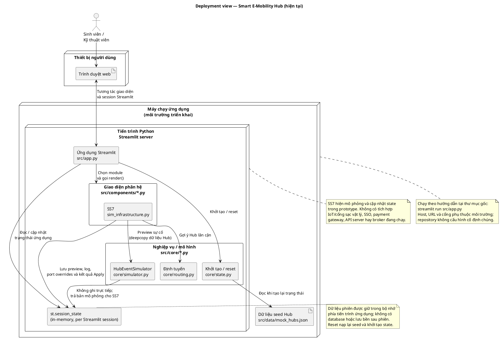
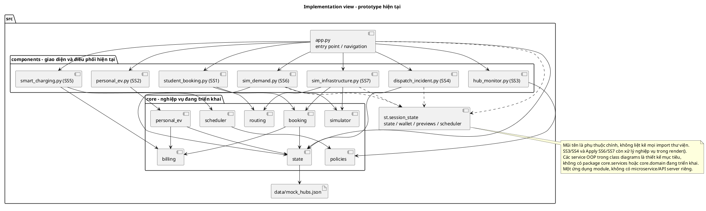
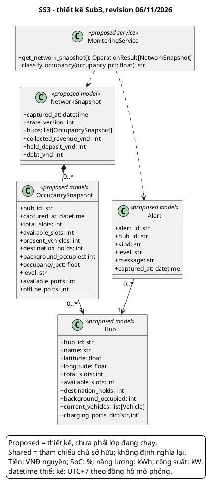

# Submission 3 - Phạm Tiến Đạt - SS3

**MSSV:** 2410724. **Revision:** 06/11/2026. **Trạng thái:** bản tích hợp kỹ thuật, cần chủ sở hữu đọc và xác nhận trước nộp.

Nội dung được bổ sung/chỉnh trong đợt tổng hợp theo yêu cầu trưởng nhóm, có AI hỗ trợ; không ghi nhận thay tác giả rằng họ đã tự làm hoặc tự xác nhận. Nguồn bàn giao cũ giữ trong lịch sử Git.

## 1. Phạm vi

- `UC_SS3_01`: Giám sát mạng lưới Hub, KPI & Doanh thu thời gian thực.
- `UC_SS3_02`: Cảnh báo phân cấp chiếm dụng Hub & Sự cố IoT.

## Kiến trúc chung và trạng thái phiên bản tích hợp

Revision 06/11/2026. Một ứng dụng Python/Streamlit: trình duyệt -> app.py -> components/core -> dữ liệu seed và session ở tiến trình server. Không có database bắt buộc, SSO/IoT/payment thật hay các microservice đang vận hành. Session thuộc từng kết nối Streamlit; reset nạp lại seed; rerun làm mới giao diện, không tạo telemetry nền. Chạy từ repository: `streamlit run src/app.py`; host/cổng phụ thuộc cấu hình, không cố định trong dự án.

## 2. Class diagram SS3

Mô hình OOP là thiết kế đề xuất, trừ HubEventSimulator thực sự tồn tại ở SS6. Service trong sơ đồ là giao tiếp nội bộ, không phải server độc lập.

## 3. Mô tả lớp, thuộc tính và ràng buộc

### `Hub`

Mô hình chuẩn TV3 cho toàn nhóm. Capacity: available+present+holds+background=total, present loại xe IN_USE. Cổng sạc và chỗ đỗ là hai tài nguyên riêng.

Thuộc tính và kiểu: `hub_id: str`, `name: str`, `latitude: float`, `longitude: float`, `total_slots: int`, `available_slots: int`, `destination_holds: int`, `background_occupied: int`, `current_vehicles: list[Vehicle]`, `charging_ports: dict[str,int]`.

### `OccupancySnapshot`

Bản đọc theo thời điểm cho một Hub; không tự cập nhật Hub. available_ports và offline_ports không cộng lẫn vào số phiên đang sạc.

Thuộc tính và kiểu: `hub_id: str`, `captured_at: datetime`, `total_slots: int`, `available_slots: int`, `present_vehicles: int`, `destination_holds: int`, `background_occupied: int`, `occupancy_pct: float`, `level: str`, `available_ports: int`, `offline_ports: int`.

### `NetworkSnapshot`

Bản đọc toàn mạng cùng captured_at/version; KPI tiền dựa trên khoản thu thực, held/debt tách riêng.

Thuộc tính và kiểu: `captured_at: datetime`, `state_version: int`, `hubs: list[OccupancySnapshot]`, `collected_revenue_vnd: int`, `held_deposit_vnd: int`, `debt_vnd: int`.

### `Alert`

Cảnh báo occupancy hoặc offline mô phỏng. Không suy ra đã có cảm biến, popup/push hoặc tự sửa tài nguyên.

Thuộc tính và kiểu: `alert_id: str`, `hub_id: str`, `kind: str`, `level: str`, `message: str`, `captured_at: datetime`.

### `MonitoringService`

Service thiết kế đề xuất; các method bên dưới nêu rõ ánh xạ đến hàm/UI đang có. Lớp sở hữu vòng đời nghiệp vụ, gọi các hợp đồng dùng chung theo quyền sở hữu.

## 4. Mô tả mọi phương thức

Xem [method_catalog.md](method_catalog.md), được nhúng đầy đủ trong PDF. Danh mục có chữ ký, đầu vào/đầu ra, điều kiện, tác động, lỗi và quy tắc gọi lặp cho từng phương thức được vẽ.

## 5. Ánh xạ và giới hạn

Dashboard hiện đọc session tại rerun; không polling IoT/background worker. Doanh thu hiện chỉ đếm SETTLE_RENTAL_FEE/SETTLE_RENTAL_DEBT/PENALTY_NOSHOW, không đủ khoản thu SS2/SS5. Ước tính kW dùng 7.4 và total-available có thể đếm offline; thiết kế phải đọc active sessions. MonitoringService/NetworkSnapshot chưa tồn tại trong code. Yêu cầu phản hồi/mở rộng/bền vững của SRS là mục tiêu, chưa có benchmark hay bằng chứng môi trường sản xuất.

## 6. Chính sách và ranh giới thiết kế

Giữ xe SS1 30 phút từ tạo; hạn SS2 30 phút từ giờ đến. Cọc 50.000, no-show phạt10.000/hoàn40.000 VNĐ. Reroute thêm15 phút miễn phí tối đa một lần, không đổi TTL. Sạc grace15 phút, phí10.000/khối15 phút bắt đầu sau grace; công suất mặc định150 kW/Hub và11 kW/cổng, cấu hình từng test có thể khác. Phí đỗ prototype5.000 VNĐ/lượt khác SRS tính theo giờ, phải ghi chênh lệch. Ownership PERSONAL/SHARED và binding nguồn lực không được trộn.

NFR về bảo mật, dữ liệu bền, phân quyền đồng thời và hiệu năng là mục tiêu thiết kế. Prototype per-session không chứng minh tính nhất quán toàn mạng giữa nhiều phiên; thiết kế tương lai cần shared storage/transaction/version và authorization thật. Đề không bắt buộc thêm database cho Sub3.

## 7. Truy vết, test, đóng góp và AI

