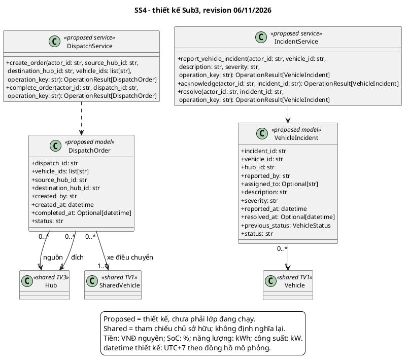

# Submission 3 - Đặng Hoàng Quý Nhân - SS4

**MSSV:** 2412401. **Revision:** 06/11/2026. **Trạng thái:** bản tích hợp kỹ thuật, cần chủ sở hữu đọc và xác nhận trước nộp.

Nội dung được bổ sung/chỉnh trong đợt tổng hợp theo yêu cầu trưởng nhóm, có AI hỗ trợ; không ghi nhận thay tác giả rằng họ đã tự làm hoặc tự xác nhận. Nguồn bàn giao cũ giữ trong lịch sử Git.

## 1. Phạm vi

- `UC_SS4_01`: Lập lệnh điều chuyển phương tiện cân bằng phụ tải.
- `UC_SS4_02`: Báo cáo, tiếp nhận xử lý và khắc phục sự cố phương tiện.

## Kiến trúc chung và trạng thái phiên bản tích hợp

Revision 06/11/2026. Một ứng dụng Python/Streamlit: trình duyệt -> app.py -> components/core -> dữ liệu seed và session ở tiến trình server. Không có database bắt buộc, SSO/IoT/payment thật hay các microservice đang vận hành. Session thuộc từng kết nối Streamlit; reset nạp lại seed; rerun làm mới giao diện, không tạo telemetry nền. Chạy từ repository: `streamlit run src/app.py`; host/cổng phụ thuộc cấu hình, không cố định trong dự án.

## 2. Class diagram SS4

Mô hình OOP là thiết kế đề xuất, trừ HubEventSimulator thực sự tồn tại ở SS6. Service trong sơ đồ là giao tiếp nội bộ, không phải server độc lập.

## 3. Mô tả lớp, thuộc tính và ràng buộc

### `DispatchOrder`

Lệnh gom xe dùng chung, CREATED/IN_TRANSIT/COMPLETED theo thiết kế; prototype tạo thẳng IN_TRANSIT. Hai Hub khác nhau, danh sách xe không trùng.

Thuộc tính và kiểu: `dispatch_id: str`, `vehicle_ids: list[str]`, `source_hub_id: str`, `destination_hub_id: str`, `created_by: str`, `created_at: datetime`, `completed_at: Optional[datetime]`, `status: str`.

### `VehicleIncident`

Sự cố phương tiện REPORTED/ACKNOWLEDGED/RESOLVED, ghi người xử lý và thời điểm. previous_status là bổ sung thiết kế cho khôi phục an toàn.

Thuộc tính và kiểu: `incident_id: str`, `vehicle_id: str`, `hub_id: str`, `reported_by: str`, `assigned_to: Optional[str]`, `description: str`, `severity: str`, `reported_at: datetime`, `resolved_at: Optional[datetime]`, `previous_status: VehicleStatus`, `status: str`.

### `DispatchService`

Service thiết kế đề xuất; các method bên dưới nêu rõ ánh xạ đến hàm/UI đang có. Lớp sở hữu vòng đời nghiệp vụ, gọi các hợp đồng dùng chung theo quyền sở hữu.

### `IncidentService`

Service thiết kế đề xuất; các method bên dưới nêu rõ ánh xạ đến hàm/UI đang có. Lớp sở hữu vòng đời nghiệp vụ, gọi các hợp đồng dùng chung theo quyền sở hữu.

## 4. Mô tả mọi phương thức

Xem [method_catalog.md](method_catalog.md), được nhúng đầy đủ trong PDF. Danh mục có chữ ký, đầu vào/đầu ra, điều kiện, tác động, lỗi và quy tắc gọi lặp cho từng phương thức được vẽ.

## 5. Ánh xạ và giới hạn

Logic đang nằm trong components/dispatch_incident.render, không có DispatchService/IncidentService. Prototype có thêm thao tác sự cố cổng tổng hợp; bản thiết kế VehicleIncident chỉ sở hữu xe, ảnh hưởng cổng phải qua SS5/SS7. Prototype khi resolve đưa xe về AVAILABLE trực tiếp; thiết kế bổ sung previous_status và kiểm tra booking/charging. Chưa có thao tác hủy lệnh, cơ chế phân quyền phía server hay transaction đồng thời nhiều người dùng.

## 6. Chính sách và ranh giới thiết kế

Giữ xe SS1 30 phút từ tạo; hạn SS2 30 phút từ giờ đến. Cọc 50.000, no-show phạt10.000/hoàn40.000 VNĐ. Reroute thêm15 phút miễn phí tối đa một lần, không đổi TTL. Sạc grace15 phút, phí10.000/khối15 phút bắt đầu sau grace; công suất mặc định150 kW/Hub và11 kW/cổng, cấu hình từng test có thể khác. Phí đỗ prototype5.000 VNĐ/lượt khác SRS tính theo giờ, phải ghi chênh lệch. Ownership PERSONAL/SHARED và binding nguồn lực không được trộn.

NFR về bảo mật, dữ liệu bền, phân quyền đồng thời và hiệu năng là mục tiêu thiết kế. Prototype per-session không chứng minh tính nhất quán toàn mạng giữa nhiều phiên; thiết kế tương lai cần shared storage/transaction/version và authorization thật. Đề không bắt buộc thêm database cho Sub3.

## 7. Truy vết, test, đóng góp và AI

