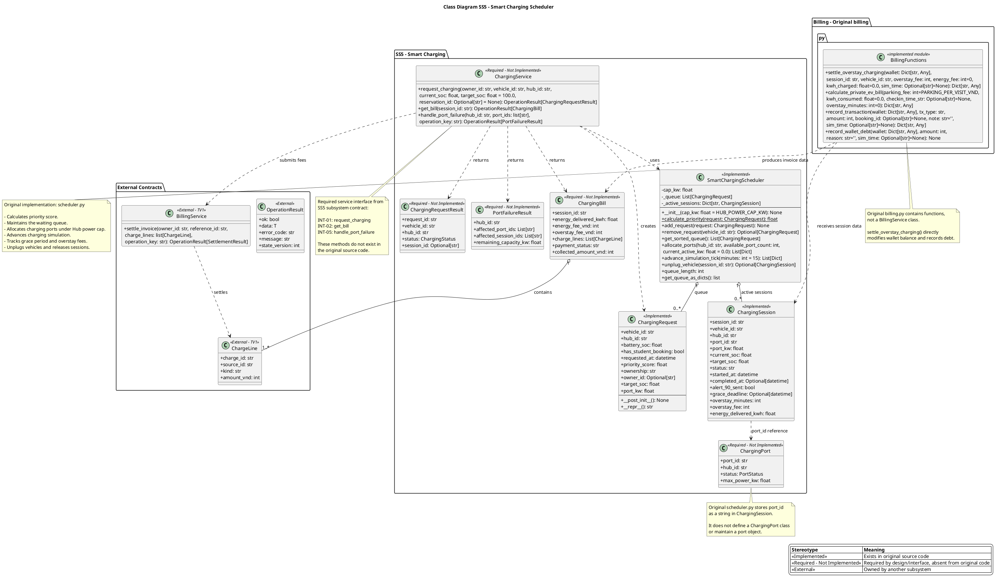

# Submission 3 — Dương Đăng Khoa — SS5

> **Revision tích hợp06/11/2026:** có chỉnh sửa với Codex hỗ trợ; chủ sở hữu cần xác nhận bản mới. Truy vết/test/catalog revision này được dùng khi khác nhận định của bản bàn giao trước.

**MSSV:** 2411589  
**Phân hệ:** SS5 — Lập lịch, phiên sạc và phí quá giờ  
**Trạng thái:** DRAFT — ĐÃ HOÀN THIỆN NỘI DUNG, CHỜ KIỂM TRA KẾT QUẢ TEST VÀ XUẤT PDF  
**Khoảng thực hiện:** 21/10/2026–30/10/2026

[Hướng dẫn và phân công](../../../../GUIDANCE_FOR_SUB_3.md) · [Quyết định dùng chung](../shared/shared_contracts.md)

---

## 1. Phạm vi và đóng góp

Phân hệ SS5 phụ trách lập lịch sạc, quản lý phiên sạc và xử lý phí quá giờ tại các hub sạc.

Các use case thuộc phạm vi cá nhân:

- **UC_SS5_01** — Lập lịch sạc tự động theo điểm ưu tiên và giới hạn công suất lưới.
- **UC_SS5_02** — Giám sát hàng chờ sạc, hoàn thành phiên sạc, thời gian ân hạn và phí quá giờ.

**Đóng góp thực tế của cá nhân:**

- Xây dựng và hoàn thiện thuật toán tính điểm ưu tiên cho yêu cầu sạc.
- Xây dựng cơ chế xếp hàng và cấp cổng sạc theo thứ tự ưu tiên.
- Xử lý giới hạn tổng công suất sạc của hub.
- Xây dựng mô hình phiên sạc và mô phỏng tiến trình sạc.
- Xử lý thông báo khi SoC đạt ngưỡng 90% và khi sạc hoàn thành.
- Xử lý thời gian ân hạn và phí quá giờ.
- Xây dựng class diagram SS5 và mô tả trách nhiệm, thuộc tính, phương thức.
- Xây dựng nội dung truy vết, test case và tự kiểm tra phân hệ.
- Đối chiếu thiết kế SS5 với các giao tiếp dùng chung của nhóm.

Phân hệ SS5 được xây dựng theo hướng mô phỏng trong ứng dụng Python/Streamlit. Các giao tiếp ChargingService và một số kiểu dữ liệu dùng chung được mô tả theo hợp đồng kiến trúc; cần phân biệt rõ phần đã triển khai trong mã nguồn với phần thiết kế đề xuất.

## 2. Deployment view

[Nguồn sơ đồ triển khai chung](../../../diagrams/submission_3/shared/deployment.puml)

### Vị trí phân hệ SS5

SS5 nằm trong ứng dụng Smart E-Mobility Hub, được triển khai cùng ứng dụng Python/Streamlit. Phân hệ không phải một microservice độc lập và không có tiến trình triển khai riêng.

### Thiết bị/tiến trình, dữ liệu và giao tiếp

- **Presentation:** giao diện Streamlit trong `src/components/smart_charging.py`.
- **Application/Core:** thuật toán lập lịch, hàng chờ, phiên sạc và xử lý phí.
- **State:** dữ liệu mô phỏng được lưu trong `st.session_state`.
- **Giao tiếp nội bộ:** các module Python gọi trực tiếp nhau trong cùng ứng dụng.
- **Giao tiếp với SS2:** theo hợp đồng ChargingService để yêu cầu sạc và truy vấn hóa đơn.
- **Giao tiếp với SS7:** theo hợp đồng xử lý sự cố cổng sạc.
- **Giao tiếp với TV1:** theo hợp đồng BillingService để chuyển các khoản phí cần thanh toán.

### Mô phỏng và giới hạn hiện tại

Ứng dụng hiện mô phỏng quá trình sạc, cập nhật SoC, trạng thái cổng và phiên sạc. Không khẳng định hệ thống đang kết nối trực tiếp với thiết bị IoT, trạm sạc vật lý hoặc hệ thống thanh toán thực tế.

Các dữ liệu mô phỏng được lưu trong session state của Streamlit. Vì vậy, không mô tả dữ liệu SS5 hiện tại là dữ liệu được lưu bền vững trong cơ sở dữ liệu.

## 3. Development/Implementation view

[Nguồn sơ đồ module chung](../../../diagrams/submission_3/shared/implementation.puml)

### Module giao diện hiện tại

`src/components/smart_charging.py`

Module này chịu trách nhiệm khởi tạo và hiển thị giao diện quản lý sạc, hàng chờ, phiên sạc và quá giờ.

### Core/service/adapter và phụ thuộc

| Module | Trách nhiệm |
|---|---|
| `src/core/scheduler.py` | Định nghĩa yêu cầu sạc, phiên sạc và thuật toán lập lịch |
| `src/core/policies.py` | Cung cấp chính sách công suất, phí quá giờ và đơn giá điện |
| `src/core/billing.py` | Cung cấp các hàm xử lý giao dịch và phí |
| `src/core/state.py` | Cung cấp cơ chế cập nhật phiên bản state |
| `src/components/smart_charging.py` | Kết nối giao diện với các chức năng SS5 |

### Ánh xạ code hiện tại / thiết kế đề xuất

**Đã triển khai trong mã nguồn:**

- `ChargingRequest`
- `ChargingSession`
- `SmartChargingScheduler`
- Các hàm xử lý phí trong `billing.py`
- Giao diện quản lý sạc trong `smart_charging.py`

**Thiết kế theo hợp đồng kiến trúc, chưa được khẳng định là đã triển khai:**

- `ChargingService`
- `ChargingRequestResult`
- `ChargingPort`
- `ChargingBill`
- `PortFailureResult`
- `BillingService` của TV1

Trong code hiện tại, giao diện SS5 gọi trực tiếp hàm `settle_overstay_charging()` từ module billing. Đây là điểm cần phân biệt với kiến trúc mục tiêu, trong đó SS5 tính phí và chuyển các khoản phí sang BillingService của TV1 để xử lý thanh toán.

## 4. Class diagram cá nhân

[Nguồn class diagram SS5](../../../diagrams/submission_3/SS5/class_diagram.puml)



Class diagram SS5 thể hiện các lớp và kiểu dữ liệu chính của phân hệ:

- `ChargingRequest`
- `ChargingRequestResult`
- `ChargingSession`
- `ChargingPort`
- `ChargingBill`
- `PortFailureResult`
- `ChargingService`
- `SmartChargingScheduler`

Các lớp dùng chung hoặc thuộc phân hệ khác được tham chiếu theo đúng chủ sở hữu, không tạo bản sao định nghĩa.

### Phân biệt mức triển khai

| Lớp | Mức triển khai |
|---|---|
| `ChargingRequest` | Đã triển khai |
| `ChargingSession` | Đã triển khai |
| `SmartChargingScheduler` | Đã triển khai |
| `ChargingRequestResult` | Kiểu dữ liệu theo hợp đồng, đề xuất |
| `ChargingPort` | Kiểu dữ liệu theo hợp đồng, đề xuất |
| `ChargingBill` | Kiểu dữ liệu theo hợp đồng, đề xuất |
| `PortFailureResult` | Kiểu dữ liệu theo hợp đồng, đề xuất |
| `ChargingService` | Service theo hợp đồng, đề xuất |

Trong mã hiện tại, cổng sạc được biểu diễn bằng các ID và dữ liệu trạng thái, chưa có lớp `ChargingPort` độc lập.

## 5. Mô tả lớp

### 5.1. ChargingRequest

- **Trách nhiệm:** biểu diễn yêu cầu sạc đang chờ cấp cổng.
- **Mức triển khai:** đã triển khai.
- **Thuộc tính:** `vehicle_id`, `hub_id`, `battery_soc`, `has_student_booking`, `requested_at`, `priority_score`, `ownership`, `owner_id`, `target_soc`, `port_kw`.
- **Quan hệ:** được `SmartChargingScheduler` tiếp nhận và sắp xếp.
- **Invariant:** SoC nằm trong phạm vi 0–100; yêu cầu phải có thông tin hub và vehicle hợp lệ.
- **Phương thức:** `__post_init__()`, `__repr__()`.

### 5.2. ChargingRequestResult

- **Trách nhiệm:** trả kết quả tiếp nhận yêu cầu sạc cho bên gọi.
- **Mức triển khai:** đề xuất theo hợp đồng.
- **Thuộc tính:** `request_id`, `vehicle_id`, `hub_id`, `status`, `session_id`.
- **Quan hệ:** kết quả của `ChargingService.request_charging()`.
- **Invariant:** yêu cầu đang chờ chưa có phiên sạc thì `session_id` không được gán.

### 5.3. ChargingSession

- **Trách nhiệm:** lưu trạng thái và dữ liệu của phiên sạc.
- **Mức triển khai:** đã triển khai.
- **Thuộc tính:** `session_id`, `vehicle_id`, `hub_id`, `port_id`, `port_kw`, `current_soc`, `target_soc`, `status`, `started_at`, `completed_at`, `alert_90_sent`, `grace_deadline`, `overstay_minutes`, `overstay_fee`, `energy_delivered_kwh`.
- **Quan hệ:** được `SmartChargingScheduler` quản lý trong danh sách phiên đang hoạt động.
- **Invariant:** một xe không được có nhiều phiên sạc hoạt động đồng thời; SoC nằm trong 0–100.
- **Phương thức:** các phương thức quản lý phiên được thực hiện bởi scheduler.

### 5.4. ChargingPort

- **Trách nhiệm:** biểu diễn cổng sạc và trạng thái khả dụng.
- **Mức triển khai:** đề xuất theo hợp đồng.
- **Thuộc tính dự kiến:** `port_id`, `hub_id`, `power_kw`, `status`, `session_id`.
- **Quan hệ:** thuộc một hub; có thể được một phiên sạc chiếm dụng.
- **Invariant:** cổng đang bận không được cấp cho phiên khác.

### 5.5. ChargingBill

- **Trách nhiệm:** biểu diễn thông tin phí điện và phí quá giờ của phiên sạc.
- **Mức triển khai:** đề xuất theo hợp đồng.
- **Thuộc tính:** `session_id`, `energy_delivered_kwh`, `energy_fee_vnd`, `overstay_fee_vnd`, `charge_lines`, `payment_info`.
- **Quan hệ:** được cung cấp cho SS2 thông qua `ChargingService.get_bill()`.
- **Invariant:** hóa đơn chỉ cung cấp dữ liệu tính phí; không tự thực hiện trừ tiền ví.

### 5.6. PortFailureResult

- **Trách nhiệm:** trả kết quả xử lý sự cố cổng sạc.
- **Mức triển khai:** đề xuất theo hợp đồng.
- **Thuộc tính:** `hub_id`, `affected_port_ids`, `affected_session_ids`, `resulting_capacity`.
- **Quan hệ:** kết quả của `ChargingService.handle_port_failure()`.
- **Invariant:** sự cố cổng sạc không tự động thay đổi trạng thái chỗ đỗ xe.

### 5.7. ChargingService

- **Trách nhiệm:** cung cấp giao tiếp SS5 cho các phân hệ khác.
- **Mức triển khai:** thiết kế theo hợp đồng, chưa khẳng định đã triển khai.
- **Phương thức chính:**
  - `request_charging(...)`
  - `get_bill(session_id)`
  - `handle_port_failure(...)`
- **Quan hệ:** SS2 gọi yêu cầu sạc và truy vấn hóa đơn; SS7 gọi xử lý sự cố cổng.

### 5.8. SmartChargingScheduler

- **Trách nhiệm:** tính điểm ưu tiên, quản lý hàng chờ, cấp cổng, giới hạn công suất và tiến trình phiên sạc.
- **Mức triển khai:** đã triển khai.
- **Thuộc tính:** `cap_kw`, `_queue`, `_active_sessions`.
- **Quan hệ:** quản lý `ChargingRequest` và `ChargingSession`.
- **Invariant:** tổng công suất các phiên sạc được cấp không vượt quá công suất giới hạn của hub.
- **Phương thức:** `calculate_priority()`, `add_request()`, `remove_request()`, `get_sorted_queue()`, `allocate_ports()`, `advance_simulation_tick()`, `unplug_vehicle()`.

## 6. Mô tả phương thức

### 6.1. ChargingRequest

**`__post_init__()`**

- Tự tính điểm ưu tiên khi yêu cầu chưa có điểm.
- Dữ liệu tác động: `priority_score`.
- Tiền điều kiện: đối tượng yêu cầu sạc đã được tạo.
- Hậu điều kiện: điểm ưu tiên được tính theo chính sách SS5.

**`__repr__()`**

- Trả chuỗi biểu diễn yêu cầu sạc.
- Không thay đổi trạng thái.

### 6.2. SmartChargingScheduler

**`__init__(cap_kw)`**

- Khởi tạo scheduler với giới hạn công suất.
- Tạo hàng chờ và danh sách phiên sạc đang hoạt động.

**`calculate_priority(request)`**

- Tính điểm ưu tiên theo SoC và trạng thái đặt chỗ sinh viên.
- Công thức:

`0.5 * (100 - SoC) + 100 * I(SoC < 20) + 60 * I(has_student_booking) + 30 * I(SoC < 50)`

- SoC càng thấp thì điểm ưu tiên càng cao.
- Yêu cầu SoC dưới 20 được cộng điểm ưu tiên khẩn cấp.
- Yêu cầu có booking sinh viên được cộng điểm ưu tiên.
- Yêu cầu SoC dưới 50 được cộng thêm điểm.

**`add_request(request)`**

- Tiếp nhận yêu cầu sạc vào hàng chờ.
- Loại yêu cầu trùng xe trước khi thêm.
- Tính lại điểm ưu tiên.

**`remove_request(vehicle_id)`**

- Loại yêu cầu của xe khỏi hàng chờ.
- Không tạo phiên sạc.

**`get_sorted_queue()`**

- Trả hàng chờ theo điểm ưu tiên giảm dần.
- Nếu điểm bằng nhau, ưu tiên thời điểm yêu cầu sớm hơn; tiếp theo là `vehicle_id` để bảo đảm thứ tự xác định.

**`allocate_ports(hub_id, available_port_count, current_active_kw)`**

- Xét các yêu cầu thuộc hub.
- Kiểm tra cổng còn khả dụng và tổng công suất hiện tại.
- Chỉ cấp phiên nếu không vượt giới hạn công suất.
- Yêu cầu chưa được cấp tiếp tục ở hàng chờ.

**`advance_simulation_tick(minutes)`**

- Cập nhật năng lượng và SoC của các phiên sạc.
- Phát sự kiện khi SoC đạt 90%.
- Khi SoC đạt 100%, bắt đầu thời gian ân hạn.
- Khi hết ân hạn mà xe vẫn chiếm cổng, chuyển sang trạng thái quá giờ và tính phí.

**`unplug_vehicle(session_id)`**

- Kết thúc phiên sạc và giải phóng phiên khỏi danh sách đang hoạt động.

**`queue_length`**

- Trả số lượng yêu cầu đang chờ.

**`get_queue_as_dicts()`**

- Trả hàng chờ dưới dạng danh sách dictionary phục vụ giao diện.

### 6.3. ChargingService — thiết kế theo hợp đồng

**`request_charging(owner_id, vehicle_id, hub_id, current_soc, target_soc=100, reservation_id=None)`**

- Bên gọi: SS2.
- Tiếp nhận yêu cầu sạc sau check-in hợp lệ.
- Kiểm tra dữ liệu, tránh tạo yêu cầu trùng cho cùng chuyến/xe.
- Kết quả: `OperationResult[ChargingRequestResult]`.

**`get_bill(session_id)`**

- Bên gọi: SS2/SS3.
- Trả dữ liệu đo lường và phí điện/phí quá giờ.
- Không tự trừ tiền.
- Kết quả: `OperationResult[ChargingBill]`.

**`handle_port_failure(hub_id, port_ids, operation_key)`**

- Bên gọi: TV7 thông qua SimulationCoordinator.
- Xử lý các cổng gặp sự cố và trả danh sách phiên bị ảnh hưởng.
- Không thay đổi chỗ đỗ xe chỉ vì cổng sạc gặp sự cố.
- Kết quả: `OperationResult[PortFailureResult]`.

### 6.4. BillingService — giao tiếp bên ngoài SS5

**`settle_invoice(owner_id, reference_id, charge_lines, operation_key)`**

- Chủ sở hữu: TV1.
- SS5 cung cấp các khoản phí cần thu; TV1 chịu trách nhiệm xử lý ví và thanh toán.
- Cần hỗ trợ xử lý lặp an toàn theo `operation_key` và ID khoản phí.

### 6.5. Các hàm billing hiện tại

**`settle_overstay_charging(...)`**

- Tính và ghi nhận phí quá giờ/điện theo luồng hiện tại.
- Trong code hiện tại có thao tác trực tiếp với wallet.
- Đây là khác biệt so với kiến trúc mục tiêu, trong đó TV1 quản lý việc thu tiền.

**`calculate_private_ev_bill(...)`**

- Tính phí cho phiên sạc xe điện theo dữ liệu đầu vào.
- Không được xem là một phương thức của `ChargingService` nếu chưa được đưa vào class diagram.

**`record_transaction(...)` và `record_wallet_debt(...)`**

- Ghi nhận giao dịch và khoản nợ ví theo luồng billing hiện tại.
- Cần đối chiếu với trách nhiệm BillingService trong kiến trúc chung.

## 7. Truy vết Sub1-Sub2-Sub3 (revision tích hợp)


ID US/FR lấy từ SRS, UC và đường dẫn scenario/sequence/activity kế thừa manifest Sub2. Các tên alias cũ trong trường functions của Sub2 không chứng minh code có method tương ứng; bảng này dùng tên hiện tại.

## UC_SS5_01 - Lập lịch sạc tự động theo điểm ưu tiên & Giới hạn công suất lưới

- **Yêu cầu:** US-10, US-12, US-18, US-20, FR-04, FR-09, FR-11.
- **Scenario:** [UC_SS5_DuongDangKhoa.md](<../../../../docs/diagrams/Use-case detail-scenario/SS5/Usecase scenario/UC_SS5_DuongDangKhoa.md>).
- **Sequence:** [UC_SS5_01_DuongDangKhoa_sequence.puml](<../../../../docs/diagrams/Use-case detail-scenario/SS5/Sequence diagrams/UC_SS5_01_DuongDangKhoa_sequence.puml>).
- **Activity:** [UC_SS5_01_DuongDangKhoa_activity.puml](<../../../../docs/diagrams/Use-case detail-scenario/SS5/Activity diagrams/UC_SS5_01_DuongDangKhoa_activity.puml>).
- **Thiết kế:** `SmartChargingScheduler.calculate_priority`, `SmartChargingScheduler.allocate_ports`, `ChargingService.request_charging`. Class diagram SS5, catalog cùng thư mục.
- **Luồng truy vết:** kiểm tra điều kiện/nhánh lỗi ở scenario và sequence/activity tương ứng -> phương thức phụ trách ở trên -> test prototype bên dưới; không tự đặt số bước nếu nguồn chưa có đánh số ổn định.
- **Test prototype:** `tests/test_scheduler_and_charging.py::test_priority_scores_matching_plan_specification`, `tests/test_scheduler_and_charging.py::test_deterministic_tie_breaking`, `tests/test_scheduler_and_charging.py::test_allocation_and_power_cap`, `tests/test_submission_2_readiness_fixes.py::test_r09_repeated_charging_allocation_obeys_power_cap`.
- **Trạng thái:** thiết kế đã rà soát kỹ thuật; chủ sở hữu chờ xác nhận. Test core/UI hiện có không xác nhận service đề xuất đã được tích hợp đầy đủ.

## UC_SS5_02 - Giám sát hàng chờ sạc, hoàn thành, ân hạn & Tính phí quá giờ

- **Yêu cầu:** US-12, US-19, US-19b, FR-05b, FR-10, FR-10b, FR-15b.
- **Scenario:** [UC_SS5_DuongDangKhoa.md](<../../../../docs/diagrams/Use-case detail-scenario/SS5/Usecase scenario/UC_SS5_DuongDangKhoa.md>).
- **Sequence:** [UC_SS5_02_DuongDangKhoa_sequence.puml](<../../../../docs/diagrams/Use-case detail-scenario/SS5/Sequence diagrams/UC_SS5_02_DuongDangKhoa_sequence.puml>).
- **Activity:** [UC_SS5_02_DuongDangKhoa_activity.puml](<../../../../docs/diagrams/Use-case detail-scenario/SS5/Activity diagrams/UC_SS5_02_DuongDangKhoa_activity.puml>).
- **Thiết kế:** `SmartChargingScheduler.advance_simulation_tick`, `SmartChargingScheduler.unplug_vehicle`, `ChargingService.get_bill`. Class diagram SS5, catalog cùng thư mục.
- **Luồng truy vết:** kiểm tra điều kiện/nhánh lỗi ở scenario và sequence/activity tương ứng -> phương thức phụ trách ở trên -> test prototype bên dưới; không tự đặt số bước nếu nguồn chưa có đánh số ổn định.
- **Test prototype:** `tests/test_scheduler_and_charging.py::test_simulation_tick_and_overstay`, `tests/test_submission_2_acceptance.py::test_charging_completion_notification_survives_rerun_and_receipt_is_recorded`, `tests/test_submission_2_readiness_fixes.py::test_r11_overstay_charging_settlement_and_debt`.
- **Trạng thái:** thiết kế đã rà soát kỹ thuật; chủ sở hữu chờ xác nhận. Test core/UI hiện có không xác nhận service đề xuất đã được tích hợp đầy đủ.


## 8. Test case bonus

Các test case bonus được xây dựng để kiểm tra thuật toán ưu tiên, thứ tự cấp cổng, giới hạn công suất và tiến trình phiên sạc.

### TC-SS5-B01 — Kiểm tra thứ tự ưu tiên và cấp cổng

- **UC:** UC_SS5_01
- **Đầu vào:** giới hạn công suất 20 kW; ba yêu cầu sạc có SoC lần lượt 5%, 30% có booking, 30% không booking; công suất mỗi yêu cầu 7.4 kW.
- **Kết quả mong đợi:** điểm ưu tiên lần lượt 177.5, 125.0, 65.0; cấp hai yêu cầu đầu tiên; yêu cầu còn lại tiếp tục chờ.
- **Trạng thái:** Đã thiết kế; chưa xác nhận PASS bằng kết quả chạy thực tế.

### TC-SS5-B02 — Kiểm tra vượt giới hạn công suất

- **UC:** UC_SS5_01
- **Đầu vào:** giới hạn 20 kW; hai yêu cầu sạc, mỗi yêu cầu 11 kW.
- **Kết quả mong đợi:** chỉ cấp một phiên sạc; yêu cầu thứ hai tiếp tục chờ do không đủ công suất.
- **Trạng thái:** Đã thiết kế; chưa xác nhận PASS bằng kết quả chạy thực tế.

### TC-SS5-B03 — Kiểm tra hoàn thành và phí quá giờ

- **UC:** UC_SS5_02
- **Đầu vào:** phiên sạc SoC 98%, công suất 7.4 kW; mô phỏng 15 phút, tiếp tục 15 phút, rồi thêm 5 phút.
- **Kết quả mong đợi:** chuyển sang grace period khi đạt 100%; hết 15 phút ân hạn chuyển sang quá giờ; phí một block là 10.000 VND; thao tác rút xe giải phóng phiên.
- **Trạng thái:** Đã thiết kế; chưa xác nhận PASS bằng kết quả chạy thực tế.

### TC-SS5-B04 — Rút xe trong thời gian ân hạn

- **UC:** UC_SS5_02
- **Đầu vào:** phiên sạc SoC 98%, công suất 7.4 kW; mô phỏng 15 phút để đạt trạng thái ân hạn; rút xe trước khi hết ân hạn.
- **Kết quả mong đợi:** phiên được kết thúc; cổng được giải phóng; không phát sinh phí quá giờ.
- **Trạng thái:** Test case đề xuất; cần kiểm tra lại với yêu cầu và mã nguồn trước khi xác nhận.

Test source: `tests/test_scheduler_and_charging.py`

Lệnh chạy:

```bash
pytest -v tests/test_scheduler_and_charging.py
```

Chỉ ghi trạng thái PASS khi có kết quả thực thi thành công. Không suy ra PASS từ việc test case đã được viết.

## 9. Giới hạn và quyết định thiết kế

### Quyết định áp dụng

- SS5 quản lý hàng chờ, ưu tiên, cấp cổng, công suất, phiên sạc và phí điện/phí quá giờ.
- SS2 chịu trách nhiệm luồng booking/check-in; SS5 tiếp nhận yêu cầu sạc theo hợp đồng.
- SS7 điều phối mô phỏng và sự cố cổng theo hợp đồng.
- TV1 sở hữu trách nhiệm xử lý thanh toán ví.
- SS5 không tạo bản sao các lớp dùng chung và không tự định nghĩa lại Hub.
- Các đơn vị sử dụng thống nhất: SoC %, công suất kW, năng lượng kWh, tiền VND.
- Thời gian ân hạn 15 phút và phí quá giờ theo block 15 phút, 10.000 VND/block được giữ độc lập với hold booking 30 phút của SS2.

### Giới hạn thuộc phân hệ

- Mô phỏng sạc hiện sử dụng dữ liệu trong session state của Streamlit.
- Không xác nhận có tích hợp IoT thật hoặc thiết bị sạc vật lý.
- Không xác nhận có thanh toán thật.
- Không xác nhận có cơ sở dữ liệu bền vững cho phiên sạc.
- Các giao tiếp ChargingService và xử lý sự cố cổng được mô tả theo hợp đồng kiến trúc; cần đánh dấu rõ phần nào chưa có trong code hiện tại.

### Vấn đề đã tự xử lý / còn mở

- Đã xác định khác biệt giữa luồng billing hiện tại và kiến trúc mục tiêu TV1.
- Đã phân biệt lớp đã triển khai với lớp đề xuất.
- Cần đối chiếu giao tiếp SS2/SS7 và BillingService theo phiên bản hợp đồng chung đã chốt.
- Cần lưu kết quả chạy test thực tế và kiểm tra PDF trước khi bàn giao.

## 10. Tự kiểm tra và khai báo AI


### Xác nhận tự kiểm tra

**CHƯA XÁC NHẬN.**

Tác giả chỉ cập nhật trạng thái xác nhận sau khi tự kiểm tra class diagram, method descriptions, traceability, code mapping, test results và PDF đầu ra.

### Khai báo sử dụng AI

AI được sử dụng để hỗ trợ:

- Tổ chức và hoàn thiện cấu trúc báo cáo theo mẫu Submission 3.
- Hỗ trợ viết mô tả lớp, phương thức, thuật toán và truy vết.
- Hỗ trợ rà soát sự nhất quán giữa code hiện tại và thiết kế đề xuất.
- Hỗ trợ xây dựng test case và checklist tự kiểm tra.

Tác giả chịu trách nhiệm kiểm tra tính chính xác, đối chiếu với mã nguồn và tài liệu nhóm, chạy test, xác nhận kết quả và hoàn thiện bản nộp cuối cùng.

## 11. Bộ file revision tích hợp

PDF chuẩn được build vào output/submission_3/ từ nguồn Markdown/PlantUML cùng revision, kèm catalog, truy vết, test, self-check, AI và kiến trúc chung. Chủ sở hữu cần mở lại, xác nhận và nộp theo quy định LMS đã kiểm chứng.

## Kiến trúc chung và trạng thái phiên bản tích hợp

Revision 06/11/2026. Một ứng dụng Python/Streamlit: trình duyệt -> app.py -> components/core -> dữ liệu seed và session ở tiến trình server. Không có database bắt buộc, SSO/IoT/payment thật hay các microservice đang vận hành. Session thuộc từng kết nối Streamlit; reset nạp lại seed; rerun làm mới giao diện, không tạo telemetry nền. Chạy từ repository: `streamlit run src/app.py`; host/cổng phụ thuộc cấu hình, không cố định trong dự án.


## Hiệu chỉnh tích hợp 06/11/2026

Các chữ ký ChargingService/BillingFunctions được bổ sung kiểu/tham số mặc định đúng code hoặc hợp đồng. Ảnh class_diagram thiếu đuôi được thay bằng PNG/SVG chuẩn từ đúng nguồn. Catalog bổ sung điều kiện, tác động và lỗi mọi phương thức; test mới thiết kế vẫn DESIGNED. Không khẳng định ChargingService đã được tích hợp hoặc billing đã có dedup charge_id. Nguồn DOCX/PDF cũ lưu trong lịch sử Git, không dùng thay bản build mới.
