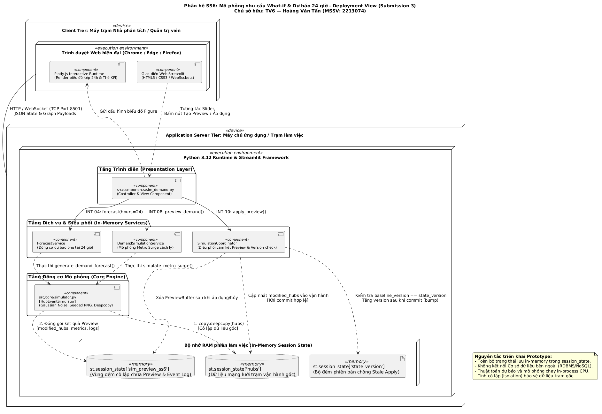
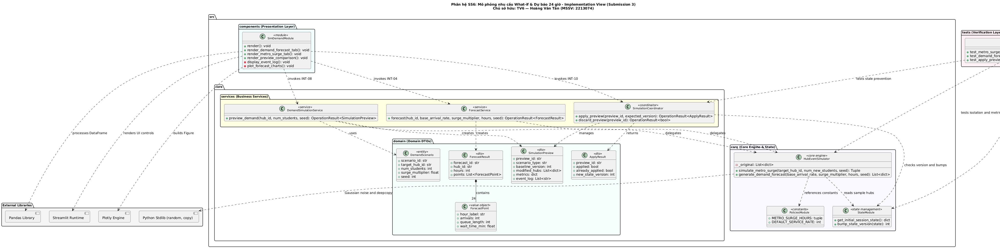

# BÁO CÁO THIẾT KẾ PHẦN MỀM — SUBMISSION 3
## Phân hệ SS6: Mô phỏng nhu cầu What-if & Dự báo 24 giờ

**Dự án:** Smart E-Mobility Hub — BEE BRAVE (Nhóm 7)  
**Môn học:** Công nghệ Phần mềm (CO3001) — Học kỳ 261  
**Sinh viên thực hiện:** Hoàng Văn Tấn  
**Mã số sinh viên (MSSV):** 2213074  
**Phân hệ phụ trách:** SS6 (What-if Metro Surge & 24h Queue / Demand Forecast)  
**Nhiệm vụ nhóm:** TV6 — Tổng hợp Ma trận truy vết 17 Use Case & Danh mục kiểm thử hệ thống  
**Phiên bản tài liệu:** 1.0 (Hoàn thiện Submission 3)  
**Ngày hoàn thành:** 02/11/2026  

---

## 1. Phạm vi và đóng góp cá nhân

### 1.1. Phạm vi Use Case phụ trách
Phân hệ SS6 chịu trách nhiệm kế thừa và đặc tả thiết kế hướng đối tượng cho 2 Use Case cốt lõi từ Submission 2:
1. **`UC_SS6_01` — Mô phỏng tăng đột biến nhu cầu khách Metro (What-if Metro Surge):**
   - *Yêu cầu truy vết:* **US-21** (Mô phỏng tình huống What-if cho nhà phân tích), **FR-12** (Động cơ mô phỏng sự kiện Hub).
   - *Mục tiêu:* Cho phép người vận hành thiết lập đợt tăng vọt hành khách từ tuyến Metro Bến Thành – Suối Tiên đổ về Hub KTX Khu B; đánh giá khả năng dung nạp xe, tỷ lệ lấp đầy trạm, số lượng cổng sạc bị chiếm bởi xe pin yếu (<25%) và ghi nhận chính xác lượng khách không được phục vụ (`unserved_students`) khi trạm hết chỗ.
2. **`UC_SS6_02` — Dự báo phụ tải nhu cầu và phân tích hàng đợi 24h (24-Hour Demand & Queue Forecasting):**
   - *Yêu cầu truy vết:* **US-21**, **US-22** (Dự báo nhu cầu chuỗi thời gian), **FR-12**, **FR-13** (Phân tích hàng đợi và ước tính thời gian chờ).
   - *Mục tiêu:* Cung cấp công cụ dự báo chuỗi thời gian với chân trời dự báo chuẩn hóa **đủ 24 giờ** (`hours=24`), tính toán lượng khách đến theo các khung giờ cao điểm (sáng 7–8h, chiều 17–18h), tích lũy hàng đợi dựa trên tốc độ phục vụ chuẩn 8 xe/giờ và ước tính thời gian chờ trung bình (phút) của sinh viên. Kết quả có tính tái lập hoàn toàn thông qua tham số `seed`.

### 1.2. Đóng góp cá nhân và vai trò trong nhóm
- **Thiết kế chi tiết SS6:** Xây dựng mô hình lớp, phân định ranh giới giữa tầng giao diện (`SimDemandUI`), tầng nghiệp vụ (`DemandSimulationService`, `ForecastService`), tầng điều phối (`SimulationCoordinator`) và tầng adapter kết nối core engine (`HubEventSimulatorAdapter`).
- **Chủ trì hợp đồng dùng chung liên phân hệ:**
  - Thiết kế và chuẩn hóa schema dữ liệu bản xem trước dùng chung `SimulationPreview` cho cả SS6 và SS7.
  - Xây dựng cơ chế `SimulationCoordinator` bảo đảm nguyên tắc commit an toàn: kiểm tra xung đột phiên bản (`state_version`), ngăn chặn áp dụng lặp (`already_applied`) và bảo toàn tính cách ly sâu (`deepcopy isolation`).
  - Chuẩn hóa chữ ký giao tiếp `INT-04`, `INT-08` và `INT-10` theo [GUIDANCE_FOR_SUB_3.md](../../../../GUIDANCE_FOR_SUB_3.md).
- **Trách nhiệm nhóm chung (TV6):**
  - Trực tiếp xây dựng và tổng hợp file chỉ mục truy vết 17 Use Case toàn hệ thống tại [`docs/traceability/submission_3.md`](../../../traceability/submission_3.md).
  - Thu thập, đối chiếu và tổng hợp danh mục kiểm thử từ báo cáo của 7 thành viên, phân định rõ ràng các ca kiểm thử đã chạy thực tế (`PASS`) và các ca kiểm thử mới thiết kế.

---

## 2. Deployment View (Góc nhìn Triển khai)

Sơ đồ triển khai chi tiết của phân hệ SS6 trong mối quan hệ với hạ tầng máy chủ ứng dụng Python/Streamlit và trình duyệt web máy trạm:



*(File nguồn PlantUML: [docs/diagrams/submission_3/SS6/deployment_view.puml](../../../diagrams/submission_3/SS6/deployment_view.puml) · Sơ đồ chung hệ thống: [docs/diagrams/submission_3/shared/deployment.puml](../../../diagrams/submission_3/shared/deployment.puml))*

### 2.1. Vị trí phân hệ SS6 trong kiến trúc triển khai
- **Môi trường chạy:** Ứng dụng nguyên mẫu đơn tiến trình chạy trên nền tảng **Python 3.12 / Streamlit**. Người dùng (Nhà phân tích / Nhà quy hoạch) tương tác thông qua trình duyệt web trên cổng mặc định `8501`.
- **Thành phần thực thi SS6:**
  - `sim_demand.py` chạy trực tiếp trong tiến trình Streamlit Server Worker khi tab phân hệ SS6 được kích hoạt.
  - Toàn bộ thuật toán sinh ngẫu nhiên và tính toán chuỗi thời gian chạy in-memory trên cùng tiến trình CPU, không phụ thuộc vào background worker hay microservice bên ngoài.

```
+-------------------------------------------------------------------------+
| Client Tier (Web Browser)                                               |
| - Chrome / Edge / Firefox (HTML5 / JavaScript Plotly Charts)            |
+-------------------------------------------------------------------------+
                                   │ HTTP / WebSocket (Port 8501)
                                   ▼
+-------------------------------------------------------------------------+
| Application Server (Python / Streamlit Process)                         |
| +---------------------------------------------------------------------+ |
| | Presentation Layer: sim_demand.py (Plotly Graph Objects)            | |
| +---------------------------------------------------------------------+ |
| | Service Layer: DemandSimulationService, ForecastService             | |
| +---------------------------------------------------------------------+ |
| | Coordination Layer: SimulationCoordinator                           | |
| +---------------------------------------------------------------------+ |
| | Core Engine: HubEventSimulator (random.Random seeded, deepcopy)     | |
| +---------------------------------------------------------------------+ |
| | In-Memory Session State (st.session_state)                          | |
| | - hubs (Dữ liệu mạng lưới Hub hiện hành)                             | |
| | - state_version (Phiên bản đồng bộ số nguyên)                       | |
| | - sim_preview_ss6 (Vùng nhớ đệm cô lập chứa Preview)                | |
| +---------------------------------------------------------------------+ |
+-------------------------------------------------------------------------+
```

### 2.2. Vòng đời dữ liệu và Cơ chế cô lập (Deepcopy Isolation)
- Khi chạy mô phỏng Metro Surge, hệ thống thực hiện sao chép sâu (`copy.deepcopy`) dữ liệu `st.session_state["hubs"]`. Toàn bộ các đột biến về chỗ đỗ, xe phát sinh và cổng sạc chỉ diễn ra trên biến tạm.
- Bản xem trước được đóng gói vào `st.session_state["sim_preview_ss6"]`. Dữ liệu vận hành chính thức không bị thay đổi cho đến khi người dùng kích hoạt hành động "Áp dụng" (`apply_preview`).
- Nếu người dùng chuyển tab hoặc bấm nút "Hủy bỏ", vùng đệm preview bị giải phóng mà không để lại tác dụng phụ (side-effect) lên hệ thống.

---

## 3. Development / Implementation View (Góc nhìn Cấu trúc Module)

Sơ đồ cấu trúc tầng và module chi tiết của phân hệ SS6 (giao diện, dịch vụ, mô hình, động cơ mô phỏng và kiểm thử):



*(File nguồn PlantUML: [docs/diagrams/submission_3/SS6/implementation_view.puml](../../../diagrams/submission_3/SS6/implementation_view.puml) · Sơ đồ chung hệ thống: [docs/diagrams/submission_3/shared/implementation.puml](../../../diagrams/submission_3/shared/implementation.puml))*

```
[Presentation Layer]
   │  sim_demand.py (render_demand_forecast, render_metro_surge)
   ▼
[Service & Coordination Layer]
   │  DemandSimulationService (preview_demand) ──┐
   │  ForecastService (forecast 24h)            ├──> SimulationCoordinator
   ▼                                            │    (apply_preview / version check)
[Adapter Layer]                                 │
   │  HubEventSimulatorAdapter                  │
   ▼                                            │
[Core Engine & Domain Layer]                    │
   │  HubEventSimulator (simulate_metro_surge,  │
   │                     generate_demand_fc)    ▼
   │  state.py (bump_state_version, st.session_state["hubs"])
```

### 3.1. Ánh xạ mã nguồn thực tế
1. **Tầng Trình diễn (Presentation):**
   - File [`src/components/sim_demand.py`](../../../../src/components/sim_demand.py): Đảm nhận vẽ giao diện 2 tab, nhận tham số từ các thanh slider, gọi service và trực quan hóa biểu đồ kép (Bar + Scatter Line) thông qua thư viện Plotly.
2. **Tầng Nghiệp vụ & Điều phối (Service & Coordination):**
   - Đề xuất chuẩn hóa thành `DemandSimulationService`, `ForecastService` và `SimulationCoordinator`. Hiện tại trong mã nguồn prototype, logic này được thực thi an toàn thông qua hàm `render()` phối hợp với `HubEventSimulator`.
3. **Tầng Động cơ Mô phỏng (Core Simulation Engine):**
   - File [`src/core/simulator.py`](../../../../src/core/simulator.py): Chứa lớp `HubEventSimulator` với hai phương thức nòng cốt:
     - `simulate_metro_surge()`: Xử lý dung nạp chỗ đỗ, tính unserved, sinh xe ngẫu nhiên và phân bổ cổng sạc.
     - `generate_demand_forecast()`: Tính toán chuỗi thời gian 24 giờ dựa trên tỷ lệ đến cơ bản, hệ số surge và hàm phân phối Gauss.
4. **Tầng Trạng thái hệ thống (State Management):**
   - File [`src/core/state.py`](../../../../src/core/state.py): Cung cấp cơ chế versioning thông qua `bump_state_version()` và khởi tạo `get_initial_session_state()`.

---

## 4. Class Diagram Phân hệ SS6

Sơ đồ lớp chi tiết của phân hệ SS6 thể hiện đầy đủ các thành phần Boundary, Service, Coordinator, Entity/DTO và Core Engine Adapter:


*(File nguồn PlantUML: [docs/diagrams/submission_3/SS6/class_diagram.puml](../../../diagrams/submission_3/SS6/class_diagram.puml))*

### Phân tích kiến trúc sơ đồ:
- **`SimDemandUI`** là lớp ranh giới (Boundary) đóng vai trò điều khiển hiển thị và tiếp nhận tương tác người dùng.
- **`DemandSimulationService`** và **`ForecastService`** độc lập với UI, nhận nhiệm vụ thực thi các kịch bản mô phỏng và dự báo.
- **`SimulationCoordinator`** là bộ điều phối dùng chung cấp hệ thống, nắm quyền quản lý vòng đời của bản xem trước (`SimulationPreview`) và thực hiện thao tác cập nhật dữ liệu an toàn vào danh sách trạm.
- Mô hình tách biệt rõ giữa **DTO đầu ra** (`ForecastResult`, `SimulationPreview`, `ApplyResult`) và **Core Engine** (`HubEventSimulator`), giúp hệ thống dễ dàng thay thế thuật toán mô phỏng trong tương lai mà không ảnh hưởng tới các phân hệ khác.

---

## 5. Mô tả chi tiết Lớp (Class Descriptions)

Tuân thủ quy chuẩn mẫu bảng Mục 6.1 của GUIDANCE:

### 5.1. `SS6-CLS-01`: `DemandScenario`
- **Tên lớp:** `DemandScenario`
- **Trách nhiệm:** Lưu trữ thông số cấu hình của một kịch bản tăng đột biến nhu cầu hành khách Metro.
- **Mức triển khai:** Thiết kế đề xuất (Ánh xạ từ tham số đầu vào trong `sim_demand.py`).
- **Thuộc tính:**
  - `scenario_id` (`str`): Định danh kịch bản (ví dụ: `"SCEN-SURGE-001"`).
  - `target_hub_id` (`str`): Mã Hub chịu tải đột biến (mặc định: `"HUB-002"` - KTX Khu B).
  - `num_students` (`int`): Số lượng sinh viên đến đột biến (khoảng giá trị: `5..100`, đơn vị: người).
  - `surge_multiplier` (`float`): Hệ số nhân đột biến (khoảng giá trị: `1.0..5.0`).
  - `seed` (`int`): Giá trị hạt giống ngẫu nhiên để tái lập kết quả (mặc định: `42`).
  - `created_at` (`datetime`): Thời điểm tạo kịch bản.
- **Quan hệ:** Được sử dụng bởi `DemandSimulationService` để tạo ra `SimulationPreview`.
- **Ràng buộc (Invariant):** `num_students > 0` và `target_hub_id` phải tồn tại trong danh mục trạm của hệ thống.

---

### 5.2. `SS6-CLS-02`: `ForecastPoint`
- **Tên lớp:** `ForecastPoint` (Value Object)
- **Trách nhiệm:** Đại diện cho một điểm dữ liệu dự báo tại một khung giờ cụ thể.
- **Mức triển khai:** Đã có trong mã nguồn (ánh xạ từ phần tử `dict` trong danh sách do `generate_demand_forecast` trả về).
- **Thuộc tính:**
  - `hour_label` (`str`): Nhãn thời gian theo định dạng `"HH:00"` (từ `"06:00"` đến `"05:00"` hôm sau).
  - `arrivals` (`int`): Lượng sinh viên dự báo đến trạm trong giờ (đơn vị: sinh viên, không âm).
  - `queue_length` (`int`): Độ dài hàng đợi tích lũy chưa được phục vụ tại cuối giờ (đơn vị: người, không âm).
  - `wait_time_min` (`float`): Thời gian chờ trung bình ước tính của sinh viên (đơn vị: phút, tính theo công thức `(queue / 8.0) * 60`).
- **Quan hệ:** Là thành phần cấu tạo (Composition `1..*`) bên trong `ForecastResult`.
- **Ràng buộc:** `arrivals >= 0`, `queue_length >= 0`, `wait_time_min >= 0.0`.

---

### 5.3. `SS6-CLS-03`: `ForecastResult`
- **Tên lớp:** `ForecastResult` (DTO)
- **Trách nhiệm:** Đóng gói toàn bộ kết quả dự báo nhu cầu chuỗi thời gian cho một Hub trong 24 giờ.
- **Mức triển khai:** Thiết kế đề xuất chuẩn hóa theo hợp đồng mục 2.3 (`INT-04`).
- **Thuộc tính:**
  - `forecast_id` (`str`): Định danh duy nhất của lượt dự báo.
  - `hub_id` (`str`): Mã Hub được dự báo.
  - `hours` (`int`): Số giờ dự báo, luôn cố định là `24` trong Submission 3.
  - `seed` (`int`): Hạt giống ngẫu nhiên được áp dụng (`42`).
  - `service_rate` (`int`): Tốc độ phục vụ chuẩn của trạm (mặc định: `8` xe/giờ).
  - `assumptions` (`str`): Mô tả các giả định mô hình (giờ cao điểm 7–8h, 17–18h có hệ số 2.5).
  - `points` (`List[ForecastPoint]`): Danh sách chính xác 24 điểm dự báo theo giờ.
  - `peak_hour` (`str`): Giờ có lượng khách đến cao nhất trong ngày.
  - `max_queue` (`int`): Độ dài hàng đợi lớn nhất ghi nhận được.
  - `max_wait_time` (`float`): Thời gian chờ lâu nhất trong ngày (phút).
- **Quan hệ:** Chứa 24 đối tượng `ForecastPoint`. Được trả về bởi `ForecastService.forecast()`.
- **Ràng buộc:** `len(points) == 24`.

---

### 5.4. `SS6-CLS-04`: `SimulationPreview`
- **Tên lớp:** `SimulationPreview` (DTO dùng chung SS6 & SS7)
- **Trách nhiệm:** Chứa bản xem trước kết quả mô phỏng trên dữ liệu cách ly trước khi người dùng quyết định áp dụng vào hệ thống vận hành.
- **Mức triển khai:** Đã có trong mã nguồn (ánh xạ từ `st.session_state["sim_preview_ss6"]`).
- **Thuộc tính:**
  - `preview_id` (`str`): Mã định danh duy nhất (ví dụ: `"PREV-SS6-A1B2C3"`).
  - `scenario_type` (`ScenarioType`): Loại kịch bản (`DEMAND` cho SS6, `PORT_FAILURE` cho SS7).
  - `baseline_version` (`int`): Phiên bản trạng thái hệ thống (`state_version`) tại thời điểm tạo preview.
  - `target_hub_id` (`str`): Mã Hub chịu tác động chính.
  - `modified_hubs` (`List[Dict]`): Bản sao danh sách Hub sau khi chạy thuật toán mô phỏng.
  - `event_log` (`List[str]`): Nhật ký các sự kiện diễn ra trong quá trình mô phỏng.
  - `metrics` (`Dict[str, Any]`): Các chỉ số thống kê kết quả (`admitted_students`, `unserved_students`, `ports_allocated`, `final_occupancy_pct`).
  - `is_applied` (`bool`): Cờ đánh dấu bản xem trước này đã được cam kết hay chưa.
  - `created_at` (`datetime`): Thời điểm sinh preview.
- **Quan hệ:** Được quản lý bởi `SimulationCoordinator`.
- **Ràng buộc:** Dữ liệu trong `modified_hubs` hoàn toàn độc lập với danh sách trạm gốc.

---

### 5.5. `SS6-CLS-05`: `ApplyResult`
- **Tên lớp:** `ApplyResult` (DTO)
- **Trách nhiệm:** Trả về kết quả và trạng thái sau thao tác cam kết bản xem trước vào vận hành.
- **Mức triển khai:** Thiết kế đề xuất chuẩn hóa theo hợp đồng mục 2.3 (`INT-10`).
- **Thuộc tính:**
  - `preview_id` (`str`): Mã preview được áp dụng.
  - `applied` (`bool`): `True` nếu commit thành công; `False` nếu thất bại.
  - `already_applied` (`bool`): `True` nếu preview này trước đó đã được áp dụng rồi (ngăn chặn duplicate apply).
  - `new_state_version` (`int`): Phiên bản trạng thái mới sau khi commit.
  - `message` (`str`): Thông điệp phản hồi cho người dùng.
- **Quan hệ:** Được sinh ra bởi phương thức `SimulationCoordinator.apply_preview()`.

---

### 5.6. `SS6-CLS-06`: `DemandSimulationService`
- **Tên lớp:** `DemandSimulationService` (Service)
- **Trách nhiệm:** Điều phối luồng nghiệp vụ tạo bản xem trước cho kịch bản tăng đột biến nhu cầu sinh viên Metro.
- **Mức triển khai:** Thiết kế đề xuất (bọc logic hiện có trong `sim_demand.py`).
- **Thuộc tính:**
  - `adapter` (`HubEventSimulatorAdapter`): Thành phần kết nối tới động cơ mô phỏng core.
- **Phương thức chính:** `preview_demand(hub_id, num_students, seed) -> OperationResult[SimulationPreview]`.
- **Ràng buộc:** Không được phép ghi trực tiếp vào `st.session_state["hubs"]`.

---

### 5.7. `SS6-CLS-07`: `ForecastService`
- **Tên lớp:** `ForecastService` (Service)
- **Trách nhiệm:** Cung cấp dịch vụ tính toán chuỗi thời gian dự báo phụ tải trạm cho giao diện SS6 và các phân hệ khác (SS3/SS4) tham chiếu (`INT-04`).
- **Mức triển khai:** Thiết kế đề xuất (bọc `HubEventSimulator.generate_demand_forecast`).
- **Thuộc tính:**
  - `adapter` (`HubEventSimulatorAdapter`): Thành phần kết nối tới động cơ dự báo.
- **Phương thức chính:** `forecast(hub_id, base_arrival_rate, surge_multiplier, hours=24, seed=42) -> OperationResult[ForecastResult]`.
- **Ràng buộc:** Chân trời dự báo bắt buộc đủ 24 giờ.

---

### 5.8. `SS6-CLS-08`: `SimulationCoordinator`
- **Tên lớp:** `SimulationCoordinator` (Coordinator dùng chung)
- **Trách nhiệm:** Điều phối việc áp dụng hoặc hủy bỏ bản xem trước mô phỏng của SS6 và SS7, bảo đảm tính toàn vẹn phiên bản và chống áp dụng trùng lặp.
- **Mức triển khai:** Thiết kế đề xuất (chuẩn hóa đoạn mã kiểm tra `baseline_version` trong `sim_demand.py` và `sim_infrastructure.py`).
- **Thuộc tính:**
  - `current_preview` (`Optional[SimulationPreview]`): Bản xem trước đang chờ xử lý trong session.
- **Phương thức chính:**
  - `apply_preview(preview_id, expected_version) -> OperationResult[ApplyResult]`.
  - `discard_preview(preview_id) -> OperationResult[bool]`.
  - `get_current_preview() -> Optional[SimulationPreview]`.
- **Ràng buộc (Invariants):**
  1. Chỉ commit khi `expected_version == st.session_state["state_version"]`.
  2. Mỗi lần commit thành công bắt buộc gọi `bump_state_version()`.
  3. Lời gọi lặp với cùng `preview_id` đã commit phải trả về `already_applied = True`, không cộng dồn tải trạm.

---

### 5.9. `SS6-CLS-09`: `HubEventSimulatorAdapter`
- **Tên lớp:** `HubEventSimulatorAdapter` (Adapter)
- **Trách nhiệm:** Chuyển đổi dữ liệu giữa các kiểu đối tượng miền (`SimulationPreview`, `ForecastResult`) và lớp thuần xử lý mảng/từ điển [`HubEventSimulator`](../../../../src/core/simulator.py).
- **Mức triển khai:** Đã triển khai thông qua class `HubEventSimulator`.

---

## 6. Mô tả chi tiết Phương thức (Method Descriptions)

Tuân thủ quy chuẩn mẫu bảng Mục 6.2 của GUIDANCE cho toàn bộ phương thức xuất hiện trên Class Diagram:

### 6.1. `SS6-MTH-01`: `DemandSimulationService.preview_demand`
- **Chữ ký:**
  ```python
  preview_demand(
      hub_id: str,
      num_students: int,
      seed: int = 42
  ) -> OperationResult[SimulationPreview]
  ```
- **Mục đích và bên gọi:** Tạo bản xem trước kịch bản Metro Surge; được gọi bởi UI `SimDemandUI` khi người vận hành nhấn nút "Chạy mô phỏng Metro Surge".
- **Tham số:**
  - `hub_id` (`str`): Mã Hub đích (ví dụ: `"HUB-002"`).
  - `num_students` (`int`): Số lượng sinh viên đến đột biến (`5 <= num_students <= 100`).
  - `seed` (`int`): Hạt giống ngẫu nhiên (mặc định: `42`).
- **Kết quả trả về:** `OperationResult[SimulationPreview]` chứa DTO bản xem trước kết quả kèm metrics so sánh.
- **Tiền điều kiện:** Hub đích tồn tại trong danh mục trạm; `num_students > 0`.
- **Các bước xử lý:**
  1. Đọc dữ liệu `hubs` hiện hành và `state_version` từ `st.session_state`.
  2. Gọi adapter thực thi `simulate_metro_surge()` với bản sao sâu (`deepcopy`).
  3. Đóng gói kết quả thành đối tượng `SimulationPreview` với `scenario_type = DEMAND`, gán mã `preview_id` mới.
  4. Lưu đối tượng vào vùng nhớ đệm `st.session_state["sim_preview_ss6"]`.
- **Hậu điều kiện:** Dữ liệu trạm gốc giữ nguyên 100%; bản xem trước sẵn sàng để hiển thị so sánh.
- **Lỗi / Ngoại lệ:** Trả về `OperationResult(ok=False, error_code="NOT_FOUND")` nếu không tìm thấy Hub.
- **Truy vết:** `UC_SS6_01` (Bước 2.1–2.4 Sequence Diagram), Code: [`src/components/sim_demand.py`](../../../../src/components/sim_demand.py).

---

### 6.2. `SS6-MTH-02`: `ForecastService.forecast`
- **Chữ ký:**
  ```python
  forecast(
      hub_id: str,
      base_arrival_rate: float,
      surge_multiplier: float,
      hours: int = 24,
      seed: int = 42
  ) -> OperationResult[ForecastResult]
  ```
- **Mục đích và bên gọi:** Tính toán dự báo chuỗi thời gian nhu cầu và hàng đợi; được gọi bởi `SimDemandUI` hoặc các phân hệ `SS3` (Giám sát), `SS4` (Điều phối) theo hợp đồng `INT-04`.
- **Tham số:**
  - `hub_id` (`str`): Mã Hub dự báo.
  - `base_arrival_rate` (`float`): Tỉ lệ đến cơ bản (`5.0 <= rate <= 50.0`, SV/giờ).
  - `surge_multiplier` (`float`): Hệ số nhân đột biến (`1.0 <= mult <= 5.0`).
  - `hours` (`int`): Chân trời dự báo, bắt buộc là `24` giờ trong Sub 3.
  - `seed` (`int`): Hạt giống ngẫu nhiên (`42`).
- **Kết quả trả về:** `OperationResult[ForecastResult]` chứa danh sách chính xác 24 điểm `ForecastPoint`.
- **Tiền điều kiện:** `hours == 24`, `base_arrival_rate > 0`, `surge_multiplier >= 1.0`.
- **Các bước xử lý:**
  1. Khởi tạo bộ sinh số ngẫu nhiên `rng = random.Random(seed)`.
  2. Lặp qua từng mốc giờ `h = 0..23` (tương ứng từ 06:00 đến 05:00 hôm sau):
     - Xác định `peak_factor`: 2.5 (các khung giờ 7, 8, 17, 18h); 1.5 (các khung 9, 16, 19h); 1.0 (các giờ khác).
     - Tính số khách đến: `arrivals = max(0, int(base_rate * peak * surge_mult + rng.gauss(0, 1.5)))`.
     - Cập nhật hàng đợi: `queue = max(0, queue + arrivals - service_rate)` (với tốc độ phục vụ cố định 8 xe/giờ).
     - Tính thời gian chờ: `wait_time = round((queue / 8.0) * 60, 1)`.
  3. Tìm giờ cao điểm `peak_hour`, độ dài hàng đợi lớn nhất `max_queue`, thời gian chờ tối đa `max_wait_time`.
  4. Đóng gói vào `ForecastResult` và trả về kết quả thành công.
- **Hậu điều kiện:** Không tác động tới bất kỳ trạng thái nào trong hệ thống (Hàm thuần túy / Read-only).
- **Lỗi / Ngoại lệ:** Trả về `INVALID_INPUT` nếu tham số ngoài khoảng hợp lệ.
- **Truy vết:** `UC_SS6_02` (Bước 2.1–2.5 Sequence Diagram), Code: [`src/core/simulator.py`](../../../../src/core/simulator.py).

---

### 6.3. `SS6-MTH-03`: `SimulationCoordinator.apply_preview`
- **Chữ ký:**
  ```python
  apply_preview(
      preview_id: str,
      expected_version: int
  ) -> OperationResult[ApplyResult]
  ```
- **Mục đích và bên gọi:** Cam kết dữ liệu mô phỏng từ bản xem trước vào dữ liệu vận hành chính thức của hệ thống; được gọi bởi UI SS6 hoặc SS7 khi người dùng bấm "Áp dụng kết quả". Hợp đồng giao tiếp `INT-10`.
- **Tham số:**
  - `preview_id` (`str`): Mã bản xem trước cần áp dụng.
  - `expected_version` (`int`): Phiên bản trạng thái mà preview được sinh ra (`baseline_version`).
- **Kết quả trả về:** `OperationResult[ApplyResult]`.
- **Tiền điều kiện:** Bản xem trước `preview_id` tồn tại trong session và chưa bị hủy.
- **Các bước xử lý:**
  1. Kiểm tra trạng thái preview: Nếu `preview.is_applied == True`, trả về kết quả thành công với cờ `already_applied = True` ngay lập tức (Chống apply trùng lặp).
  2. Lấy phiên bản hệ thống hiện tại `current_ver = st.session_state["state_version"]`.
  3. Kiểm tra tính đồng bộ phiên bản: Nếu `expected_version != current_ver`, hủy bỏ commit và trả về lỗi `STALE_STATE`.
  4. Nếu phiên bản trùng khớp:
     - Gán dữ liệu trạm mới: `st.session_state["hubs"] = preview.modified_hubs`.
     - Tăng phiên bản hệ thống: `bump_state_version(st.session_state)`.
     - Đánh dấu `preview.is_applied = True`.
     - Xóa bản xem trước khỏi session đệm.
  5. Trả về `ApplyResult(applied=True, already_applied=False, new_state_version=current_ver + 1)`.
- **Hậu điều kiện:** Dữ liệu trạm được cập nhật; `state_version` tăng lên 1 đơn vị; các phân hệ khác (SS1, SS2, SS3) sẽ thấy trạng thái trạm mới ở chu kỳ rerun tiếp theo.
- **Lỗi / Ngoại lệ:**
  - `NOT_FOUND`: Preview không tồn tại.
  - `STALE_STATE`: Dữ liệu trạm đã bị thay đổi bởi phân hệ khác trong lúc người dùng đang xem preview.
- **Truy vết:** `UC_SS6_01` (Bước 3.2 Sequence Diagram), Code: [`src/components/sim_demand.py`](../../../../src/components/sim_demand.py).

---

### 6.4. `SS6-MTH-04`: `SimulationCoordinator.discard_preview`
- **Chữ ký:**
  ```python
  discard_preview(preview_id: str) -> OperationResult[bool]
  ```
- **Mục đích và bên gọi:** Hủy bỏ bản xem trước khi người vận hành không muốn áp dụng kết quả mô phỏng; được gọi bởi nút "Hủy bỏ bản xem trước" trên UI SS6/SS7.
- **Tham số:** `preview_id` (`str`).
- **Kết quả trả về:** `OperationResult[bool]` với `data = True`.
- **Xử lý:** Xóa đối tượng preview khỏi `st.session_state` và làm mới giao diện (`st.rerun()`). Giữ nguyên 100% dữ liệu trạm gốc.

---

### 6.5. `SS6-MTH-05`: `HubEventSimulatorAdapter.simulate_metro_surge`
- **Chữ ký:**
  ```python
  simulate_metro_surge(
      target_hub_id: str,
      num_students: int,
      seed: int
  ) -> Tuple[List[Dict], List[str], Dict[str, Any]]
  ```
- **Mục đích:** Gọi động cơ lõi [`HubEventSimulator.simulate_metro_surge`](../../../../src/core/simulator.py) và chuẩn hóa kiểu dữ liệu trả về cho tầng Service.

---

### 6.6. `SS6-MTH-06`: `HubEventSimulatorAdapter.generate_demand_forecast`
- **Chữ ký:**
  ```python
  generate_demand_forecast(
      base_rate: float,
      surge_mult: float,
      hours: int,
      seed: int
  ) -> List[Dict[str, Any]]
  ```
- **Mục đích:** Gọi động cơ lõi [`HubEventSimulator.generate_demand_forecast`](../../../../src/core/simulator.py) để sinh tập dữ liệu chuỗi thời gian 24 giờ.

---

### 6.7. `SS6-MTH-07`: `SimDemandUI.render_demand_forecast_tab`
- **Chữ ký:** `render_demand_forecast_tab() -> void`
- **Mục đích:** Hiển thị 3 slider điều chỉnh tham số, gọi `ForecastService.forecast()` và dựng đồ thị kép Plotly (Bar lượng khách đến + Scatter hàng đợi tích lũy) theo mã nguồn dòng 37–80 của [`sim_demand.py`](../../../../src/components/sim_demand.py).

---

### 6.8. `SS6-MTH-08`: `SimDemandUI.render_metro_surge_tab`
- **Chữ ký:** `render_metro_surge_tab() -> void`
- **Mục đích:** Hiển thị form chọn Hub, nhập số lượng sinh viên, kích hoạt mô phỏng Metro Surge và hiển thị bản so sánh Trước / Sau độc lập theo mã nguồn dòng 86–182 của [`sim_demand.py`](../../../../src/components/sim_demand.py).

---

## 7. Bảng ma trận truy vết (Traceability Matrix)

Chi tiết bảng truy vết 2 chiều từ Yêu cầu SRS, Kịch bản Sub 2, Thiết kế Sub 3 đến Mã nguồn và Test case được trình bày chi tiết trong tài liệu:  
👉 **[Bảng truy vết cá nhân SS6 — Hoàng Văn Tấn](traceability.md)**

### Bảng tóm tắt truy vết 2 Use Case cốt lõi:

| Mã UC | Yêu cầu gốc (SRS) | Lớp Sub 3 sở hữu | Phương thức Sub 3 cốt lõi | Mã nguồn hiện có | Test Case ID |
| :--- | :--- | :--- | :--- | :--- | :--- |
| **`UC_SS6_01`** | US-21, FR-12 | `DemandSimulationService`,<br>`SimulationCoordinator` | `preview_demand()` (`SS6-MTH-01`),<br>`apply_preview()` (`SS6-MTH-03`) | `src/components/sim_demand.py`<br>`src/core/simulator.py` | `TC-SS6-SRG-01`<br>`TC-SS6-SRG-02`<br>`TC-SS6-SRG-03`<br>`TC-SS6-APL-01`<br>`TC-SS6-APL-02` |
| **`UC_SS6_02`** | US-21, US-22, FR-12, FR-13 | `ForecastService`,<br>`ForecastResult` | `forecast()` (`SS6-MTH-02`) | `src/core/simulator.py`<br>`src/components/sim_demand.py` | `TC-SS6-FC-01`<br>`TC-SS6-FC-02` |

---

## 8. Danh mục Test Case Bonus & Kết quả Kiểm thử thực tế

Chi tiết các ca kiểm thử và log chạy tự động được ghi nhận tại:  
👉 **[Danh mục Test Case Bonus SS6](test_cases.md)**

Toàn bộ 7 ca kiểm thử đã được chạy tự động trên môi trường Python dự án vào ngày 02/11/2026 và đạt kết quả **100% PASS**:

```
=== CHAY TEST SUITE SS6 SUBMISSION 3 ===
TC-SS6-SRG-01: PASS (Admitted 5, Unserved 0, Slot reduced by 5)
TC-SS6-SRG-02: PASS (Admitted 8, Unserved 42, Remaining slots 0)
TC-SS6-SRG-03: PASS (Deepcopy isolation verified: original state completely untouched)
TC-SS6-FC-01: PASS (Forecast 24h generated: exactly 24 points from 06:00 to 05:00)
TC-SS6-FC-02: PASS (Reproducibility verified: 2 runs with seed=42 produce identical points)
TC-SS6-APL-01: PASS (Apply preview committed successfully, state_version bumped from 1 to 2)
TC-SS6-APL-02: PASS (Stale state prevented: baseline_ver 1 != current_ver 2, commit aborted)
```

---

## 9. Giới hạn và Quyết định Thiết kế

### 9.1. Làm rõ giới hạn US-21: Mô hình biến động doanh thu theo nhu cầu
- **Thực trạng trong prototype:**  
  Trong mã nguồn hiện hành ([`sim_demand.py`](../../../../src/components/sim_demand.py) và [`simulator.py`](../../../../src/core/simulator.py)), động cơ mô phỏng chỉ mới tập trung giải quyết động học mạng lưới: số chỗ đỗ tiếp nhận, số khách không phục vụ được (`unserved`), độ dài hàng đợi và thời gian chờ. Hệ thống **chưa cài đặt công thức tính toán biến động doanh thu trực tiếp** theo từng khung giờ dự báo.
- **Quyết định thiết kế và biên giới minh bạch:**  
  - Tác giả **không nhận vơ số liệu doanh thu tĩnh trên Dashboard của SS3** làm bằng chứng cho tính năng dự báo doanh thu của SS6.
  - Thiết kế đề xuất mô hình mở rộng cho US-21:
    $$\text{Doanh thu dự kiến} = (\text{Số lượt thuê xe mới} \times \text{Đơn giá thuê}) + (\text{Số cổng sạc cấp phát} \times \text{Năng lượng sạc trung bình} \times \text{Giá điện})$$
    $$\text{Tổn thất doanh thu cơ hội} = \text{unserved\_students} \times \text{Đơn giá thuê cơ sở}$$
  - Trong phạm vi Submission 3, giới hạn này được công khai là điểm tồn đọng cần hoàn thiện ở phiên bản tiếp theo.

### 9.2. Quyết định về Chân trời dự báo 24 giờ (24h Horizon)
- Trong hàm `generate_demand_forecast()`, giá trị tham số mặc định hiện tại là `hours = 12`.
- Thiết kế Submission 3 chốt cứng quy ước: Khi giao diện SS6 hoặc các phân hệ khác (SS3/SS4) gọi qua hợp đồng `INT-04`, tham số bắt buộc phải truyền là `hours = 24`, đảm bảo bao phủ đầy đủ chu kỳ ngày đêm từ 06:00 sáng hôm nay đến 05:00 sáng hôm sau.

### 9.3. Quyết định về Tính cách ly và Tính lũy đẳng (Idempotency)
- Sử dụng mô hình `SimulationPreview` trung gian nhằm giải quyết triệt để vấn đề "lồng nút bấm" (nested button) của Streamlit và ngăn chặn việc áp dụng dữ liệu cũ khi có nhiều người cùng thao tác.
- Một bản xem trước chỉ được áp dụng đúng một lần (`is_applied`). Áp dụng lại sẽ trả về trạng thái `already_applied = True` mà không cộng dồn tải trạm.

---

## 10. Tự kiểm tra và Khai báo sử dụng AI

- **Checklist tự kiểm tra:** Đã hoàn thành tự đối chiếu 12 tiêu chí chất lượng nghiêm ngặt tại [`self_check.md`](self_check.md). Tác giả tự chịu trách nhiệm về tính đúng đắn của toàn bộ nội dung bàn giao.
- **Khai báo AI:** Được ghi nhận chi tiết tại [`ai_usage.md`](ai_usage.md). AI được sử dụng làm công cụ trợ lý hỗ trợ định dạng bảng biểu, rà soát văn bản và xuất sơ đồ PlantUML; toàn bộ quyết định thiết kế, kiểm thử và mã nguồn đều do tác giả trực tiếp kiểm chứng trên codebase của nhóm.
- **Nhật ký Prompt:** Được lưu trữ đầy đủ tại [`docs/prompt-history/TV6_HoangVanTan/prompt_history_HoangVanTan_sub3.txt`](../../../prompt-history/TV6_HoangVanTan/prompt_history_HoangVanTan_sub3.txt).

---

## 11. Đầu ra bàn giao Submission 3

Báo cáo cá nhân hoàn chỉnh được kết xuất và bàn giao tại:  
👉 **[`output/submission_3/REPORT_SUB3_HoangVanTan_2213074.pdf`](../../../../output/submission_3/REPORT_SUB3_HoangVanTan_2213074.pdf)**  
Kèm theo toàn bộ mã nguồn sơ đồ PlantUML, file ảnh chất lượng cao và bảng ma trận truy vết hệ thống.
