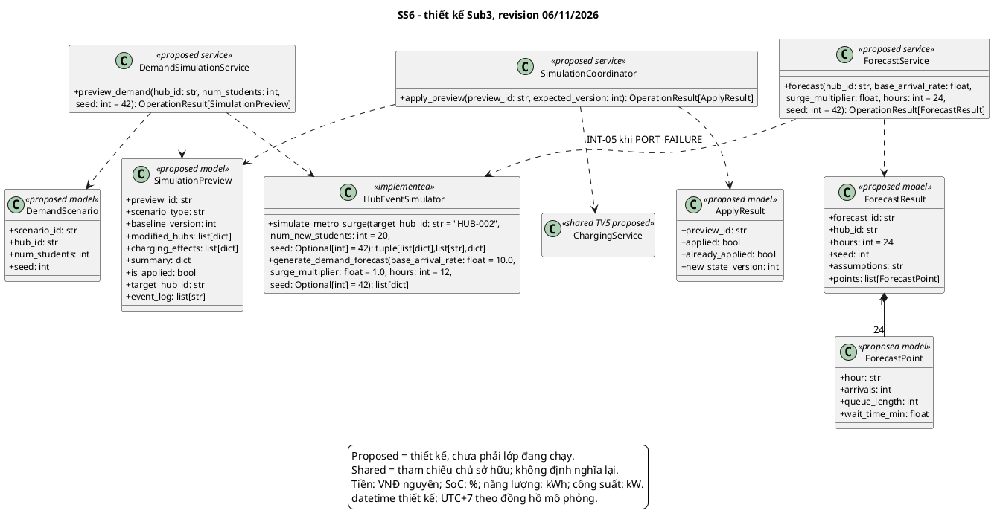

# Submission 3 - Hoàng Văn Tấn - SS6

**MSSV:** 2213074. **Revision:** 06/11/2026. **Trạng thái:** bản tích hợp kỹ thuật, cần chủ sở hữu đọc và xác nhận trước nộp.

Nội dung được bổ sung/chỉnh trong đợt tổng hợp theo yêu cầu trưởng nhóm, có AI hỗ trợ; không ghi nhận thay tác giả rằng họ đã tự làm hoặc tự xác nhận. Nguồn bàn giao cũ giữ trong lịch sử Git.

## 1. Phạm vi

- `UC_SS6_01`: Mô phỏng tăng đột biến nhu cầu khách Metro (What-if Metro Surge).
- `UC_SS6_02`: Dự báo phụ tải nhu cầu và phân tích hàng đợi 24h.

## Kiến trúc chung và trạng thái phiên bản tích hợp

Revision 06/11/2026. Một ứng dụng Python/Streamlit: trình duyệt -> app.py -> components/core -> dữ liệu seed và session ở tiến trình server. Không có database bắt buộc, SSO/IoT/payment thật hay các microservice đang vận hành. Session thuộc từng kết nối Streamlit; reset nạp lại seed; rerun làm mới giao diện, không tạo telemetry nền. Chạy từ repository: `streamlit run src/app.py`; host/cổng phụ thuộc cấu hình, không cố định trong dự án.

Sơ đồ hệ thống lược thuộc tính/phương thức nằm trong phụ lục chung. Tất cả mô tả chi tiết phải được đọc cùng [danh mục phương thức](method_catalog.md), [truy vết](traceability.md), [test cases](test_cases.md) và [khai báo AI](ai_usage.md); PDF build sẽ nhúng toàn bộ các phụ lục này. Không đánh đồng kiểm tra kỹ thuật với chữ ký xác nhận của tác giả hoặc biên nhận LMS.

## 2. Class diagram SS6

Mô hình OOP là thiết kế đề xuất, trừ HubEventSimulator thực sự tồn tại ở SS6. Service trong sơ đồ là giao tiếp nội bộ, không phải server độc lập.

## 3. Mô tả lớp, thuộc tính và ràng buộc

### `DemandScenario`

Dữ liệu đầu vào nhu cầu không âm và seed, không tự thay đổi state.

Thuộc tính và kiểu: `scenario_id: str`, `hub_id: str`, `num_students: int`, `seed: int`.

### `ForecastPoint`

Một mốc giờ: arrivals/queue theo người, wait_time_min theo phút; không phải số liệu thực tế đã quan sát.

Thuộc tính và kiểu: `hour: str`, `arrivals: int`, `queue_length: int`, `wait_time_min: float`.

### `ForecastResult`

Kết quả 24 điểm liên tiếp, seed/giả định được ghi để tái lập; mô hình phục vụ 8 xe/giờ là giả định, chưa dự báo doanh thu.

Thuộc tính và kiểu: `forecast_id: str`, `hub_id: str`, `hours: int = 24`, `seed: int`, `assumptions: str`, `points: list[ForecastPoint]`.

### `SimulationPreview`

DTO chuẩn SS6/SS7, bản sao dữ liệu và hiệu ứng dự kiến. metrics prototype -> summary; charging_effects là danh sách tác động sạc; is_applied chống lặp ở thiết kế.

Thuộc tính và kiểu: `preview_id: str`, `scenario_type: str`, `baseline_version: int`, `modified_hubs: list[dict]`, `charging_effects: list[dict]`, `summary: dict`, `is_applied: bool`, `target_hub_id: str`, `event_log: list[str]`.

### `ApplyResult`

Kết quả áp dụng preview, phân biệt applied và already_applied, new_state_version chính xác.

Thuộc tính và kiểu: `preview_id: str`, `applied: bool`, `already_applied: bool`, `new_state_version: int`.

### `DemandSimulationService`

Service thiết kế đề xuất; các method bên dưới nêu rõ ánh xạ đến hàm/UI đang có. Lớp sở hữu vòng đời nghiệp vụ, gọi các hợp đồng dùng chung theo quyền sở hữu.

### `ForecastService`

Service thiết kế đề xuất; các method bên dưới nêu rõ ánh xạ đến hàm/UI đang có. Lớp sở hữu vòng đời nghiệp vụ, gọi các hợp đồng dùng chung theo quyền sở hữu.

### `SimulationCoordinator`

Service thiết kế đề xuất; các method bên dưới nêu rõ ánh xạ đến hàm/UI đang có. Lớp sở hữu vòng đời nghiệp vụ, gọi các hợp đồng dùng chung theo quyền sở hữu.

### `HubEventSimulator`

Lớp hiện có tại src/core/simulator.py; constructor giữ _original, các phép mô phỏng deepcopy để không ghi dữ liệu nguồn.

## 4. Mô tả mọi phương thức

Xem [method_catalog.md](method_catalog.md), được nhúng đầy đủ trong PDF. Danh mục có chữ ký, đầu vào/đầu ra, điều kiện, tác động, lỗi và quy tắc gọi lặp cho từng phương thức được vẽ.

## 5. Ánh xạ và giới hạn

Service/coordinator/DTO trong sơ đồ là đề xuất, không có package core.services/core.domain hoặc hàm UI tách tab. UI hiện một render(), mặc định dự báo 12 giờ, có chọn 24. Hai UI Apply riêng có version check nhưng chưa dùng coordinator nguyên tử dùng chung. Chuyển tab không tự hủy preview nếu chưa reset/discard. US-21 chưa mô hình biến động doanh thu; mở rộng cần demand->admitted->service mix->tariff->expected collected/debt, ghi giả định thay vì dùng doanh thu dashboard làm bằng chứng. Core dùng thời gian log thực; datetime mô phỏng trong session là chuỗi naive quy ước UTC+7.

## 6. Chính sách và ranh giới thiết kế

Giữ xe SS1 30 phút từ tạo; hạn SS2 30 phút từ giờ đến. Cọc 50.000, no-show phạt10.000/hoàn40.000 VNĐ. Reroute thêm15 phút miễn phí tối đa một lần, không đổi TTL. Sạc grace15 phút, phí10.000/khối15 phút bắt đầu sau grace; công suất mặc định150 kW/Hub và11 kW/cổng, cấu hình từng test có thể khác. Phí đỗ prototype5.000 VNĐ/lượt khác SRS tính theo giờ, phải ghi chênh lệch. Ownership PERSONAL/SHARED và binding nguồn lực không được trộn.

NFR về bảo mật, dữ liệu bền, phân quyền đồng thời và hiệu năng là mục tiêu thiết kế. Prototype per-session không chứng minh tính nhất quán toàn mạng giữa nhiều phiên; thiết kế tương lai cần shared storage/transaction/version và authorization thật. Đề không bắt buộc thêm database cho Sub3.

## 7. Truy vết, test, đóng góp và AI

Các phụ lục traceability.md, test_cases.md, self_check.md và ai_usage.md được nhúng khi build PDF. Các test trên core/UI prototype không chứng minh service OOP đề xuất đã triển khai. Không tự xác nhận PASS cho test chưa có nguồn và log tái chạy.
