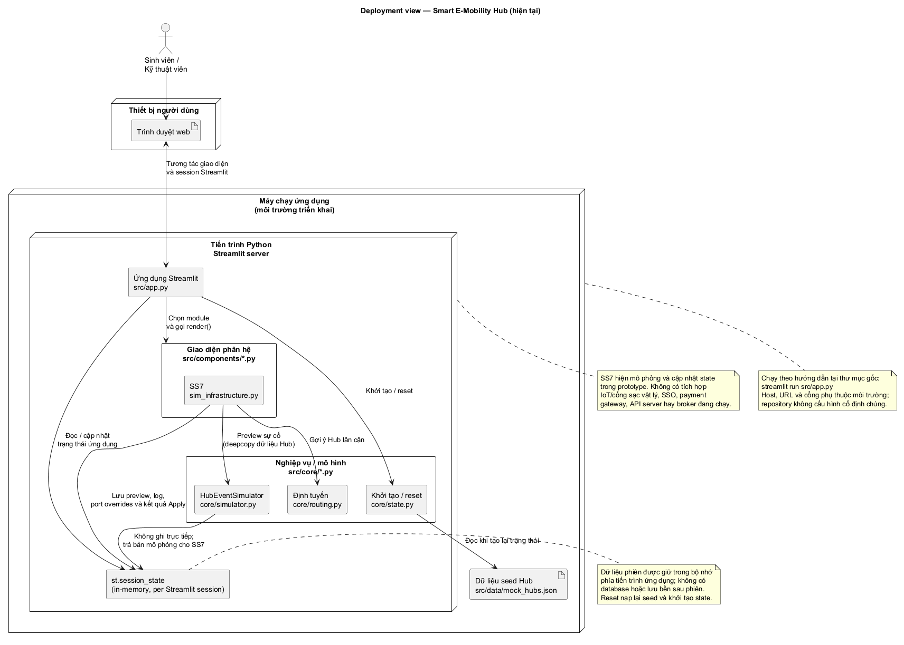
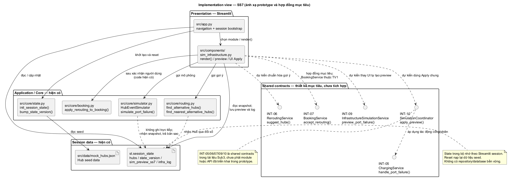
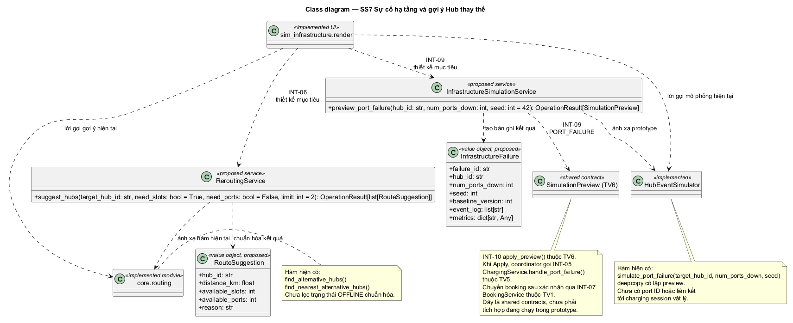

<strong>ĐẠI HỌC QUỐC GIA THÀNH PHỐ HỒ CHÍ MINH</strong>

<strong>TRƯỜNG ĐẠI HỌC BÁCH KHOA</strong>

<strong>KHOA KHOA HỌC VÀ KỸ THUẬT MÁY TÍNH</strong>

  
<h1>BÁO CÁO SUBMISSION 3</h1>
<h2>SMART E-MOBILITY HUB</h2>
<h3>SS7 — SỰ CỐ HẠ TẦNG VÀ GỢI Ý HUB THAY THẾ</h3>
  

<strong>Sinh viên:</strong> Nguyễn Trung Nguyên

<strong>MSSV:</strong> 2011710

<strong>Môn học:</strong> Công nghệ Phần mềm — CO3001, HK261

<strong>Nhóm:</strong> BEE BRAVE — Nhóm 7

  

<strong>Ngày hoàn thiện:</strong> 30/10/2026

# Submission 3 — Nguyễn Trung Nguyên — SS7

**MSSV:** 2011710  
**Phân hệ:** SS7 — Sự cố hạ tầng và gợi ý Hub thay thế  
**Phiên bản nội dung:** 1.0 
**Trạng thái:** Nội dung, sơ đồ và test prototype liên quan đã hoàn tất; PDF cá nhân đã xuất và kiểm tra trực quan.
**Khoảng thực hiện theo kế hoạch:** 21/10/2026–30/10/2026.

[Hướng dẫn Sub3](<../../../../GUIDANCE_FOR_SUB_3.md>) · [Hợp đồng dùng chung](<../shared/shared_contracts.md>) · [Chỉ mục sơ đồ](<../../../diagrams/submission_3/README.md>)

> Nội dung dưới đây phân biệt rõ code hiện có với giao tiếp thiết kế Sub3. Các sơ đồ đã được render PNG/SVG và kiểm tra; báo cáo có kèm các nội dung cần nộp.

## Mục lục

- [1. Phạm vi và đóng góp](#1-pham-vi-va-ong-gop)
- [2. Deployment view](#2-deployment-view)
- [3. Development/Implementation view và ánh xạ code](#3-developmentimplementation-view-va-anh-xa-code)
- [4. Class diagram cá nhân](#4-class-diagram-ca-nhan)
- [5. Hợp đồng liên phân hệ và xử lý sự cố](#5-hop-ong-lien-phan-he-va-xu-ly-su-co)
- [6. Truy vết Sub1–Sub2–Sub3](#6-truy-vet-sub1sub2sub3)
- [7. Test case bonus](#7-test-case-bonus)
- [8. Giới hạn và vấn đề còn mở](#8-gioi-han-va-van-e-con-mo)
- [9. Tự kiểm tra, khai báo AI và đầu ra](#9-tu-kiem-tra-khai-bao-ai-va-au-ra)

## 1. Phạm vi và đóng góp

### Use case kế thừa

| UC | Tên | Truy vết kế thừa | Vị trí code liên quan |
|---|---|---|---|
| `UC_SS7_01` | Mô phỏng sự cố hạ tầng & mất điện trạm sạc | `US-23`, `US-24`; `FR-14`, `FR-15` | `src/components/sim_infrastructure.py`; `src/core/simulator.py` |
| `UC_SS7_02` | Đề xuất gợi ý điều hướng sang Hub lân cận & cảnh báo | `US-24`, `US-24b`; `FR-15`, `FR-15c` | `src/components/sim_infrastructure.py`; `src/core/routing.py`; thao tác đổi Hub đặt tại `src/core/booking.py` |

Nguồn scenario, sequence, activity và bảng truy vết Sub2 được liệt kê trong [traceability.md](<traceability.md>). Các sơ đồ Sub2 là đầu vào kế thừa; nếu chúng mô tả IoT/SSO/payment hoạt động hoặc thuật toán khác với code, báo cáo này ghi đó là chênh lệch cần xác nhận, không dùng làm bằng chứng tích hợp.

### Đóng góp thực tế

- Tài liệu và nguồn PlantUML trong phần TV7 của Submission 3 được soạn/cập nhật với AI hỗ trợ dựa trên repository và hợp đồng thiết kế chung.
- Bản ghi AI và prompt history được đính kèm. TV7 tự rà soát bộ file/PDF cuối và thao tác nộp LMS.

## 2. Deployment view

**Nguồn chung:** [deployment.puml](<../../../diagrams/submission_3/shared/deployment.puml>). Sơ đồ chỉ mô tả prototype hiện tại; không có deployment production hoặc sơ đồ tương lai giả định.

Nguồn vector: [deployment.svg](<../../../diagrams/submission_3/shared/deployment.svg>).

### Thành phần và luồng chạy

1. Người dùng thao tác trong trình duyệt; tiến trình Streamlit/Python chạy trên máy chủ hoặc máy phát triển do người chạy ứng dụng chọn. Hướng dẫn repo là `streamlit run src/app.py`; repository không chốt host, URL hoặc cổng.
2. `src/app.py` khởi tạo session state, quét reservation hết hạn, dựng điều hướng và gọi `render()` của component được chọn.
3. Với SS7, `src/components/sim_infrastructure.py` đọc dữ liệu Hub trong `st.session_state`, gọi `HubEventSimulator` hoặc hàm định tuyến, hiển thị preview/log và xử lý lựa chọn Apply/hủy.
4. `src/core/state.py` nạp dữ liệu ban đầu từ `src/data/mock_hubs.json`. Dữ liệu Hub, `state_version`, `sim_preview_ss7`, `infra_log` và `port_overrides` được giữ trong `st.session_state` phía tiến trình ứng dụng.
5. `HubEventSimulator.simulate_port_failure` sao chép sâu dữ liệu Hub, tính kết quả dự kiến và trả dữ liệu cho UI. Preview được lưu vào session; chỉ khi bấm Apply và phiên bản nền còn khớp thì component mới thay `hubs` trong session state.
6. Reset gọi `init_session_state(..., force_reset=True)`, nạp lại seed và tạo lại trạng thái demo. Không có lưu bền nghiệp vụ vào database; session/memory mất khi tiến trình hoặc session tương ứng kết thúc.

### Ranh giới triển khai

- **Đã có:** ứng dụng Streamlit, các module Python, dữ liệu seed JSON, xử lý trong bộ nhớ theo session, mô phỏng và thao tác UI Apply/hủy.
- **Chưa có tích hợp vận hành:** thiết bị/cảm biến/IoT, SSO, payment gateway, API server, message broker, database bền vững hoặc tự động phát hiện sự cố từ phần cứng. Nội dung IoT/SSO/wallet trong một số sơ đồ Sub2 không phải node đã triển khai.
- Cổng sạc trong dữ liệu hiện là bộ đếm `total`/`available`/có thể có `offline`, không phải danh mục cổng vật lý có định danh và telemetry riêng.

## 3. Development/Implementation view và ánh xạ code

**Sơ đồ module chung:** [implementation.puml](<../../../diagrams/submission_3/shared/implementation.puml>) (TV3 tổng hợp). Bổ sung [Implementation view SS7](<../../../diagrams/submission_3/SS7/implementation_view.puml>) để chỉ rõ module/lời gọi do TV7 phụ trách; sơ đồ này không thay thế view tổng hợp hệ thống của TV3.

Nguồn vector: [implementation_view.svg](<../../../diagrams/submission_3/SS7/implementation_view.svg>).

Implementation view chung cấp hệ thống vẫn thuộc TV3; hình SS7 bên trên hoàn thiện phần ánh xạ module cá nhân của TV7, không tuyên bố sơ đồ tổng hợp hệ thống đã hoàn thành.

| Trách nhiệm | Hiện thực trong prototype | Trạng thái / giới hạn |
|---|---|---|
| UI SS7, preview, log, Apply/hủy | `src/components/sim_infrastructure.py` — `render`, `_init_ss7` | Đã triển khai bằng Streamlit; preview dictionary có `preview_id`, `baseline_version`, `target_hub_id`, `modified_hubs`, `event_log`, `metrics`. |
| Mô phỏng cổng lỗi | `src/core/simulator.py` — `HubEventSimulator.simulate_port_failure` | Đã triển khai trên bản sao sâu Hub; trả `(hubs, log, metrics)`. Chưa có ID cổng thật/định tuyến tới charging session theo port ID. Tham số `seed` hiện không quyết định kết quả trong hàm này. |
| Gợi ý Hub lân cận | `src/core/routing.py` — `find_alternative_hubs`, `find_nearest_alternative_hubs`, `haversine_distance_km` | Đã triển khai; lọc theo chỗ/cổng theo tham số rồi xếp khoảng cách. Chưa lọc một trạng thái hoạt động/offline chuẩn hóa của Hub. |
| Nạp/reset state và version | `src/core/state.py` — `load_and_normalize_hubs`, `init_session_state`, `bump_state_version` | Đã triển khai; state và version trong session, reset nạp JSON seed. |
| Đổi Hub booking sau xác nhận | `src/core/booking.py` — `apply_rerouting_to_booking` | Hàm hiện có chuyển giữ chỗ nếu Hub mới còn slot, tăng version và chỉ cộng `REROUTING_EXTRA_FREE_MINUTES` (15 phút) nếu booking chưa nhận ưu đãi. Đây là thao tác hiện tại; hợp đồng `BookingService.accept_rerouting` là thiết kế mục tiêu có kiểm soát version/idempotency chặt hơn. |
| Xử lý phiên/cổng bị lỗi | Hợp đồng `ChargingService.handle_port_failure` do TV5 sở hữu | **Chưa được gọi bởi SS7 prototype.** `src/core/scheduler.py` có model/lập lịch phiên nhưng chưa có adapter `ChargingService` theo `INT-05`. |
| Schema preview và Apply dùng chung | `SimulationPreview` / `SimulationCoordinator.apply_preview` do TV6 sở hữu | **Thiết kế mục tiêu.** UI hiện giữ `sim_preview_ss7` dictionary và tự kiểm tra `baseline_version`; chưa dùng coordinator chung hoặc đánh dấu Apply lặp theo `preview_id`. |

### Hành vi SS7 đang chạy

- `render()` hiển thị console bật/tắt cổng, mô phỏng sự cố, tổng quan và log.
- Nút tạo preview gọi `simulate_port_failure` với Hub và số cổng do UI chọn, seed truyền vào là `42`; kết quả mô phỏng không trực tiếp sửa `hubs` gốc.
- Trong tab preview, UI tìm tối đa hai Hub thay thế với `need_ports=True`, `need_slots=False`. Đây là gợi ý cho năng lực sạc, không phải chấp nhận chuyển booking.
- Nút Apply so `baseline_version` với `state_version`; nếu trùng, gán `modified_hubs` vào state và tăng version. Chưa có `SimulationCoordinator`, chưa gọi `ChargingService`, chưa có transaction toàn phần cho Hub và phiên sạc.
- Luồng đổi điểm đến booking riêng phải yêu cầu người dùng xác nhận và gọi nghiệp vụ SS1. Ưu đãi 15 phút không làm thay đổi TTL giữ chỗ 30 phút.

## 4. Class diagram cá nhân

**Nguồn:** [class_diagram.puml](<../../../diagrams/submission_3/SS7/class_diagram.puml>). Đây là thiết kế đề xuất có ánh xạ prototype; nhãn `implemented` chỉ dùng cho lớp/module/hàm đang có. Shared classes được tham chiếu theo chủ sở hữu, không sao chép định nghĩa.

Nguồn vector: [class_diagram.svg](<../../../diagrams/submission_3/SS7/class_diagram.svg>).

### 4.1. Mô tả lớp

| Class ID / lớp | Chủ sở hữu, mức triển khai | Trách nhiệm, thuộc tính và ràng buộc | Quan hệ / truy vết |
|---|---|---|---|
| `SS7-CLS-01 InfrastructureFailure` | TV7; value object **đề xuất**, hiện ánh xạ một phần tới preview dictionary | `failure_id: str`; `hub_id: str`; `num_ports_down: int`; `seed: int`; `baseline_version: int`; `event_log: list[str]`; `metrics: dict[str, Any]`. Số cổng lỗi không âm; phạm vi thực tế không vượt tổng cổng. Bản ghi là kết quả/kịch bản, không đại diện sự kiện IoT thật. | Một kịch bản tạo một `SimulationPreview`; UC_SS7_01. |
| `SS7-CLS-02 InfrastructureSimulationService` | TV7; **đề xuất** bọc hàm simulator hiện tại | Tạo preview `PORT_FAILURE` từ snapshot Hub; không sửa Hub thật trước Apply; dùng schema preview và cơ chế Apply chung. | Dùng `HubEventSimulator`; trả `SimulationPreview` của TV6; gọi `ChargingService` chỉ khi Apply qua coordinator. UC_SS7_01, INT-05/09/10. |
| `SS7-CLS-03 RouteSuggestion` | TV7; value object **đề xuất**, hiện chuẩn hóa dictionary routing | `hub_id: str`; `distance_km: float`; `available_slots: int`; `available_ports: int`; `reason: str`. Snapshot chỉ đúng tại thời điểm gợi ý, không bảo đảm capacity còn nguyên khi Apply. | Được tạo bởi `ReroutingService`; không tự thay booking. UC_SS7_02, INT-06. |
| `SS7-CLS-04 ReroutingService` | TV7; **đề xuất** bọc `core.routing` | Lọc Hub theo nhu cầu chỗ/cổng và trạng thái vận hành, xếp tăng dần theo Haversine, trả danh sách rỗng nếu không có ứng viên. Không ghi thay đổi vào booking hoặc capacity. | Đọc Hub chuẩn của TV3; đề xuất cho SS1/UI; sau xác nhận, TV1 xử lý booking qua INT-07. UC_SS7_02. |
| `HubEventSimulator` | Module core hiện có | `simulate_port_failure` làm bản sao sâu danh sách Hub, giảm cổng available, phân bổ cổng ảnh hưởng vào busy trước rồi free, chuyển số xe tương ứng `CHARGING` sang `WAITING`; trả log và metrics. | Được gọi từ component SS7; hiện không biết ID cổng hoặc phiên sạc cụ thể. |
| `core.routing` | Module core hiện có | Hàm khoảng cách Haversine và các hàm lọc/xếp Hub hiện trả dictionary, không phải `RouteSuggestion` có kiểu riêng. | `ReroutingService` tương lai chuẩn hóa kết quả. |
| `SimulationPreview`, `SimulationCoordinator` | TV6; shared contract, **không sở hữu bởi TV7** | Preview có `preview_id`, `scenario_type`, `baseline_version`, `modified_hubs`, `charging_effects`, `summary`, trạng thái Apply. `apply_preview` kiểm tra version/invariant, commit đồng bộ và chống Apply lặp theo hợp đồng INT-10. | SS7 dùng INT-09/10; không tạo một cơ chế Apply thứ hai. |
| `ChargingService` | TV5; shared contract, **không sở hữu bởi TV7** | `handle_port_failure(hub_id, port_ids, operation_key)` cập nhật cổng/phiên bị ảnh hưởng, trả công suất và danh sách phiên; không đổi số slot đỗ. | Coordinator gọi INT-05 khi Apply; prototype chưa triển khai adapter này. |
| `BookingService` | TV1; shared contract, **không sở hữu bởi TV7** | `accept_rerouting(booking_id, new_hub_id, expected_version, operation_key)` xác nhận lại trạng thái/version/capacity và chuyển giữ chỗ nguyên tử; thưởng tối đa một lần. | Chỉ gọi sau xác nhận của người dùng, INT-07. |

**Quan hệ và bội số thiết kế:** một `InfrastructureSimulationService` có thể tạo nhiều preview theo các lần chạy; mỗi preview tham chiếu một kịch bản sự cố và một baseline version. Một `ReroutingService` tạo 0..N `RouteSuggestion` cho một Hub đích; mỗi suggestion tham chiếu đúng một Hub. Một booking có thể được yêu cầu đổi đích nhiều lần, nhưng mỗi thao tác phải kiểm tra lại trạng thái/sức chứa; ưu đãi 15 phút không cộng dồn. Một `SimulationPreview` được Apply nhiều nhất một lần có hiệu lực.

### 4.2. Mô tả phương thức trên sơ đồ

#### `SS7-MTH-01 — HubEventSimulator.simulate_port_failure(target_hub_id: str = "HUB-004", num_ports_down: int = 3, seed: Optional[int] = 42) -> tuple[list[dict], list[str], dict]`

- **Trạng thái:** Đã triển khai tại `src/core/simulator.py`; gọi từ UI SS7.
- **Mục đích:** mô phỏng cổng sạc lỗi và tác động cơ bản trên bản sao Hub.
- **Tiền điều kiện:** `target_hub_id` có trong danh sách; `num_ports_down` là số lượng trong khoảng hợp lệ theo UI. Core hiện chưa có validate input đầy đủ; UI giới hạn số tối thiểu/tối đa.
- **Xử lý:** deepcopy dữ liệu; tính `actual_down = min(num_ports_down, total_ports)`; cổng đang bận bị ảnh hưởng trước, xe `CHARGING` tương ứng chuyển `WAITING`; phần còn lại làm giảm cổng available; trả danh sách Hub mô phỏng, log và metrics.
- **Hậu điều kiện:** dữ liệu Hub đầu vào không bị sửa; không có ghi nhận phiên/cổng vật lý hay side effect lên lịch sạc thật. Nếu không tìm thấy Hub, hàm trả snapshot, log lỗi và metrics rỗng theo hành vi hiện tại.
- **Lỗi/lặp:** hàm thuần trên dữ liệu đầu vào theo deepcopy; không có preview ID, idempotency key hoặc xử lý đồng thời bên trong. Tham số `seed` hiện không ảnh hưởng kết quả cổng lỗi.
- **Truy vết:** UC_SS7_01; test hiện có `test_port_failure_distinguishes_free_vs_busy_ports`.

#### `SS7-MTH-02 — InfrastructureSimulationService.preview_port_failure(hub_id: str, num_ports_down: int, seed: int = 42) -> OperationResult[SimulationPreview]`

- **Trạng thái:** Giao tiếp đề xuất theo INT-09; chưa tồn tại dưới dạng service trong code.
- **Mục đích/bên gọi:** UI SS7 yêu cầu tạo preview mô phỏng.
- **Tiền điều kiện:** Hub tồn tại; số cổng yêu cầu hợp lệ; lấy `baseline_version` từ state hiện tại.
- **Xử lý/hậu điều kiện:** gọi simulator trên snapshot; đóng gói `scenario_type=PORT_FAILURE`, `modified_hubs`, `charging_effects`, `summary` vào schema `SimulationPreview` của TV6; giữ dữ liệu gốc không đổi; lưu preview có ID trong session. Không sửa cổng/phiên vận hành.
- **Lỗi/lặp:** trả `NOT_FOUND` hoặc `INVALID_INPUT` theo `OperationResult`; preview mới là kết quả độc lập, chưa Apply. Không tự đổi dữ liệu nếu lỗi.
- **Truy vết:** UC_SS7_01, INT-09; ca `SS7-TC-02`.

#### `SS7-MTH-03 — ReroutingService.suggest_hubs(target_hub_id: str, need_slots: bool = True, need_ports: bool = False, limit: int = 2) -> OperationResult[list[RouteSuggestion]]`

- **Trạng thái:** Giao tiếp đề xuất INT-06; hiện ánh xạ một phần tới `find_alternative_hubs`/`find_nearest_alternative_hubs`.
- **Mục đích/bên gọi:** SS1 hoặc SS7 lấy danh sách Hub phù hợp; chỉ đọc, không đổi booking.
- **Tiền điều kiện:** Hub mục tiêu tồn tại; `limit >= 0`; yêu cầu slot/cổng lấy theo nghiệp vụ (trả xe cần slot, đổi nơi sạc cần cổng).
- **Xử lý:** bỏ Hub mục tiêu; lọc theo capacity cần thiết và trạng thái vận hành được xác nhận; xếp theo khoảng cách Haversine tăng dần; chuyển kết quả thành `RouteSuggestion`.
- **Hậu điều kiện:** trả 0..`limit` kết quả; state không đổi. Capacity là snapshot và phải kiểm tra lại ở thao tác Apply/đổi booking.
- **Lỗi/lặp:** Hub đích không tồn tại trả lỗi phù hợp; không có ứng viên trả danh sách rỗng. Gọi lặp không có side effect.
- **Giới hạn ánh xạ:** code hiện tại không lọc trạng thái hoạt động/offline của Hub; khi thiếu tọa độ dùng tọa độ mặc định trong hàm khoảng cách. Không tuyên bố lọc `OFFLINE` cho đến khi dữ liệu trạng thái có thật.
- **Hàm được bọc:** `find_alternative_hubs` chuyển `need_slots`/`need_ports` thành ngưỡng availability rồi gọi `find_nearest_alternative_hubs`; hàm lõi bỏ Hub nguồn, lọc capacity, tính khoảng cách Haversine, sắp xếp tăng dần và giới hạn số kết quả.
- **Truy vết:** UC_SS7_02, INT-06; ca `SS7-TC-04`.

> `SimulationCoordinator.apply_preview` (INT-10), `ChargingService.handle_port_failure` (INT-05) và `BookingService.accept_rerouting` (INT-07) là giao tiếp được vẽ/tham chiếu nhưng thuộc TV6, TV5 và TV1. TV7 chịu trách nhiệm ánh xạ/kiểm thử lời gọi SS7 khi các chủ sở hữu tích hợp; không nhận chúng là code hiện có hoặc mô tả lại nội bộ của service chủ sở hữu.

## 5. Hợp đồng liên phân hệ và xử lý sự cố

| Giao tiếp | Nội dung SS7 | Quy tắc bắt buộc |
|---|---|---|
| INT-05 — TV5 `ChargingService.handle_port_failure` | Khi Apply, gửi Hub, các port ID và operation key; nhận danh sách phiên bị ảnh hưởng/công suất mới. | Không thay số chỗ đỗ vì lỗi cổng. Prototype chưa có port ID/adapter; không giả định tự động cập nhật phiên sạc. |
| INT-06 — TV7 `ReroutingService.suggest_hubs` | Chỉ trả gợi ý phù hợp với nhu cầu slot/cổng, khoảng cách và tình trạng. | Danh sách rỗng là kết quả hợp lệ; không thay booking; kiểm tra lại capacity khi nhận đề xuất. |
| INT-07 — TV1 `BookingService.accept_rerouting` | Chỉ gọi sau khi người dùng xác nhận điểm đến mới. | Kiểm tra version/trạng thái/sức chứa và chuyển giữ chỗ nhất quán; ưu đãi 15 phút tối đa một lần, độc lập TTL 30 phút. |
| INT-09 — TV7 `InfrastructureSimulationService.preview_port_failure` | Tạo preview cô lập theo schema chung `SimulationPreview`. | `scenario_type=PORT_FAILURE`; không cập nhật state thật trước Apply. |
| INT-10 — TV6 `SimulationCoordinator.apply_preview` | Apply theo `preview_id` và `expected_version`. | Kiểm tra version và invariant; cập nhật Hub/phiên đồng bộ, tăng version, chống Apply lặp; không ghi đè ví/booking bằng snapshot cũ. |

### Phân biệt loại sự cố và tác động

- **Cổng rảnh hỏng:** giảm khả dụng/công suất cổng; không làm đổi slot đỗ.
- **Cổng đang bận hỏng:** phiên sạc bị ảnh hưởng và phải được xác định qua `ChargingService`/port ID; prototype hiện chỉ chuyển tối đa số xe phù hợp từ `CHARGING` sang `WAITING`, chưa liên kết phiên sạc cụ thể.
- **Mất điện toàn Hub:** cần mô hình trạng thái hoạt động và cập nhật phiên/công suất nhất quán. Prototype không có tín hiệu điện lưới, trạng thái Hub chuẩn `OFFLINE` hoặc tự phát hiện outage; `simulate_port_failure` không phải tích hợp mất điện thật.
- **Gợi ý Hub thay thế:** đối với sạc, lọc cổng theo nhu cầu; đối với nơi trả xe/booking, cần slot. Không dùng một kết quả lọc cho mọi nhu cầu.
- **Không có ứng viên:** báo không có Hub đáp ứng, không tự chuyển booking hoặc khẳng định đã phục hồi hệ thống.
- **Preview cũ / Apply lặp:** thiết kế chung trả `STALE_STATE` nếu baseline không khớp, `already_applied` nếu cùng preview đã được áp dụng. UI prototype hiện có kiểm tra version cơ bản nhưng chưa có bảo vệ Apply lặp theo hợp đồng.

## 6. Truy vết Sub1–Sub2–Sub3

| US / FR | UC | Thiết kế Sub3 | Code/test |
|---|---|---|---|
| `US-23`, `US-24` / `FR-14`, `FR-15` | `UC_SS7_01` mô phỏng lỗi cổng/mất điện | `InfrastructureFailure`; `InfrastructureSimulationService`; preview tách khỏi Apply | `sim_infrastructure.py`; `HubEventSimulator.simulate_port_failure`; `SS7-TC-01` đến `SS7-TC-03`; test hiện có về phân biệt free/busy |
| `US-24`, `US-24b` / `FR-15`, `FR-15c` | `UC_SS7_02` gợi ý Hub và cảnh báo | `RouteSuggestion`; `ReroutingService.suggest_hubs`; booking chỉ đổi sau xác nhận qua TV1 | `core.routing`; `core.booking.apply_rerouting_to_booking`; `SS7-TC-04` đến `SS7-TC-06`; test hiện có chọn hai Hub và chuyển giữ chỗ |

Nguồn chi tiết: [scenario SS7](<../../../diagrams/Use-case detail-scenario/SS7/Usecase scenario/UC_SS7_NguyenTrungNguyen.md>), [sequence UC_SS7_01](<../../../diagrams/Use-case detail-scenario/SS7/Sequence diagrams/UC_SS7_01_NguyenTrungNguyen_sequence.puml>), [sequence UC_SS7_02](<../../../diagrams/Use-case detail-scenario/SS7/Sequence diagrams/UC_SS7_02_NguyenTrungNguyen_sequence.puml>), [activity UC_SS7_01](<../../../diagrams/Use-case detail-scenario/SS7/Activity diagrams/UC_SS7_01_NguyenTrungNguyen_activity.puml>), [activity UC_SS7_02](<../../../diagrams/Use-case detail-scenario/SS7/Activity diagrams/UC_SS7_02_NguyenTrungNguyen_activity.puml>).

 sequence/activity Sub2 có nhắc đến IoT, SSO, xử lý offline, trạng thái Hub `OFFLINE`, tự động Apply/đổi Hub và (ở activity UC_SS7_02) khoảng cách Euclidean. Prototype hiện không triển khai tích hợp ngoài; routing dùng Haversine; mô phỏng không phát hiện outage từ phần cứng. Báo cáo Sub3 mô tả code thực tế và hợp đồng tương lai, không coi các bước cũ này là đã chạy.

## 7. Test case bonus

| Test ID / use case | Dữ liệu và thao tác | Kết quả mong đợi | Trạng thái |
|---|---|---|---|
| `SS7-TC-01` / `UC_SS7_01` | Hub `H-1`: 4 cổng, 2 rảnh, 2 xe `CHARGING`; mô phỏng hỏng 3 cổng. | 2 cổng bận bị ảnh hưởng, 1 cổng rảnh bị tắt; `available=1`; hai xe chuyển `WAITING`; dữ liệu gốc không đổi. | DESIGNED / NOT_RUN |
| `SS7-TC-02` / `UC_SS7_01` | Snapshot state khởi tạo; tạo preview lỗi cổng, chưa Apply hoặc hủy. | Hub, version, booking, ví và charging sessions không đổi; preview ghi đúng baseline và `PORT_FAILURE`. | DESIGNED / NOT_RUN; test hiện tại chỉ kiểm tra một phần deepcopy. |
| `SS7-TC-03` / `UC_SS7_01` | Apply preview tại version cũ, sau đó thử Apply preview hợp lệ hai lần. | Trường hợp cũ trả `STALE_STATE` không commit từng phần; Apply hợp lệ lần đầu, lần hai `already_applied`; slot đỗ không đổi do lỗi cổng. | DESIGNED / NOT_RUN; coordinator chưa triển khai. |
| `SS7-TC-04` / `UC_SS7_02` | Hub nguồn `H0`; `HA`/`HB` có chỗ và cổng; `HC` hết cổng; yêu cầu cả slot/cổng, limit 2. | Loại nguồn và `HC`; trả `HA`, `HB` theo Haversine tăng dần; kết quả không sửa capacity. | DESIGNED / NOT_RUN |
| `SS7-TC-05` / `UC_SS7_02` | Mọi Hub thay thế đều thiếu slot hoặc cổng theo nhu cầu. | Trả danh sách rỗng/cảnh báo; không đổi booking, holds, ví, Hub hoặc thời gian thuê. | DESIGNED / NOT_RUN |
| `SS7-TC-06` / `UC_SS7_02` | Booking có giữ chỗ Hub cũ; người dùng xác nhận Hub mới đang còn slot; thử thao tác lặp. | Nhả/giữ đúng một slot; không đổi ví; thưởng 15 phút tối đa một lần; Hub hết chỗ khi nhận thì không sửa state. | DESIGNED / NOT_RUN cho hợp đồng idempotent; test hiện tại xác nhận luồng chuyển một lần. |

### Kết quả test prototype thực sự chạy

| Phạm vi | Lệnh | Kết quả |
|---|---|---|
| Mô phỏng cổng lỗi, deepcopy và metrics | `$env:PYTHONPATH = (Resolve-Path .\src).Path; python -m pytest -q tests/test_simulations.py` | **PASS — 2 passed.** |
| Gợi ý Hub và chuyển giữ chỗ booking | `$env:PYTHONPATH = (Resolve-Path .\src).Path; python -m pytest -q tests/test_submission_2_acceptance.py -k rerouting` | **PASS — 1 passed, 12 deselected.** |

Các lệnh cần `PYTHONPATH=src` do repository không có pytest configuration đưa thư mục `src` vào import path. Kết quả này chỉ áp dụng cho test hiện có; sáu ca Sub3 phía trên vẫn là test được thiết kế/chưa chạy. Mô tả chi tiết từng ca nằm trong [test_cases.md](<test_cases.md>).

## 8. Giới hạn và vấn đề còn mở

1. Không có danh mục port ID trong dữ liệu Hub; cần thống nhất cách ánh xạ số cổng mô phỏng sang ID ổn định trước INT-05.
2. `simulate_port_failure` hiện không điều chỉnh/đối soát đầy đủ `offline` cũ, phiên sạc cụ thể hoặc toàn bộ invariant của Hub; không gọi kết quả như dự báo chính xác cho vận hành vật lý.
3. Routing không loại Hub lỗi/offline dựa trên trạng thái chuẩn; thiếu tọa độ có thể rơi về giá trị mặc định. Bọc service cần validate dữ liệu trước khi đề xuất.
4. `sim_preview_ss7` là dictionary riêng; UI chưa gọi `SimulationCoordinator`, chưa lưu lịch sử Apply/idempotency và chưa xử lý transaction SS7–SS5.
5. Chưa có endpoint/port/hosting cấu hình trong repository; deployment view vì vậy không ghi số cổng hoặc topology cloud.
6. PlantUML JAR được dùng tạm từ thư mục hệ thống để kiểm tra cú pháp và xuất PNG/SVG; ảnh đã được mở để kiểm tra bố cục. Không thêm JAR vào repository. PDF cuối vẫn cần được TV7 xuất, mở và kiểm tra.

## 9. Tự kiểm tra, khai báo AI và đầu ra

- **Xác nhận nội dung:** 30/10/2026.
- **Tự kiểm tra kỹ thuật:** hai sơ đồ TV7 đã qua PlantUML syntax check và được xuất PNG/SVG; hai test prototype nêu ở mục 7 đã chạy đạt. Các ca bonus ở mức thiết kế chưa chạy; PDF được xuất từ báo cáo này và kiểm tra sau khi tạo.
- **Khai báo AI:** AI assistant using Copilot SDK in VS Code hỗ trợ đọc hướng dẫn/code, soạn và chỉnh báo cáo TV7, tạo nguồn sơ đồ Deployment/SS7 và Implementation SS7, truy vết, test case, khai báo/checklist và xuất bản PDF. TV7 rà soát và chấp nhận nội dung theo xác nhận nêu trên. Không sửa code triển khai. Tên model cụ thể không được cung cấp trong phiên làm việc.
- **Đóng góp và giới hạn:** TV7 phụ trách SS7 và Deployment view chung; class diagram hệ thống/Implementation view chung cấp hệ thống thuộc TV3. SimulationCoordinator thuộc TV6, ChargingService thuộc TV5, BookingService thuộc TV1. Phần chia sẻ và giao tiếp được ghi theo đúng chủ sở hữu.
- **Prompt history:** [Bản ghi prompt Sub3](<../../../prompt-history/TV7_NguyenTrungNguyen/prompt_history_NguyenTrungNguyen_sub3.txt>) gồm prompt thực tế của phiên hỗ trợ và tóm tắt công việc; đây là bản ghi bổ sung, không phải transcript toàn bộ hội thoại.
- **Self-check:** [Checklist và bằng chứng](<self_check.md>).
- **PDF cá nhân:** `output/submission_3/REPORT_SUB3_NguyenTrungNguyen_2011710.pdf`.
- **LMS:** chưa xác nhận trạng thái nộp; TV7 phải tự tải đúng bộ file và kiểm tra biên nhận/trạng thái trên LMS.
