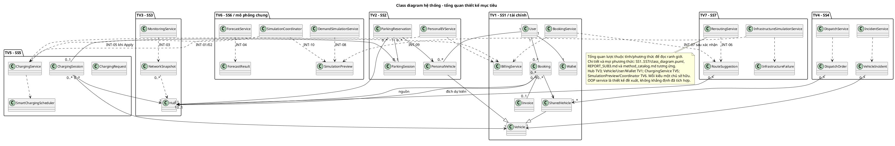

# Kiến trúc chung revision 06/11/2026

## Deployment view hiện tại

Browser giao tiếp ứng dụng Streamlit/Python; server đọc seed từ src/data/mock_hubs.json khi khởi tạo/reset. st.session_state giữ hubs, ví/ledger, booking, scheduler, preview và version trong bộ nhớ server theo session. Rerun chạy lại script theo tương tác; không có một tiến trình IoT/polling/background riêng. Đổi tab không tự bảo đảm xóa preview. Session/reset/restart không là lưu bền; hai session không phải cùng một cơ sở dữ liệu mạng lưới.

Chạy `streamlit run src/app.py` từ repository. 8501 chỉ là giá trị mặc định công cụ nếu không bị cấu hình đổi, không phải endpoint cố định được triển khai bởi nhóm. SSO, QR/barie/IoT/payment thật là mô phỏng hoặc ngoài phạm vi prototype.

## Development/Implementation view hiện tại

app.py điều hướng tới bảy components; core.booking/personal_ev/billing/scheduler/simulator/routing/state/policies chứa phần nghiệp vụ đã tách. SS3/SS4 và Apply SS6/SS7 vẫn có xử lý trong render(). Các service OOP trong class diagram là thiết kế mục tiêu, không là import/package đang chạy. Thư viện Streamlit/Pandas/Plotly phụ trách UI/biểu đồ, không thay lớp miền nghiệp vụ.

## Class diagram hệ thống - thiết kế mục tiêu

Sơ đồ tổng quan chỉ thể hiện quyền sở hữu và liên kết; từng SS có sơ đồ chi tiết, lớp/thuộc tính và catalog cho mọi phương thức. Không vẽ lược để né mô tả phương thức. Hub chuẩn TV3, Vehicle/User/tài chính TV1, sạc TV5, preview/coordinator TV6. INT01–10 trong shared_contracts.md là chữ ký thống nhất.

## Ràng buộc chất lượng và hướng mở rộng

Kiểm tra capacity, quyền và version phải nằm tại ranh giới service, không chỉ ở UI. Commit thay đổi Hub/booking/wallet/charging phải nguyên tử trong thiết kế; cùng operation_key/charge_id không được gây tác động hai lần. Để hỗ trợ nhiều người dùng cần storage/version/transaction dùng chung và authentication/authorization thật. SRS về độ trễ, tải và availability cần kế hoạch benchmark/deploy riêng, chưa được chứng minh bởi unit test prototype. Đề giảng viên không bắt buộc database cho Sub3.
